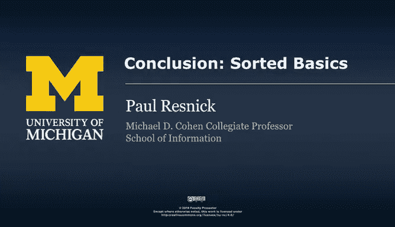

# 课程73：Python排序基础总结 📚

在本节课中，我们将总结Python中序列排序的核心知识。你将学习如何使用`sorted`函数，以及如何通过参数控制排序的顺序和依据。

---

恭喜你，你已经学会了如何让Python为你排序序列。😊

`sorted`函数处理了所有细节。你只需要指定期望的排序顺序即可。

现在，你应该能够调用`sorted`函数来排序任何序列。

你应该能够使用`reverse`参数来指定升序或降序排序。

并且，你应该能够通过一个`key`函数来指定排序所依据的属性。

---

上一节我们介绍了排序的基本概念，本节中我们来看看一个有趣的小故事，它巧妙地关联了“排序”这个主题。

我确信你听过一些“从底层到巅峰”的故事，比如某人从公司的收发室开始工作，最终成为了首席执行官。

嗯，下面这个故事有点不一样。这是杰里在公司上班的第一天。

他被分配到了收发室。他接到的任务是：对收到的邮件进行排序。

杰里排序信件速度快到他的动作都模糊不清。

他的主管对此印象非常深刻。一天结束时，主管走近杰里，说道：

“我只想让你知道，我对你今天的工作非常满意。”

“你是我们见过最快的员工之一。”😊

“哦，谢谢您，先生。”杰里说道，脸上洋溢着笑容。

“明天我会努力做得更好。”

“更好？”😊，“这怎么可能呢？”主管问。

杰里回答说：“明天，我打算阅读邮件上的地址。”

---

本节课中我们一起学习了Python排序的基础，包括`sorted`函数、`reverse`参数和`key`函数的使用。我们将在下次课程中学习如何对字典进行排序，并了解如何处理排序中出现的并列情况。