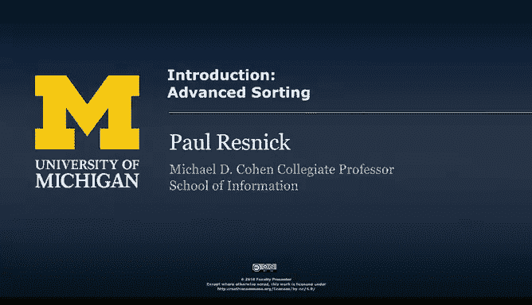

# 密歇根大学《Python3编程》课程1、2｜P162：高级排序导论 🧠

在本节课中，我们将深入学习Python中的高级排序技巧。我们将探讨如何对字典进行排序，以及如何在主排序规则相同时，使用次级规则来“打破平局”。课程结束时，你将能够根据字典的值或值的属性来排序字典的键，并理解如何使用元组作为键函数来实现多级排序。


---



上一节我们学习了列表的基本排序方法。本节中，我们来看看如何将这些概念应用到更复杂的数据结构——字典上。

对字典进行排序可能会有些令人困惑，但其遵循的机制与你之前学过的排序原理完全相同。

以下是排序字典的关键思路：我们通常不是直接排序字典本身，而是排序它的键、值或键值对。

**核心概念**：`sorted()`函数可以接受一个`key`参数，该参数指定一个函数，用于从每个元素中提取比较键。

```python
# 示例：根据值排序字典的键
my_dict = {'a': 2, 'b': 1, 'c': 3}
sorted_keys = sorted(my_dict, key=my_dict.get)  # 返回 ['b', 'a', 'c']
```

---

接下来，我们看看如何实现多级排序，即当主排序条件相同时，如何用次级条件来区分顺序。

**核心概念**：通过让键函数返回一个元组`(主键, 次键)`，可以轻松实现多级排序。Python会先按元组的第一个元素排序，如果相同，再按第二个元素排序。

```python
# 示例：先按长度排序，长度相同则按字母顺序
words = ['apple', 'fig', 'banana', 'date']
sorted_words = sorted(words, key=lambda w: (len(w), w))
# 返回 ['fig', 'date', 'apple', 'banana']
```

---

本节课中我们一起学习了Python的高级排序技术。我们掌握了如何根据值来排序字典的键，并学会了通过让键函数返回元组来实现主次分明的多级排序。这些技巧能帮助你更灵活地处理和组织数据。