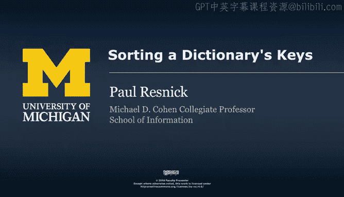
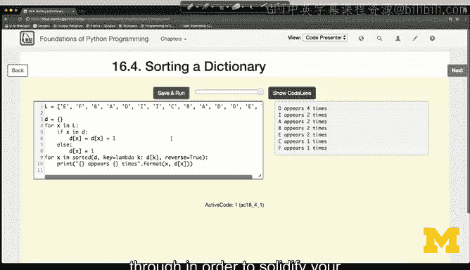

# 课程 75：Python 3 编程 - 字典键排序技术 📚




在本节课中，我们将要学习如何对字典进行排序。字典本身是无序的，但我们可以通过对其键进行排序，然后按顺序访问键值对，来实现有序输出。

## 字典排序的基本思路 🔑

上一节我们介绍了字典的基本概念。本节中我们来看看如何对字典进行排序。对字典排序的核心思路是：**先对其键进行排序，然后通过排序后的键来访问对应的值**。

## 一个计数示例 📊

以下是创建一个字典来统计列表中元素出现次数的示例代码。

```python
lst = ['A', 'B', 'A', 'C', 'B', 'D', 'D', 'D', 'D', 'E', 'E', 'F']
D = {}
for item in lst:
    if item not in D:
        D[item] = 1
    else:
        D[item] = D[item] + 1

for k in D:
    print(k, 'appears', D[k], 'times')
```

运行这段代码，你会发现键的输出顺序是随机的，这是字典的特性。

## 按键排序（字母顺序）🔠

如果我们希望按键的字母顺序输出，就需要在迭代前对键进行排序。

以下是实现按键字母顺序排序的代码。

```python
for k in sorted(D):
    print(k, 'appears', D[k], 'times')
```

现在，输出会按照 A、B、C... 的顺序排列。

## 按值排序（出现次数）📈

更常见的情况是，我们希望根据值（即出现次数）来排序，让出现次数最多的项排在最前面。

以下是实现按值排序的代码。

```python
for k in sorted(D, key=lambda k: D[k], reverse=True):
    print(k, 'appears', D[k], 'times')
```

这里，`key=lambda k: D[k]` 是一个关键函数，它告诉 `sorted` 函数根据每个键 `k` 在字典 `D` 中对应的值 `D[k]` 来进行排序。`reverse=True` 参数确保结果按降序排列（从大到小）。

## 理解“键”的双重含义 🤔

在这个上下文中，“键”这个词有两种含义，需要区分清楚。

以下是两种“键”的含义。

1.  **字典键**：字典中的键，如示例中的 `'A'`、`'B'`。
2.  **排序键函数**：`sorted()` 函数中的 `key` 参数，它指定了排序所依据的属性。

在我们的代码 `key=lambda k: D[k]` 中，`k` 代表字典键，而整个 `lambda` 函数作为排序的“键函数”。

## 排序的简写形式 ✨

`sorted()` 函数在处理字典时有一个便利的简写形式。

以下是简写形式的示例。

```python
# 这两种写法是等价的
sorted(D.keys())
sorted(D)  # Python 会自动获取字典的键进行排序
```

当 `sorted()` 函数接收到一个字典时，它会自动获取其所有键并排序。

## 总结 📝



本节课中我们一起学习了如何对字典进行排序。我们掌握了两种主要方法：**按键排序**和**按值排序**。关键在于使用 `sorted()` 函数并正确指定 `key` 参数。我们还了解了“键”一词在上下文中的双重含义，并学会了一种简写形式。通过练习，你将能熟练运用这些技术来处理各种数据排序需求。