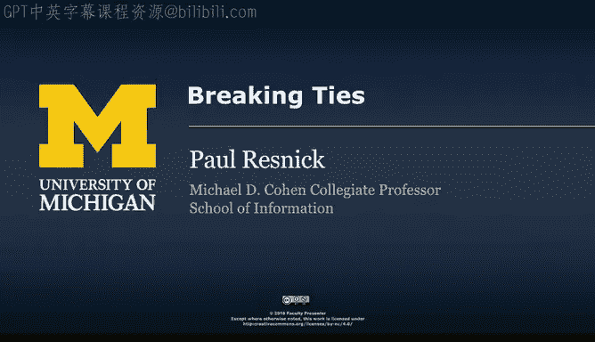
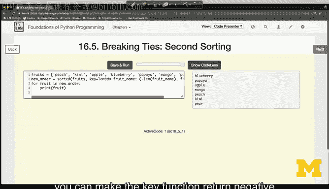

# Python 3 编程（课程 1、2）｜第 76 课：并列项处理策略 🧩




在本节课中，我们将要学习如何在 Python 排序中精确控制并列项的处理顺序。我们将探讨如何利用元组的排序特性，来为我们的数据排序定义一个主属性和一个或多个次要属性，从而实现更精细的排序控制。

---

## 元组的排序规则

上一节我们介绍了基本的排序方法，本节中我们来看看当排序遇到并列项时，Python 如何处理。

Python 为元组内置了明确的排序规则。当比较两个元组时，它会首先比较第一个元素。如果第一个元素可以决定大小关系，则排序完成。如果第一个元素相等，它会继续比较第二个元素，以此类推。

让我们通过一段代码来理解：

```python
# 一个包含五个元组的列表
my_list = [('A', 3, 2), ('C', 1, 4), ('B', 2, 1), ('A', 2, 3), ('C', 2, 2)]

# 对列表进行排序
sorted_list = sorted(my_list)

# 打印排序后的结果
for item in sorted_list:
    print(item)
```

运行这段代码，输出顺序将是：
```
('A', 2, 3)
('A', 3, 2)
('B', 2, 1)
('C', 1, 4)
('C', 2, 2)
```

排序首先按元组的第一个元素（字母）进行。对于同为 `'A'` 的两个元组，由于第一个元素打平，系统会比较第二个元素（数字 2 和 3），因此 `('A', 2, 3)` 排在 `('A', 3, 2)` 之前。这个机制为我们处理并列项提供了基础。

---

## 利用元组实现并列项处理

理解了元组的排序规则后，我们可以利用它来为其他类型的数据创建精细的排序规则。核心思想是：让 `key` 函数返回一个元组，而不仅仅是一个属性。

以下是具体步骤：

1.  **定义 `key` 函数**：这个函数接收一个数据项作为输入。
2.  **返回元组**：函数应返回一个元组，其中第一个元素是**主排序属性**，第二个元素是**次排序属性**（用于处理并列情况），还可以有更多元素用于更细粒度的控制。

让我们通过一个水果列表的例子来实践：

```python
fruits = ['peach', 'kiwi', 'apple', 'mango', 'pear', 'blueberry']

# 按单词长度排序，长度相同则按字母顺序排序
sorted_fruits = sorted(fruits, key=lambda fruit: (len(fruit), fruit))
print(sorted_fruits)
```

输出结果为：
```
['kiwi', 'pear', 'apple', 'mango', 'peach', 'blueberry']
```

在这个例子中，`lambda fruit: (len(fruit), fruit)` 是 `key` 函数。它为每个水果生成一个“标签”元组，例如 `('peach',)` 的标签是 `(5, 'peach')`。排序时，先比较标签元组的第一个元素（长度 4 小于 5，所以 `'kiwi'` 在前）。当长度相同时（如 `'kiwi'` 和 `'pear'` 长度都是 4），则比较元组的第二个元素（字母顺序），因此 `'kiwi'` 在 `'pear'` 之前。

---

## 控制排序方向

有时我们可能需要混合不同的排序方向，例如让长的单词排在前面（降序），但长度相同的单词按字母升序排列。

如果简单地使用 `reverse=True` 参数，会同时反转所有属性的排序方向：

```python
# 反转整个排序顺序
sorted_fruits_reverse = sorted(fruits, key=lambda fruit: (len(fruit), fruit), reverse=True)
print(sorted_fruits_reverse)
```
输出：
```
['blueberry', 'peach', 'mango', 'apple', 'pear', 'kiwi']
```
这导致长度降序，且相同长度的单词按字母降序（Z-A）排列，这可能不是我们想要的。

为了实现“长度降序，字母升序”，我们可以对数值型的主属性使用一个小技巧：取其负值。

```python
# 长度降序，字母升序
sorted_fruits_mixed = sorted(fruits, key=lambda fruit: (-len(fruit), fruit))
print(sorted_fruits_mixed)
```
输出：
```
['blueberry', 'apple', 'mango', 'peach', 'kiwi', 'pear']
```

现在，最长的 `'blueberry'` 排在最前。在长度同为 5 的水果中，`'apple'`、`'mango'`、`'peach'` 按照字母升序正确排列。这个技巧通过将长度取负，使得较长的单词（原值大）其负值更小，从而在升序排序中排在前面，同时不影响次要的字母排序属性。

> **注意**：这个取负值的技巧主要适用于数值型属性。如果需要对多个非数值型属性混合控制排序方向，情况会更为复杂。

---

## 总结

本节课中我们一起学习了如何在 Python 排序中处理并列项并实现精细控制。

*   我们了解到 **Python 元组的排序是逐元素比较的**，这天然构成了一个并列处理机制。
*   我们学会了通过让 **`key` 函数返回一个元组** 来定义主次排序属性。元组的第一个元素是主排序键，第二个是次排序键（用于处理并列），依此类推。
*   我们探索了如何控制排序方向。使用 `reverse=True` 会反转所有属性的顺序。如果只想反转主属性（特别是数值属性）的顺序，可以**在主属性前取负号**（例如 `-len(fruit)`），这是一个常用技巧。



掌握这些策略，你就能为复杂的数据集定义出几乎任何你想要的排序规则。