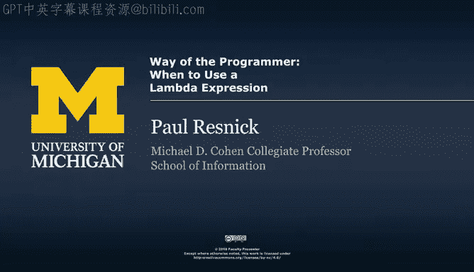
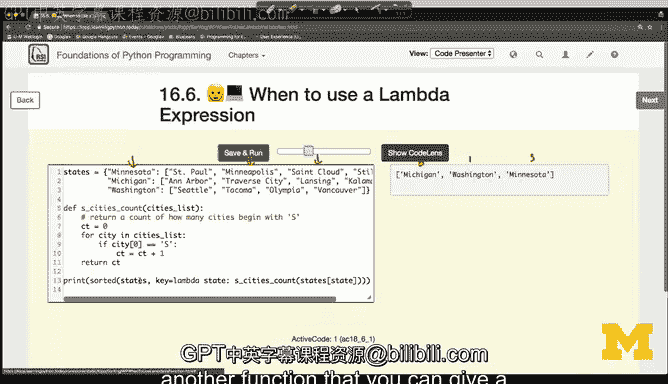

# 165：程序员之道：lambda表达式适用场景 🧑‍💻




## 概述

在本节课中，我们将学习在Python排序操作中，如何选择使用`lambda`表达式还是命名函数作为`key`参数。我们将通过具体示例，理解两者的适用场景和最佳实践。

---

## 核心原则

我的经验法则是：如果`lambda`表达式**简短且简单**，易于理解其功能，则使用`lambda`表达式。一旦它变得过于复杂，就应该转而使用命名函数，并为其起一个能清晰描述排序属性的好名字。

上一节我们介绍了选择的核心原则，本节中我们来看看具体的示例。

## 示例一：在lambda表达式的理解极限内

以下是一个我认为刚好处于`lambda`表达式可理解性极限的示例。

我们有一个名为`states`的字典。它的键是美国各州的名称，例如“Minnesota”、“Michigan”和“Washington”。与每个键（州）相关联的值是一个城市名称的列表。

**代码示例：**
```python
states = {
    'Minnesota': ['Saint Paul', 'Minneapolis', 'Saint Cloud', 'Stillwater'],
    'Michigan': ['Ann Arbor', 'Traverse City', ...],
    'Washington': ['Seattle', ...]
}
```

现在，我们希望根据其值的某个属性对键进行排序。我们有一个通用结构：一个名为`states`的字典，我们将对其键进行排序。

我们的`key`函数将接收该列表中的一个项目（州名）作为输入，并查找该州在`states`字典中对应值的某个属性。在这个例子中，我们想获取该州城市列表中第一个城市的名称长度。

**排序代码：**
```python
sorted_states = sorted(states, key=lambda state: len(states[state][0]))
```

以下是该`lambda`表达式的工作过程：
*   对于“Minnesota”，`states['Minnesota'][0]`得到“Saint Paul”，`len()`得到`8`。
*   对于“Michigan”，`states['Michigan'][0]`得到“Ann Arbor”，`len()`得到`9`。
*   对于“Washington”，`states['Washington'][0]`得到“Seattle”，`len()`得到`7`。

排序后，我们得到的州列表顺序将是：Washington（第一个城市名最短），然后是Minnesota，最后是Michigan。

这个例子之所以在`lambda`的可理解极限内，是因为`states[state]`是一个我们熟悉的模式（通过键查找字典值），而`[0]`表示取列表的第一个元素，`len()`计算长度。组合起来仍相对清晰。

---

## 示例二：何时转向命名函数

现在，让我们考虑一个更复杂的属性，这将促使我们使用命名函数。

假设我们想根据每个州的城市列表中，以字母“S”开头的城市数量来排序。

这个属性听起来像是需要**计数**和**过滤**的累积操作。虽然不难写成一个函数，但写成`lambda`表达式会很难阅读。

因此，我将编写一个命名函数。

**第一步：创建命名函数**

以下是实现该计数功能的函数：
```python
def s_cities_count(cities_list):
    count = 0
    for city in cities_list:
        if city[0] == 'S':
            count += 1
    return count
```

**第二步：在排序中结合使用**

`key`函数需要接收一个州名作为输入，而我的`s_cities_count`函数接收城市列表。因此，我需要一个“混合”方法：在`lambda`中查找城市列表，再传递给命名函数。

**排序代码：**
```python
sorted_states = sorted(states, key=lambda state: s_cities_count(states[state]))
```

运行后，我们得到按以“S”开头的城市数量排序的州列表：Michigan（0个），Washington（1个），Minnesota（3个）。

---

## 替代方案：完全使用命名函数

实际上，也可以完全不使用`lambda`表达式，只引用一个命名函数，但该函数必须直接接收州名作为输入。

**代码示例：**
```python
def s_cities_count_for_state(state):
    cities_list = states[state]
    count = 0
    for city in cities_list:
        if city[0] == 'S':
            count += 1
    return count

sorted_states = sorted(states, key=s_cities_count_for_state)
```

虽然第17行的`key=s_cities_count_for_state`看起来非常简洁，但我个人更倾向于前一种（`lambda`与命名函数结合）的方式。因为`states[state]`这种在字典中查找键值的模式，在对字典键进行排序时非常常见和直观。

---

## 总结

本节课中我们一起学习了在Python排序时选择`lambda`表达式与命名函数的策略。

*   **核心建议**：如果`lambda`表达式足够简单，就使用它。当它变得难以阅读或编写时，就是时候使用命名函数了。将复杂逻辑移入一个有明确名称的函数中，能极大提高代码的可读性。
*   **关键点**：`lambda`表达式适用于简短、一次性的操作。命名函数则更适合封装复杂的逻辑，并通过函数名自解释其用途。



记住这个原则，将帮助你写出更清晰、更易维护的代码。我们下次见！