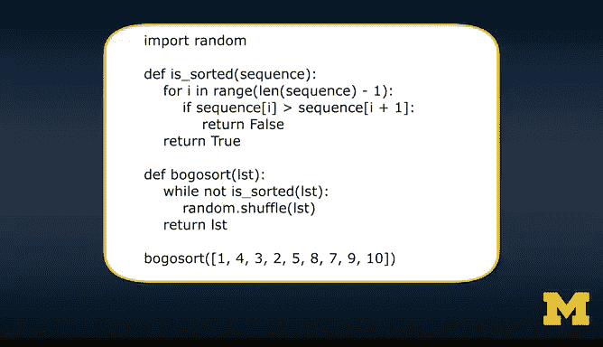

# 课程1、2：Python 3 编程｜P166：高级排序总结 🎓


在本节课中，我们将总结Python中高级排序的各种技巧。我们已经学习了如何对简单和复杂的数据结构进行排序，现在来回顾并整合这些知识。

---

## 掌握排序技巧 🧠

上一节我们介绍了多种排序方法，本节中我们来看看如何综合运用这些技巧。

你现在已经真正掌握了如何进行各种排序。你可以根据字典值的某些属性来对字典的键进行排序。你可以通过让键函数返回一个元组来解决排序中的并列情况。你可以使用lambda表达式，也可以使用具名函数。你已经是排序方面的专家了。

## 关于排序算法的幽默插曲 😄

在本周课程开始时，我重点强调过，我们不会深入探讨具体使用哪种排序算法以及它们的运行时间。因此，与其直接讲一个笑话，不如让我分享一个程序员式的幽默——一种运行速度极慢的排序算法。

它被称为**Bogo排序**，其工作原理是试错。以下是其核心逻辑：

1.  获取项目列表。
2.  随机打乱它们的顺序。
3.  检查它们是否恰好被排好序。
4.  如果是，则完成。
5.  否则，再次尝试，重新打乱顺序，并重复检查。

这个过程会一直持续，直到你幸运地得到一次已排序的打乱结果。

值得注意的是，在Python中实现这个算法的代码非常简短。在`random`模块中，有一个内置函数叫`shuffle`。我写了一个5行的函数来检查列表是否有序，另外用了4行代码来实现试错的`while`循环。

以下是完整的代码示例：

```python
import random

def is_sorted(lst):
    """检查列表是否已排序"""
    return all(lst[i] <= lst[i+1] for i in range(len(lst)-1))

def bogo_sort(lst):
    """Bogo排序算法"""
    attempts = 0
    while not is_sorted(lst):
        random.shuffle(lst)
        attempts += 1
    print(f"排序完成！尝试次数：{attempts}")
    return lst

# 示例：对一个小列表进行排序（谨慎尝试！）
my_list = [3, 1, 2]
sorted_list = bogo_sort(my_list.copy())
print(sorted_list)
```

当然，由于每次都是随机打乱，所以完成排序所需的时间是随机的。但可以想象，这不是一种快速的排序方式。如果你有一堆项目并只是随机打乱它们，它们恰好被排好序的几率非常低。



我曾在包含10个项目的列表上运行过一次，它花了68秒才完成。我不敢尝试用11个项目来排序。

相比之下，Python内置的`sorted`函数能够在短短半秒多的时间内对一百万个项目进行排序。

## 一个有趣的谈资 🎉

现在你有了一个聚会小把戏。你可以问问那些很久以前上过计算机科学课程的朋友，让他们试着回忆他们学过的最慢的排序算法。他们会饶有兴趣地回想冒泡排序和插入排序，并试图决定哪个更慢。然后，你就可以用Bogo排序的故事让他们大开眼界。相信我，你会成为聚会的焦点。

---

本节课中我们一起学习了Python高级排序的总结，包括灵活运用键函数、lambda表达式解决复杂排序需求，并通过Bogo排序这个幽默的例子，对比理解了高效内置排序函数的重要性。下次见！