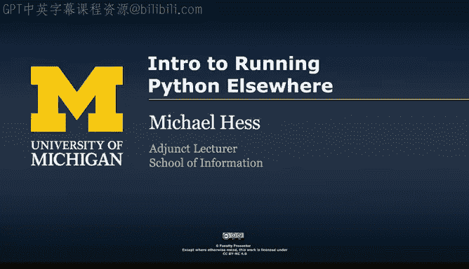

# 167：外部Python环境导论 🚀

在本节课中，我们将要学习如何在Coursera云环境之外运行Python。目前，你正在Coursera云和一个名为Roonestone的工具集中运行Python。这是一个学习Python的绝佳环境，因为教学团队可以完全控制Python的执行方式、可用的软件包以及代码运行前后的处理过程。事实上，我们可以运行你的代码并检查输出，这就是你获得评分的方式。这对于教育环境来说非常理想。

然而，当你需要为个人项目或工作运行Python时，这种环境可能就不太合适了。

因此，我准备了一些后续视频，你将在其中看到可以在不同地方运行Python。我们将讨论在本地运行Python，在云服务提供商上运行Python，以及在托管的Notebook中运行Python。我们将全面探讨你可能运行Python的各种方式，甚至是如何在不同位置运行Python来创建API。

---

上一节我们介绍了当前学习环境的局限性，本节中我们来看看为什么需要了解其他运行Python的方式。

## 为何需要外部环境？🤔

当前环境专为教育设计，教学团队掌控一切。这对于学习基础非常有利，但缺乏灵活性。

当你开始个人项目或专业工作时，你需要：
*   控制执行环境。
*   安装特定的软件包。
*   将Python程序部署到不同的平台。

---

了解了学习外部环境的必要性后，以下是几种常见的Python运行方式。

## 主要的Python运行方式概览 📋

后续课程将涵盖以下内容：

1.  **在本地运行Python**
    *   在你自己的计算机上安装和配置Python。

2.  **在云提供商上运行Python**
    *   利用AWS、Google Cloud、Azure等服务运行Python应用。

3.  **在托管Notebook中运行Python**
    *   使用类似Google Colab或Jupyter Notebook的服务。

4.  **创建基于Python的API**
    *   学习如何让Python程序通过网络提供服务。

我们将遍历你可能运行Python的全部场景，并探索如何在不同位置运行Python来创建API。

---

本节课中我们一起学习了从受控的Coursera云环境过渡到外部Python环境的重要性。我们概述了即将探讨的各种Python运行方式，包括本地、云端和Notebook环境，为后续的实际应用开发打下基础。