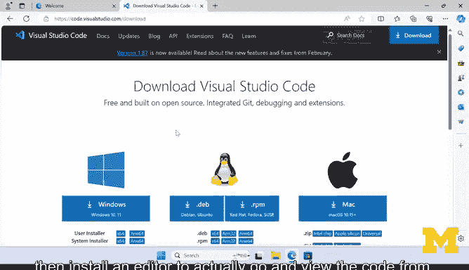
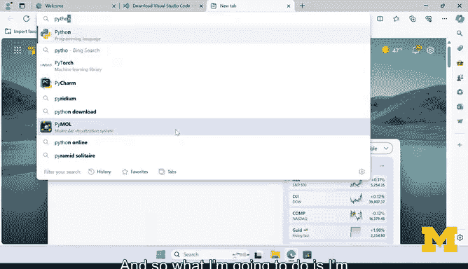
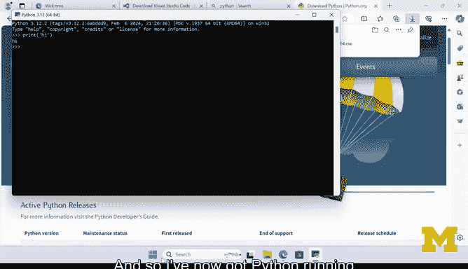
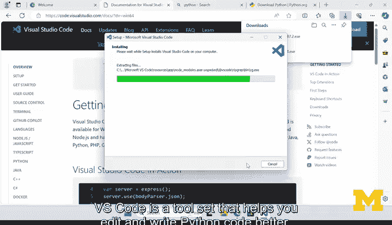

# 课程1：Python 3编程 🐍 - P168：在Windows本地安装Python与VS Code


## 概述

在本节课中，我们将学习如何在Windows操作系统上安装Python编程语言，以及如何安装并配置一个名为Visual Studio Code（VS Code）的集成开发环境（IDE），以便在本地计算机上编写和运行Python代码。





---

## 在Windows上安装Python

上一节我们介绍了课程目标，本节中我们来看看如何获取并安装Python。

首先，你需要访问Python的官方网站。打开浏览器，搜索“Python”并进入其官网。在网站上，你可以下载最新版本的Python。在本视频录制时，最新版本是Python 3.12.2。下载过程多年来基本保持一致。

以下是安装Python的步骤：
1.  从Python官网下载Windows安装程序。
2.  等待下载完成后，运行下载的安装程序。
3.  在安装向导中，通常选择“Install Now”即可。除非你有特殊需求（例如需要管理多个Python版本），否则无需自定义安装。
4.  等待安装程序完成。安装成功后，你会看到“Setup was successful”的提示。

安装完成后，你可以验证Python是否安装成功。打开命令提示符（Command Prompt），输入 `python` 并按下回车键。如果安装正确，你将进入Python交互式解释器（Python interpreter）。这是一个可以逐行执行Python命令的环境。

```python
# 在命令提示符中输入 `python` 后，可以尝试执行以下命令
print("Hello, World!")
```

---

## 安装代码编辑器：Visual Studio Code



现在我们已经成功安装了Python，接下来需要一款工具来方便地编写代码。本节中我们将介绍如何安装Visual Studio Code。

在本地计算机上编写代码，通常需要使用集成开发环境（IDE）。IDE能帮助开发者更高效地编写代码，并提供语法提示等功能。对于Python开发，我推荐两款IDE：VS Code和PyCharm。本节课我们将以VS Code为例。

以下是下载和安装VS Code的步骤：
1.  访问Visual Studio Code官网，下载适用于Windows（x64系统）的安装程序。
2.  运行下载好的安装程序。
3.  阅读并接受用户许可协议。
4.  在安装选项中，可以勾选“创建桌面快捷方式”以便后续快速启动。
5.  点击“安装”并等待安装过程完成。VS Code是一个功能强大的工具集，能帮助你更好地编辑和编写Python代码。

---

## 总结



本节课中我们一起学习了在Windows系统上进行Python本地开发环境的搭建。我们首先完成了Python解释器的下载与安装，并通过命令提示符验证了安装结果。接着，我们下载并安装了Visual Studio Code这款流行的代码编辑器，为后续编写Python程序做好了准备。