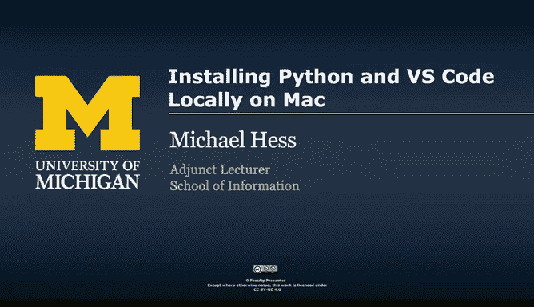
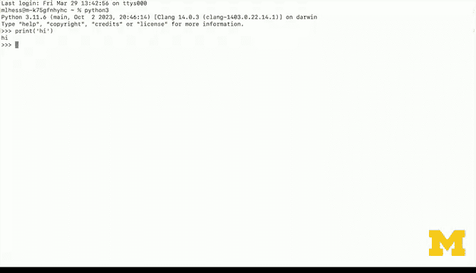
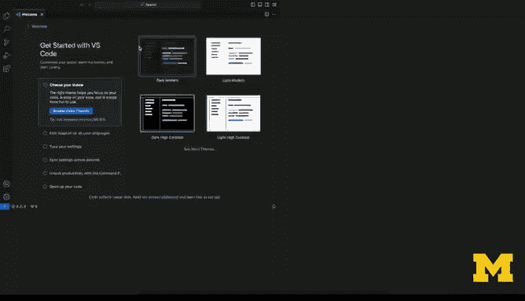

# 169：在Mac上安装本地Python与VS Code 🍎💻


## 概述



在本节课中，我们将学习如何在Mac电脑上安装和运行Python，并配置一个名为Visual Studio Code的集成开发环境来编写代码。我们将从检查Mac是否已预装Python开始，然后下载并设置VS Code，以便更高效地编写和运行Python程序。

---

## 检查Mac上的预装Python

Mac操作系统通常已经预装了Python。我们可以通过终端来验证这一点。

打开“终端”应用程序，输入命令 `python3` 并按下回车键。这将启动Python解释器。

```bash
python3
```

启动后，你将看到类似 `>>>` 的提示符。这表示你已成功进入Python交互式环境。在此环境中，你可以直接输入Python代码并立即看到执行结果。

例如，你可以输入：

```python
print("Hello, World!")
```

然后按下回车，屏幕上将显示“Hello, World!”。

> **注意**：虽然可以在解释器中直接运行代码，但这通常用于快速测试。编写完整的程序脚本需要用到代码编辑器。

---

## 安装集成开发环境：Visual Studio Code

上一节我们介绍了如何通过终端运行Python。本节中，我们来看看如何安装一个更强大的工具来编写代码。

为了更高效地编写Python代码，我强烈推荐使用集成开发环境。IDE集成了代码编辑、运行和调试等多种功能。对于Mac用户，Visual Studio Code是一个流行且免费的选择。



以下是下载和安装Visual Studio Code的步骤：

1.  访问Visual Studio Code官方网站。
2.  下载适用于Mac的安装包。下载完成后，你通常会得到一个 `.zip` 压缩文件。
3.  双击该 `.zip` 文件进行解压。
4.  解压后，你会看到一个名为 “Visual Studio Code” 的应用程序图标。
5.  你可以将此图标拖拽到“应用程序”文件夹中，以便长期使用；也可以直接双击运行。

由于该软件是从互联网下载的，首次运行时系统可能会询问你是否确定要打开。请点击“打开”以继续。

启动后，你将看到Visual Studio Code的主界面。现在，你的代码编辑环境就准备就绪了。

---

## 总结

本节课中，我们一起学习了在Mac上设置Python开发环境的核心步骤。

我们首先验证了Mac系统自带的Python 3，并通过终端进行了简单的交互式编程。接着，我们下载并安装了Visual Studio Code这款强大的集成开发环境，为后续编写和运行更复杂的Python程序做好了准备。



记住核心命令 `python3` 用于在终端启动Python，而VS Code将成为我们编写代码的主要工具。