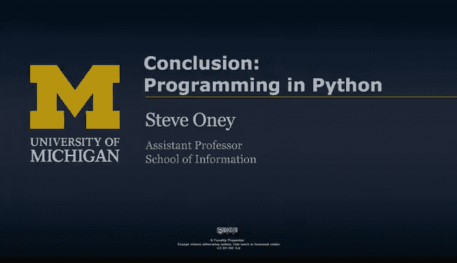

# 密歇根大学《Python3编程》课程总结 🎓

在本节课中，我们将对已学习的Python编程基础知识进行总结，并展望后续的学习方向。

---

## 课程总结与展望

到目前为止，你做得非常出色。你正在为学习Python打下坚实的基础。我们将在这个基础上继续构建，学习更多的结构和Python语法，以编写各种各样的程序。这既是对你已取得进步的奖励，也可能是对你未来挑战的“惩罚”。

## 一个程序员的小幽默

在结束之前，这里有一个你或许知道的、在许多电脑、手机和网站上流传的笑话，包括本课程的教材中。

许多界面都提供“浅色模式”和“深色模式”供用户选择。

但深色模式在程序员中尤其受欢迎，因为他们希望编写没有错误或漏洞的代码。

为什么呢？😊

因为“光”（Light）会吸引“虫子”（Bugs，即程序漏洞）。

---

## 本节总结

本节课中，我们一起回顾了学习历程，巩固了Python编程的基础。我们了解到，坚实的入门知识是后续学习更复杂概念和编写多样化程序的基石。最后，我们还分享了一个关于程序员偏爱深色模式的有趣原因。

下节课再见。