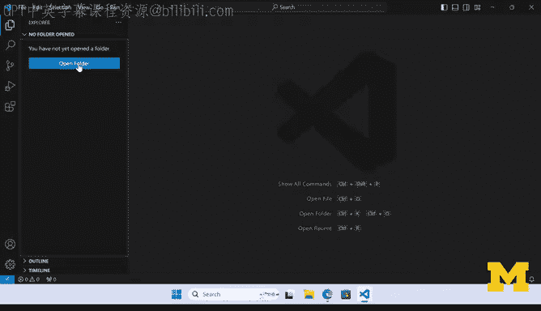
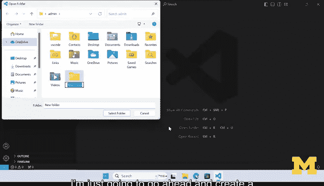
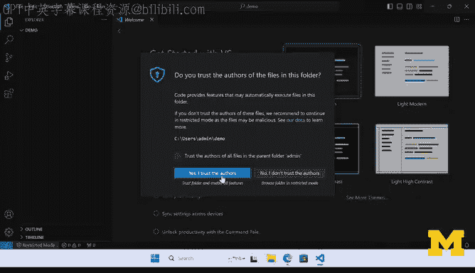
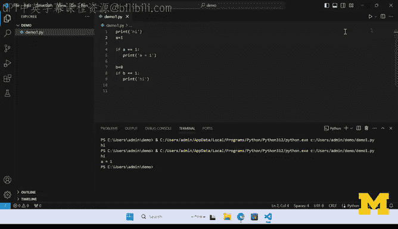

# 课程1：Python 3编程 - P170：VS Code使用指南 🛠️


在本节课中，我们将学习如何安装并开始使用Visual Studio Code（VS Code）来编写和运行Python代码。VS Code是一款功能强大的集成开发环境，它能帮助我们更高效地编写程序，并在运行前发现错误。

---

## 安装与初始设置

上一节我们介绍了Python的安装，本节中我们来看看如何设置VS Code。

首先，确保你已经完成了VS Code的安装。启动软件后，它会像大多数新安装的程序一样，询问你偏好浅色模式、深色模式还是高对比度模式。选择你喜欢的主题后，可以关闭欢迎屏幕。

接下来，我们需要为Python项目创建一个工作区。点击左侧活动栏的文件图标，然后选择“打开文件夹”。






你可以创建一个新文件夹。例如，创建一个名为 `demo` 的文件夹并选中它。


首次打开文件夹时，VS Code会询问你是否信任此文件夹的作者。如果你是从网上下载的代码，可能需要谨慎。但这里我们创建的是空文件夹，所以可以选择信任。




---

## 创建Python文件与安装扩展

现在，我们已经在VS Code中打开了`demo`文件夹。在资源管理器区域，有一个图标可以创建新文件。

以下是创建并配置第一个Python文件的步骤：
1.  点击“新建文件”图标。
2.  将文件命名为 `demo1.py`。
3.  首次创建`.py`文件时，VS Code会检测到这是Python文件，并提示你安装Python扩展。点击“安装”即可。这个扩展能提供代码补全、语法高亮和错误检查等功能。
4.  扩展安装需要一点时间，并且要求你的电脑上已经安装了Python（我们在之前的课程中已完成）。

---

## 编写代码与利用IDE功能

扩展安装完成后，我们就可以开始编写代码了。VS Code的智能感知功能会帮助我们。

例如，当你输入 `print` 时，编辑器会弹出建议并显示`print()`函数的功能提示。这就像一个实时助手。

让我们写一段包含常见错误的代码来演示VS Code的纠错功能：

```python
if a = 1:
print("a equals one")
```

输入以上代码后，你会立刻看到页面上出现了红色波浪线，表示存在语法错误。

VS Code指出了两个主要错误：
1.  **比较运算符错误**：在条件判断中，应使用双等号 `==` 进行比较，而不是单等号 `=`（单等号是赋值运算符）。
2.  **缩进错误**：`if`语句下的代码块必须缩进。

此外，变量`a`也未被定义。让我们修正这些错误：

```python
a = 0
if a == 1:
    print("a equals one")
```

修正后，所有的错误提示都会消失。如果你将鼠标悬停在错误信息上，VS Code会给出更详细的解释，例如“变量b未定义”或“print语句未在正确的代码块内（需要缩进）”。

学习使用IDE来辅助编写和调试Python代码本身就是一项有价值的技能。它能让你的编程过程更顺畅，并帮助你在运行代码前发现潜在问题。

---

## 运行Python代码

说到运行代码，在VS Code中非常方便。

你会注意到编辑器顶部有一个“播放”按钮（▶️）。点击这个按钮，VS Code就会在终端中执行当前的Python文件。

例如，将变量`a`的值改为1后，再次点击运行按钮，你将在终端看到相应的输出结果。

---

## 总结

本节课中我们一起学习了：
1.  如何在VS Code中创建项目文件夹和Python文件。
2.  如何安装必不可少的Python扩展来获得代码支持。
3.  如何利用VS Code的智能感知和实时错误检查功能来编写更规范的代码，例如正确使用 `==` 进行比较和保持正确的**缩进**。
4.  如何使用VS Code内置的运行功能来执行Python脚本。



通过使用VS Code这样的集成开发环境，你可以更快地定位和修复错误，从而成为一名更高效的程序员。