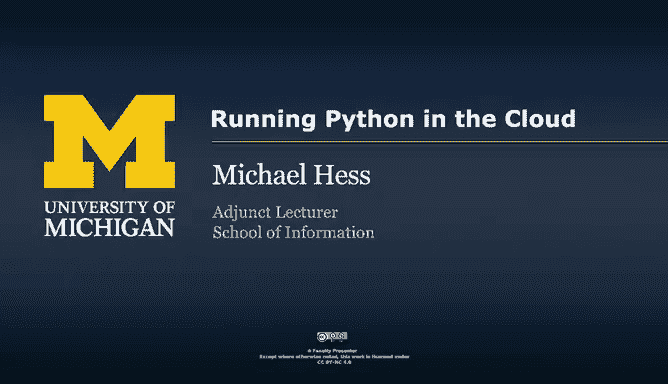
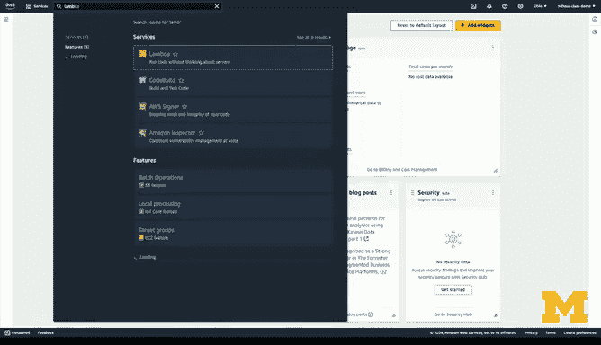
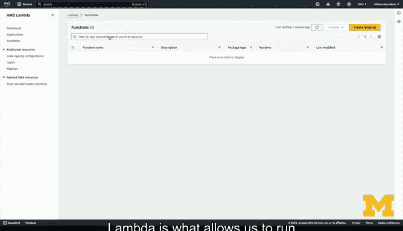
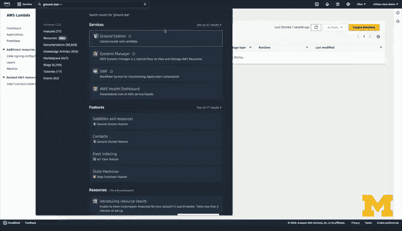
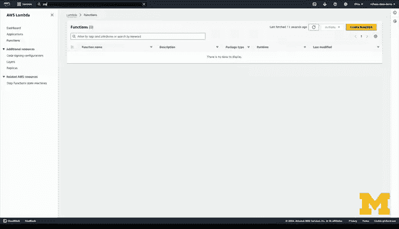
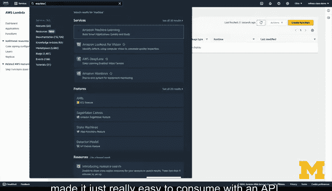
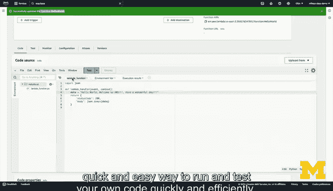

# 171：在云端运行Python 🚀




在本节课中，我们将学习如何在云端运行Python代码。我们将了解什么是“云”，并演示如何使用亚马逊的AWS Lambda服务快速、轻松地部署和运行一个简单的Python函数。

---

## 什么是“云”？☁️

“云”本质上是指他人的服务器，这些服务器由服务商进行管理。你当然可以购买自己的物理服务器并在上面运行Python，但在云端运行程序通常更便宜（如果操作得当），并且启动起来也更容易。

上一节我们介绍了“云”的基本概念，本节中我们来看看具体的云服务提供商。

## 选择云服务提供商

不同的云服务商提供不同的服务。它们之间的主要区别并不在于基础服务（这些通常都很相似），而在于它们在这些基础服务之上提供的附加服务。



例如，亚马逊AWS提供一项名为Lambda的服务，它让我们能够快速、轻松地在云端运行代码。此外，AWS还提供许多其他强大的服务，如用于与卫星通信的GroundStation，以及大量内置的机器学习服务，这些服务通过API简化了复杂的机器学习工作。

---





## 使用AWS Lambda运行Python函数





现在，让我们回到最初的演示，使用AWS Lambda在云端运行一个函数。要正确使用Lambda，你需要稍微改变一下编写代码的思路。你通常可能习惯于在一个大型Python文件中编写多个函数，但Lambda的工作方式不同，它更侧重于运行一个（或少数几个）具有特定目的的独立函数。

以下是创建和运行Lambda函数的基本步骤：

1.  **创建函数**：登录AWS控制台，进入Lambda服务，选择“创建函数”。
2.  **配置函数**：为函数命名，并选择运行时环境。对于Python代码，我们可以选择例如`Python 3.12`。
3.  **编写函数代码**：Lambda函数的代码结构是固定的。它接收输入（事件和上下文参数）并返回输出。

还记得我们之前关于函数的课程吗？函数接收输入并返回输出，Lambda函数也是如此。这里有一个默认的函数模板：

```python
def lambda_handler(event, context):
    # TODO: 在此处添加你的逻辑
    return {
        'statusCode': 200,
        'body': 'Hello from Lambda!'
    }
```

*   `event` 参数包含触发函数的事件数据（例如HTTP请求的内容）。
*   `context` 参数提供运行时信息。
*   函数最后返回一个字典，通常包含状态码（如200表示成功）和响应主体。

我们可以修改这个函数来返回自定义内容。例如，将返回语句改为：

```python
    return {
        'statusCode': 200,
        'body': 'Hello World, welcome to AWS. Have a wonderful day.'
    }
```

4.  **部署函数**：编写完代码后，点击“部署”按钮。AWS会将你的函数代码部署到其服务器上。
5.  **测试函数**：部署成功后，你可以使用“测试”功能来运行它。测试时会模拟一个事件输入（即使我们当前未使用它），并显示函数的返回结果。

通过测试，我们可以看到函数成功返回了我们设定的消息：“Hello World, welcome to AWS. Have a wonderful day.”

---

## Lambda的优势与局限

在这个环境中编写和调试代码可能有点挑战，但总体而言，Lambda是一种非常快速、高效地运行和测试代码的方式。

AWS Lambda是一个功能丰富的工具集，我们在这里仅仅触及了它的表面。但毫无疑问，如果你需要能够在云端快速、高效地运行代码，它应该成为你工具箱中的一员。

---

## 总结



本节课中，我们一起学习了：
1.  “云”计算是指利用服务商管理的远程服务器来运行程序。
2.  不同的云提供商（如AWS）提供各具特色的服务。
3.  我们重点演示了如何使用AWS Lambda服务：通过创建一个简单的、符合其格式要求的Python函数，然后进行部署和测试，从而在云端执行代码。
4.  Lambda非常适合运行单一目的的、事件驱动的小段代码，是快速进行云端开发和测试的强大工具。