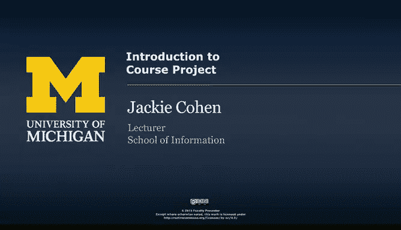
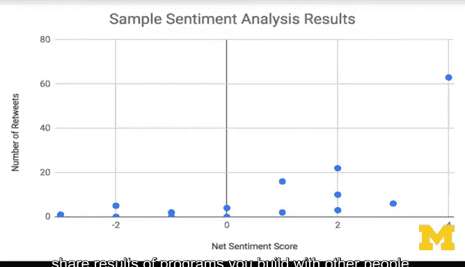

# 密歇根大学《Python3编程》课程2：最终项目导论 🎯

在本节课中，我们将学习课程2的最终项目。该项目将引导你分步构建一个用于情感分析的程序。情感分析程序被广泛应用于各种公司和场景中。你将使用模拟的Twitter数据，最终生成一个CSV文件，并用它来绘制结果图表。这是一种可视化数据和与他人分享程序成果的极佳方式。

## 项目概述与目标 🎯

上一节我们介绍了课程项目的基本情况，本节中我们来看看项目的具体目标和最终成果。

你将构建一个程序，对模拟的Twitter数据进行情感分析。最终，你需要生成一个CSV文件，并利用该文件绘制出分析结果的图表。图表能直观地展示数据，便于你向他人展示程序的运行结果。

完成此项目后，你将有能力构建一个类似的程序来处理真实的Twitter数据。虽然在本课程中我们无法使用真实数据，但所学的技能是通用的。

## 分步构建方法 📝

为了完成最终的分析并生成CSV文件，我们将引导你通过一系列步骤来构建不同的函数，最终将这些函数组合成完整的程序。

以下是进行项目开发的核心建议：

*   **专注于单个步骤**：在推进项目时，你应该一次只专注于一个步骤。确保在编写代码前，完全理解每一步的指令。
*   **避免同时思考多个步骤**：同时考虑程序中的多个步骤容易让人不知所措，并可能导致混淆代码的执行顺序。因此，务必一次只处理一个步骤的指令。
*   **规划与编码**：为每一步制定计划，然后将计划转化为代码。

## 函数设计思路 💡

在思考每一个需要完成的步骤时，你应该仔细考虑关于函数的知识。

对于每个函数，你需要明确：
*   **输入**是什么？
*   **返回值**是什么？
*   在接收输入后、返回最终输出前，函数需要**执行什么操作**？

通过逐一完成每个函数，你将能够将它们组合起来，构建出完整的项目。

## 项目开发注意事项 ⚠️

请记住，在每一个步骤中，你可能需要将之前完成的部分工作复制到下一个步骤中，以便最终生成类似图表的成果。

在开发过程中，请确保：
*   **隔离当前任务**：专注于当前需要实现的概念，而不要过分纠结于之前已完成的部分。
*   **参考课程示例**：重点关注课程中对本项目有用的示例，例如**函数定义**、**高级函数**以及**文件处理**（因为你将创建一个文件来可视化数据）。

## 总结与鼓励 ✨

本节课中我们一起学习了课程2最终项目的目标、分步构建方法、函数设计思路以及重要的开发注意事项。

我认为这个项目是一个特别令人兴奋的方式，它能让你思考如何将这些编程概念应用到现实生活可能想做的事情中。可以说，它能帮助你理解程序如何具体地为你所用。

祝你好运，并享受编程的乐趣！