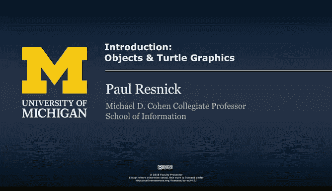

# 课程18：对象与海龟绘图导论 🐢

在本节课中，我们将学习如何通过编程控制屏幕上的“海龟”来绘制图形。这是一个有趣且富有创造性的方式，帮助你理解Python中的核心概念，包括对象、方法、属性以及循环结构。

---

编程入门时，需要掌握许多细节。这可能有些枯燥，且回报感不强。今天的课程将给你一个发挥创造力的机会。你可以做一些有趣的小事。你将编写程序来指挥屏幕上的海龟绘制图画。


在直播课程中，我有时会用这些来自墨西哥的手工摇头海龟作为奖品，奖励那些特别出色的作品，以激发我们的灵感。



你将编写程序来指挥你的屏幕海龟绘制图画。但今天的课程还有一个隐藏目标，即介绍一些Python的核心能力，特别是**对象表示法**、**作用于对象的方法**，以及如何**重复执行一组命令**。

在本课结束时，你应该能够：
*   编写一个多行的程序。
*   区分**实例**、**属性**和**方法**。
*   使用**点表示法**来调用方法和设置属性。
*   使用**循环**（`for`循环）来重复执行命令。

课程最后还有一个关于海龟的笑话，请坚持看到最后。

---

## 核心概念：对象、属性与方法

上一节我们提到了本课的隐藏目标。本节中，我们来看看这些核心编程概念。

在Python中，几乎所有东西都是**对象**。你可以将对象想象成一个拥有特定**属性**（数据）并能执行特定**动作**（方法）的事物。

*   **对象**：一个具体的实体。例如，屏幕上的每只海龟都是一个独立的对象。
*   **属性**：描述对象状态的数据。例如，海龟的**位置**（`x`， `y`坐标）、**颜色**、**方向**。
*   **方法**：对象可以执行的操作或函数。例如，海龟可以**前进**、**转向**、**拾笔**、**落笔**。

我们使用**点表示法**来访问对象的属性和调用其方法。其基本格式为：`对象.属性` 或 `对象.方法()`。

以下是其工作方式的代码示例：
```python
import turtle

# 创建一个海龟对象，命名为‘alex’
alex = turtle.Turtle()

# 设置‘alex’的属性：颜色和画笔粗细
alex.color("blue")
alex.pensize(5)

# 调用‘alex’的方法：前进和转向
alex.forward(100)  # 前进100像素
alex.left(90)      # 向左转90度
```

---

## 开始绘图：基础海龟命令

了解了基本概念后，让我们动手实践。以下是控制海龟绘图的一些基本命令。

首先，你需要导入`turtle`模块并创建一个海龟对象。

```python
import turtle
window = turtle.Screen()  # 创建绘图窗口
my_turtle = turtle.Turtle()  # 创建一只海龟
```

创建海龟后，你可以使用以下方法控制它：

*   `my_turtle.forward(distance)`：向前移动指定像素距离。
*   `my_turtle.backward(distance)`：向后移动。
*   `my_turtle.right(angle)`：向右（顺时针）旋转指定角度。
*   `my_turtle.left(angle)`：向左（逆时针）旋转。
*   `my_turtle.penup()`：抬起画笔，移动时不画线。
*   `my_turtle.pendown()`：落下画笔，移动时画线。
*   `my_turtle.color(color_name)`：设置画笔颜色（如`"red"`， `"green"`）。
*   `my_turtle.goto(x， y)`：移动到绝对坐标(x， y)处。

---

## 使用循环重复动作

手动编写每一行移动指令来绘制复杂图形非常繁琐。这时，**循环**就派上用场了。`for`循环可以让你重复执行一段代码多次。

例如，要画一个正方形，你需要重复“前进-右转”这个动作4次。

不使用循环的代码：
```python
my_turtle.forward(100)
my_turtle.right(90)
my_turtle.forward(100)
my_turtle.right(90)
my_turtle.forward(100)
my_turtle.right(90)
my_turtle.forward(100)
```

使用`for`循环的代码：
```python
for i in range(4):
    my_turtle.forward(100)
    my_turtle.right(90)
```
`range(4)`会产生一个序列`[0， 1， 2， 3]`，循环体（缩进的代码）会针对序列中的每个数字执行一次，总共执行4次。

---

## 综合示例：绘制一个彩色三角形

现在，让我们综合运用所学知识，编写一个绘制彩色三角形的程序。

```python
import turtle

# 设置窗口和海龟
screen = turtle.Screen()
t = turtle.Turtle()
t.pensize(3)

# 绘制三角形
t.color("red")
for _ in range(3):
    t.forward(150)
    t.left(120)  # 等边三角形每个外角是120度

# 将海龟移动到新位置，准备画另一个
t.penup()
t.goto(100， -50)
t.pendown()

# 用另一种颜色再画一个三角形
t.color("blue")
for _ in range(3):
    t.forward(80)
    t.right(120)

# 点击窗口关闭程序
screen.exitonclick()
```

---

## 总结与笑话

本节课中，我们一起学习了如何用Python的海龟绘图库进行创造性编程。我们掌握了**对象**、**属性**和**方法**的概念，学会了使用**点表示法**（`object.attribute`， `object.method()`）来控制对象，并运用**`for`循环**来高效地重复命令。

记住，编程不仅是逻辑，也是艺术。多尝试不同的命令、颜色和循环组合，创造出属于你自己的图形。

最后，附上承诺的海龟笑话：
> 为什么海龟过马路这么慢？
> 因为它背着整个“家”（壳）呢！