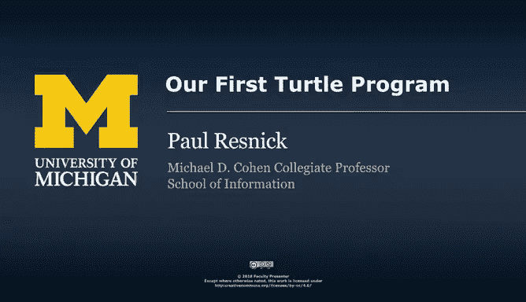
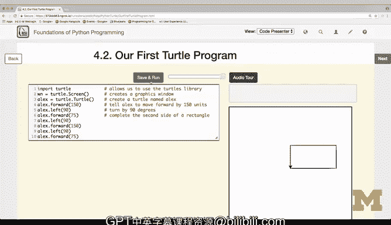

# 课程1：Python 3编程入门 | P19：19_01_02_首个海龟程序 🐢




在本节课中，我们将学习如何使用Python的`turtle`模块来绘制图形。我们将通过一个虚拟的“海龟”在屏幕上移动并留下轨迹的比喻，来理解基本的编程概念，包括对象、实例和方法。

---

## 概述

我们将创建一个名为Alex的海龟，并指挥它移动和转向，从而在屏幕上绘制一个矩形。在此过程中，我们会学习到Python中对象和方法的调用方式。

---

## 创建海龟与屏幕

首先，我们需要导入`turtle`模块，并创建一个绘图屏幕和一个海龟实例。

```python
import turtle
wn = turtle.Screen()
alex = turtle.Turtle()
```

*   **`import turtle`**：这行代码导入了`turtle`模块，使我们能够使用所有海龟绘图命令。
*   **`wn = turtle.Screen()`**：这行代码创建了一个绘图窗口（屏幕）。`Screen`是一个类，`wn`是这个类的一个实例。我们后续的所有绘图都将在这个窗口中进行。
*   **`alex = turtle.Turtle()`**：这行代码创建了一只海龟。`Turtle`是一个类，`alex`是这个类的一个实例。我们可以通过`alex`来指挥这只海龟进行移动和绘图。

---

## 指挥海龟移动

现在，我们有了海龟`alex`。让我们指挥它移动，从而在屏幕上画出线条。

```python
alex.forward(150)
alex.left(90)
alex.forward(75)
```

以下是每一行代码的作用：

*   **`alex.forward(150)`**：这行代码调用了`alex`对象的`forward`方法。`alex`是对象，`.`是点操作符，`forward`是方法名，`150`是传递给方法的参数。它的作用是让海龟`alex`向前移动150个像素。
*   **`alex.left(90)`**：这行代码让海龟`alex`向左转90度。
*   **`alex.forward(75)`**：这行代码再次让海龟`alex`向前移动75个像素。

因为海龟的尾巴上有一支“笔”，所以当它移动时，就会在屏幕上留下移动轨迹，从而形成我们看到的线条。

---

## 核心概念：对象、实例与方法

通过上面的代码，我们接触了几个重要的编程概念：

*   **类（Class）**：`Turtle`和`Screen`都是类。你可以把类理解为一种蓝图或模板，它定义了某种事物（如海龟、屏幕）应该具有的属性和行为。
*   **实例（Instance）**：`alex`是`Turtle`类的一个实例，`wn`是`Screen`类的一个实例。实例是根据类这个“蓝图”创建出来的具体对象。我们可以创建多个海龟实例，每只都是独立的。
*   **方法（Method）**：`forward`和`left`都是方法。方法是定义在类中的函数，表示该类的对象可以执行的动作。我们通过 **`对象.方法名(参数)`** 的格式来调用方法。

---

## 设置对象属性

除了调用方法，我们还可以为对象的属性赋值。属性是对象的状态或特征。

例如，我们可以为海龟`alex`设置一个`salary`（薪水）属性：

```python
alex.salary = 50000
print(alex.salary)
```

*   **`alex.salary = 50000`**：这行代码为`alex`实例创建（或设置）了一个名为`salary`的属性，并将其值设为`50000`。
*   **`print(alex.salary)`**：这行代码读取并打印出`alex`的`salary`属性值。运行后，输出窗口会显示`50000`。

虽然在这个绘图教程中我们暂时不会深入使用属性，但了解如何设置和访问它们对理解Python对象模型很有帮助。

---

## 完成矩形绘制

上一节我们让海龟移动并绘制了两条边。现在，让我们指挥它完成一个完整的矩形。

我们需要让海龟继续转向并移动，以画出矩形的另外两条边。

```python
# 接续之前的移动代码
alex.left(90)      # 再次左转90度，使海龟朝向与第一条边相反的方向
alex.forward(150)  # 向前移动150像素，画出第三条边（与第一条边等长）
alex.left(90)      # 再次左转90度
alex.forward(75)   # 向前移动75像素，画出第四条边（与第二条边等长）
```

运行这段代码后，海龟`alex`将绘制出一个闭合的矩形。

---

## 总结

在本节课中，我们一起学习了：
1.  如何使用Python的`turtle`模块创建绘图窗口和海龟。
2.  如何通过调用方法（如`forward`和`left`）来指挥海龟移动和转向，从而绘制图形。
3.  理解了**类**、**实例**和**方法**这三个核心的面向对象编程概念。
4.  了解了如何为对象实例设置和读取**属性**。
5.  通过分步指挥海龟，最终完成了一个矩形的绘制。



海龟绘图是一个直观有趣的方式，帮助你理解程序是如何通过执行一系列指令来完成任务。