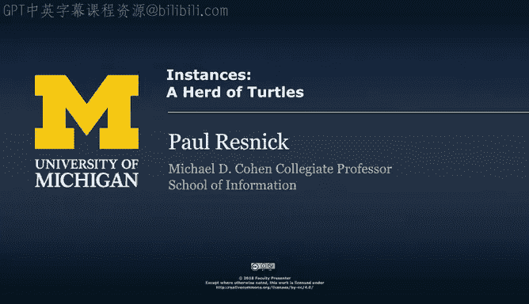
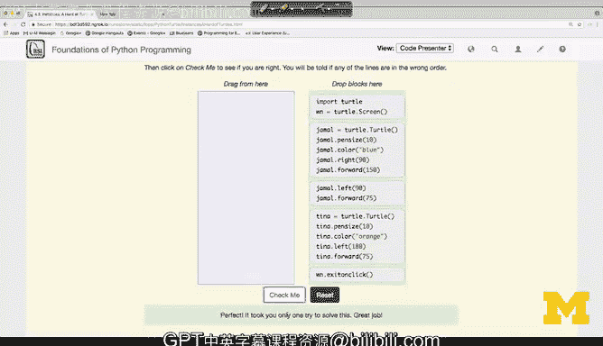

# 课程20：Python 3编程 - 实例：海龟群组 🐢




在本节课中，我们将学习如何在一个程序中创建并使用多个海龟（Turtle）实例。每个实例都拥有独立的属性和内部状态，这使得我们可以让不同的海龟同时绘制不同的图形。

---

## 概述

我们将编写一个程序，创建两个名为“Tess”和“Alex”的海龟。Tess将使用粗黑笔绘制一个三角形，而Alex将使用粉色笔绘制一个正方形。通过这个例子，我们将理解如何分别控制多个对象，并学习如何组织代码以提高可读性。

---

## 代码实现步骤

首先，我们需要导入必要的模块并设置绘图窗口。

```python
import turtle

# 创建绘图窗口
wn = turtle.Screen()
wn.bgcolor("lightgreen")
```

上一节我们设置了绘图环境，本节中我们来看看如何创建并配置两个海龟。

以下是创建和配置两个海龟的代码：

```python
# 创建第一个海龟 Tess
tess = turtle.Turtle()
tess.pensize(5)  # 设置笔的粗细为5

# 创建第二个海龟 Alex
alex = turtle.Turtle()
alex.color("hotpink")
```

现在，我们分别为Tess和Alex编写移动命令，让它们绘制图形。

以下是Tess绘制三角形的移动命令：

```python
# Tess绘制三角形
tess.forward(80)
tess.left(120)
tess.forward(80)
tess.left(120)
tess.forward(80)
tess.left(120)  # 此次转向使Tess回到初始方向

# Tess额外向左画一条线
tess.right(180)
tess.forward(80)
```

以下是Alex绘制正方形的移动命令：

```python
# Alex绘制正方形
alex.forward(50)
alex.left(90)
alex.forward(50)
alex.left(90)
alex.forward(50)
alex.left(90)
alex.forward(50)
alex.left(90)  # 此次转向使Alex回到初始方向
```

最后，我们添加一个指令，使得点击窗口时程序退出。

```python
# 点击窗口退出
wn.exitonclick()
```

---

## 代码风格与组织

在编写程序时，良好的代码组织至关重要。我们使用空白行将不同功能的代码块分隔开，例如将Tess的绘图代码和Alex的绘图代码分开。这样做虽然不影响程序的运行结果，但能让他人（包括未来的自己）更容易阅读和理解程序结构。

例如，代码第12至17行是绘制三角形的部分，第22至29行是绘制正方形的部分。这种“分块”的写法让我们一眼就能看出每段代码的功能。

另一个需要注意的细节是，在每个图形绘制完毕后，我们都让海龟通过额外的转向回到其初始方向。例如，Tess在画完三角形后多转了一次120度，Alex在画完正方形后多转了一次90度。这样做的目的是让海龟的状态（位置和方向）在绘图前后保持一致。这种一致性在后续将代码块封装成函数并复用时会非常有用。

---

## 实践练习：重组代码

在本页底部有一个“帕森斯问题”（Parson‘s problem）。你的任务是将打乱的代码块按正确顺序排列，以完成一个特定的绘图任务。

该程序的目标是：先让名为“Jamal”的海龟用蓝色笔绘制一个大写字母“L”，然后让名为“Tina”的海龟用橙色笔画一条线。

解决此类问题的关键在于记住海龟程序的基本结构：

1.  首先必须导入 `turtle` 模块。
2.  然后需要创建屏幕实例（`Screen`）。
3.  根据题目要求，所有与Jamal相关的操作应放在Tina的操作之前。
4.  一个重要的逻辑是：必须在让Jamal转向或移动**之前**，先执行 `Jamal = turtle.Turtle()` 这行代码来创建Jamal这个实例。
5.  Tina的操作应安排在Jamal的操作之后。
6.  最后，添加 `exitonclick()` 方法。

按照这个逻辑顺序排列代码块，即可正确解决问题。

---

## 总结



本节课中我们一起学习了如何在一个程序中创建和管理多个海龟实例。我们掌握了为不同实例设置独立属性（如颜色、笔触粗细）的方法，并通过分块编写移动命令来控制它们绘制不同的图形。此外，我们还了解了保持代码结构清晰的重要性，以及让海龟在绘图后回到初始状态的良好编程习惯。这些概念是面向对象编程和代码模块化的基础，将在后续课程中继续深化。