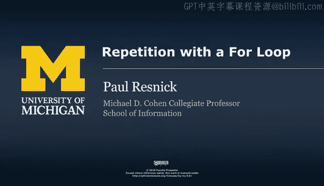
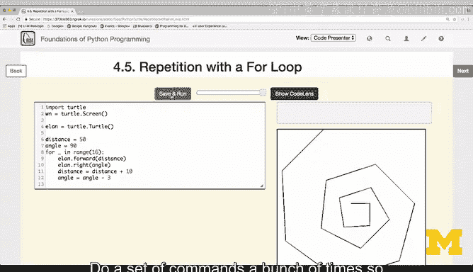

# 密歇根大学《Python3编程》课程1、2 - P21：21_01_04_for循环实现重复 🌀




在本节课中，我们将要学习Python中一个非常强大的概念——**for循环**。循环允许我们重复执行一段代码多次，而无需手动复制粘贴，这能让我们的程序更简洁、更易于管理。

## 概述

假设我们有一行或几行代码，我们希望它们能运行不止一次。虽然可以通过复制粘贴来实现，但这会使程序变得冗长且难以理解。因此，Python提供了一个特殊的命令来重复执行代码块，这就是**for循环**，也称为**迭代**。

## for循环的基本结构

以下是for循环的基本语法：

```python
for variable in sequence:
    # 要重复执行的代码块
```

让我们通过一个简单的例子来理解它的工作原理。

## 第一个例子：理解执行顺序

请看以下代码：

```python
print("This will execute first.")
for _ in range(3):
    print("This line will execute three times.")
    print("This line will also execute three times.")
```

在运行代码之前，尝试预测它的输出。你可能会认为它会先打印第一行，然后连续三次打印第二行，再连续三次打印第三行。

然而，实际并非如此。for循环的执行方式是：**整个缩进的代码块会作为一个整体，重复执行指定的次数**。

因此，实际的执行顺序是：
1.  打印 `"This will execute first."`。
2.  进入循环，**第一次**执行整个代码块：打印 `"This line will execute three times."`，然后打印 `"This line will also execute three times."`。
3.  **第二次**执行整个代码块。
4.  **第三次**执行整个代码块。

所以输出窗口会显示：
```
This will execute first.
This line will execute three times.
This line will also execute three times.
This line will execute three times.
This line will also execute three times.
This line will execute three times.
This line will also execute three times.
```

## 第二个例子：用循环绘制图形

上一节我们介绍了for循环的基本执行逻辑，本节中我们来看看如何用它来创建一个更有趣的程序。我们将使用Python的`turtle`模块来绘制图形。

以下是示例代码：

```python
import turtle

elon = turtle.Turtle()
distance = 50

for _ in range(10):
    elon.forward(distance)
    elon.right(90)
    distance = distance + 10
```

让我们分解这段代码：
*   `for _ in range(10):`：这行代码表示接下来的缩进块将执行**10次**。这里的`_`是一个变量名，表示我们暂时不关心循环的当前次数。
*   在循环块内：
    *   `elon.forward(distance)`：让名为`elon`的海龟向前移动`distance`像素的距离。
    *   `elon.right(90)`：让海龟向右转90度。
    *   `distance = distance + 10`：这是一个重要的操作。它将变量`distance`的当前值加上10，然后将结果重新赋值给`distance`。所以，第一次循环`distance`是50，第二次变成60，第三次变成70，依此类推。

因此，每次循环海龟移动的距离都会增加10像素。运行这段代码，海龟不会画出一个标准的正方形，而是会画出一个**螺旋形**。

## 第三个例子：增加更多变化

如果我们想让螺旋形变得更加复杂，可以尝试在每次循环中同时改变移动距离和旋转角度。

请看修改后的代码：

```python
import turtle

elon = turtle.Turtle()
distance = 50
angle = 90

for _ in range(10):
    elon.forward(distance)
    elon.right(angle)
    distance = distance + 10
    angle = angle - 5  # 每次循环角度减少5度
```

在这段代码中，我们新增了一个变量`angle`，初始值为90度。在循环内部，我们不仅增加了移动距离，还让旋转角度每次减少5度（`angle = angle - 5`）。

运行这段代码，你会得到一个角度逐渐变化的、更复杂的螺旋图案。通过增加`range()`中的数字（例如改为`range(50)`），可以让海龟执行更多次循环，画出更长的螺旋线。

## 总结

本节课中我们一起学习了Python的**for循环**。我们了解到：
1.  for循环用于重复执行一个代码块，其基本结构是 `for variable in sequence:`。
2.  循环体是通过**缩进**来定义的，整个缩进块会作为一个整体被重复执行。
3.  通过结合变量（如`distance = distance + 10`），我们可以在每次循环中改变程序的行为，从而用简短的代码创造出复杂的输出，例如绘制螺旋图形。



掌握for循环是自动化重复任务和构建复杂程序逻辑的关键一步。