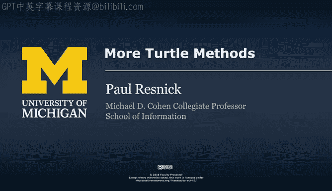
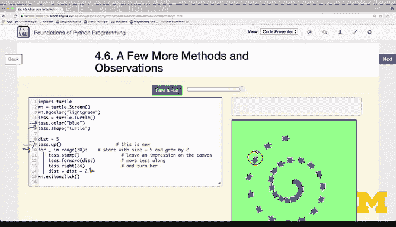

# 课程22：更多海龟绘图方法 🐢




在本节课中，我们将学习海龟绘图模块中更多有趣的方法，包括如何让海龟“拾笔”移动而不画线，以及如何在画布上“盖章”留下海龟的形状印记。这些方法能帮助我们创建更复杂和有趣的图形。

---

上一节我们介绍了海龟的基本移动和转向方法，本节中我们来看看如何控制海龟的“笔”以及使用“盖章”功能。

首先，我们观察一个不同的螺旋图形。在这个例子中，我们看不到完整的连线，海龟只在移动过程中偶尔留下印记。

以下是实现这一效果的代码示例：

```python
import turtle

# 创建一个名为 Tess 的海龟
tess = turtle.Turtle()
# 将海龟的颜色设置为蓝色
tess.color("blue")
# 将海龟的形状改为真正的乌龟图标
tess.shape("turtle")
# 拾起画笔，移动时不画线
tess.up()

for i in range(30):
    # 在当前海龟位置盖章，留下形状印记
    tess.stamp()
    # 海龟向前移动，距离随循环递增
    tess.forward(5 + i)
    # 海龟向右旋转 25 度
    tess.right(25)
```

代码解析如下：

*   **`tess.up()`**： 此方法用于抬起画笔。调用后，海龟移动时不会在画布上留下轨迹。
*   **`tess.stamp()`**： 此方法用于在海龟当前所在位置，复制一个海龟的形状印记到画布上。
*   循环内的其他命令（`forward`, `right`）与之前所学功能一致。通过每次循环增加前进距离，形成了螺旋效果。

---

在配套教材的本节页面中，提供了一些顺序混淆的代码练习题（Parson‘s problems）。强烈建议你尝试完成它们，这将帮助你巩固以下两点认识：

1.  代码语句必须按特定顺序执行。
2.  在 `for` 循环等控制结构下，需要正确缩进代码块。

---

本节课中我们一起学习了海龟绘图中两个新方法：`up()` 用于拾笔移动，以及 `stamp()` 用于在画布上盖章。结合循环与递增变量，我们可以创造出更有趣的图案。记得通过练习题来巩固对代码顺序和缩进的理解。



下次见。