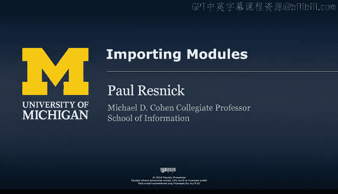
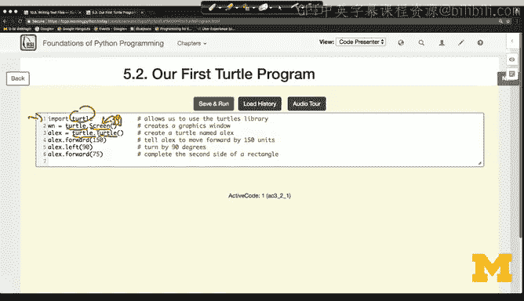
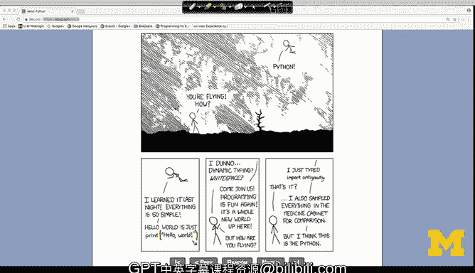

# 23课：模块导入 🧩





在本节课中，我们将要学习Python中的模块导入。我们将了解如何利用他人编写好的代码，以及两种不同的导入语法。理解模块导入是编写高效、简洁Python代码的关键一步。

## 概述：什么是模块导入？

在我们之前所有的海龟绘图示例中，我们简要地使用了`import`语句。在本系列课程中，我们致力于减少代码中的“魔法”，让你能够阅读代码并理解其逻辑。因此，本视频将详细介绍`import`语句。

Python中有许多由他人编写的函数和方法可供我们直接使用，我们无需自己重新编写。其中一些函数是Python核心内置的，例如`len()`函数，你可以直接调用它，它总是可用的。然而，还有许多其他函数并非内置在Python核心中，但它们也很容易获取，它们是标准库模块的一部分。

**模块**是一个代码文件，它定义了一些可以被其他程序使用的函数。在你调用来自标准库模块的函数之前，你需要告诉Python解释器使其可用，这正是`import`语句的作用。`turtle`就是这样一个标准库模块，但我们稍后再讨论它。首先，让我们看一个更简单的模块。

## 导入 `random` 模块

有一个名为`random`的模块。你只需要导入它，就可以使用它内部的所有函数。

以下是导入`random`模块并使用其函数的示例代码：

```python
import random

# 使用 random 模块中的 random() 函数
print(random.random())

# 使用 random 模块中的 randrange() 函数
print(random.randrange(1, 7))
```

在上面的代码中，第1行导入了`random`模块。第4行调用了`random.random()`，这个函数返回一个0到1之间的浮点数。第7行调用了`random.randrange(1, 7)`，这个函数返回一个从1到6（包含1，不包含7）的随机整数。

每次运行这段代码，你可能会得到不同的值。

## 两种导入语法

有两种可能的语法用于导入和引用模块中的内容。

### 方法一：直接导入模块

第一种方法使模块内容可用，但不为其提供任何特殊别名。这就是上面示例代码所采用的方式。

*   **语法**：`import module_name`
*   **引用方式**：`module_name.function_name()`

在这种方式下，每次我们想引用模块中的函数时，都必须使用`模块名.函数名()`的格式。例如，`random.randrange()`。这里的点号`.`是一种表示法，用于从模块中获取某个对象（这里是函数）。

值得注意的是，这与我们之前见过的`tess.forward()`中的点号用法类似，但又不完全相同。`tess`是一个海龟对象，`forward`是应用于该对象的方法。而`random`是一个模块，`randrange`是该模块内部定义的函数。

这也就解释了为什么会有`random.random()`这种看似奇怪的写法。第一个`random`是模块名，第二个`random`是该模块内部定义的一个同名函数。

### 方法二：从模块中导入特定函数

第二种导入方法将函数直接放入我们本地的命名空间，这样我们就不必再通过模块名来引用它们。

以下是这种方法的示例：

```python
from random import randrange, random

# 现在可以直接使用函数名，无需前缀
print(random())
print(randrange(1, 7))
```

*   **语法**：`from module_name import function1, function2`
*   **引用方式**：`function_name()`

在这种方式下，我们不再需要说明这些函数来自哪个模块，它们的名称直接在我们的本地命名空间中变得可用。

以上两种方法都有效，但根据你选择的方式，引用函数时需要采用不同的语法。

## 回顾 `turtle` 模块的导入

理解了模块导入后，让我们回顾一下我们是如何导入`turtle`模块的。

```python
import turtle

# 创建屏幕对象
wn = turtle.Screen()

# 创建海龟对象
tess = turtle.Turtle()
```

在第1行，我们导入了`turtle`模块。在第4行和第7行，我们使用了`turtle.Screen()`和`turtle.Turtle()`。这里，`Screen`和`Turtle`是定义在`turtle`模块中的类。调用它们就像调用函数一样，但它们是创建新屏幕对象和海龟对象的函数。这和我们之前看到的`import random`语法是相同的：我们导入模块，然后引用模块内部定义的某个东西（`Screen`或`Turtle`）。

## 关于Python模块的更多信息

顺便提一下，在Runestone教科书环境中，通常只有少数几个Python标准库模块可用。我们拥有`random`模块、`turtle`模块和`math`模块。但标准发行版中包含的模块远不止这些。如果你在自己的机器上安装了Python，它们可以为你做很多事情，你只需要找到正确的模块即可。

甚至除了标准库之外，如果你在本地机器上安装了Python，还可以安装许多其他模块。




（注：这里引用了一则关于Python的幽默漫画，大意是Python非常简单强大，甚至能“导入反重力模块”让人飞起来，以此说明Python模块的丰富和有趣。）



## 总结

本节课中，我们一起学习了Python的模块导入机制。我们了解到：

1.  **模块**是包含可重用代码的文件。
2.  使用`import`语句可以引入标准库或第三方模块的功能。
3.  有两种主要的导入语法：
    *   `import module_name`：导入整个模块，使用时需加模块名前缀。
    *   `from module_name import something`：导入模块中的特定部分，使用时可直接使用其名称。
4.  我们通过`random`和`turtle`模块的实例，具体实践了这两种导入方式。

理解并熟练使用模块导入，能让你站在“巨人的肩膀上”，利用丰富的现有代码库，更高效地完成编程任务。


我们下次再见。