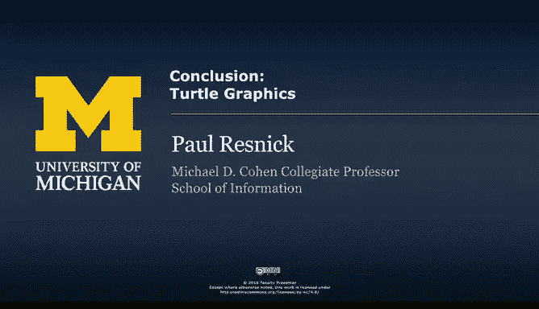

# 课程24：海龟绘图总结 🐢


在本节课中，我们将对之前学习的海龟绘图知识进行总结，并通过一个有趣的故事来结束这个主题。



---

上一节我们介绍了海龟绘图的各种功能，本节中我们来看看如何将这些知识融会贯通，并轻松地结束本章。

海龟绘图是Python中一个有趣的模块，它允许我们通过命令控制一个屏幕上的“海龟”来绘制图形。我们学习了如何移动海龟、改变其颜色和绘制形状。

以下是使用海龟绘图的核心步骤概述：
1.  导入 `turtle` 模块。
2.  创建一个海龟对象。
3.  使用如 `forward()`、`right()` 等方法控制海龟移动。
4.  使用 `done()` 方法保持窗口打开。

例如，绘制一个正方形的代码如下：
```python
import turtle
t = turtle.Turtle()
for i in range(4):
    t.forward(100)
    t.right(90)
turtle.done()
```

掌握了这些基础后，你就可以创作出各种复杂的图案了。

---

作为坚持学习到这里的奖励，这里有一个小笑话。

一只蜗牛在海滩上散步，它回头看了一眼，发现三只穿着皮夹克的乌龟跟在它后面。这让它有点担心，于是它加快了速度。

四个小时后，它又回头看了一眼。果然，它们还在跟着，而且离得更近了。它非常担心，继续向前移动。

两小时后，它偷偷又看了一眼。它们仍然跟着它，而且非常近了。于是它开始以最快的速度冲刺。

但一小时后，乌龟们还是抓住了它并抢劫了它，拿走了它的钱和车钥匙。直到第二天早上，它才设法走到停车场的付费电话亭。

它打电话报警说：“我被三只穿着皮夹克的乌龟抢劫了。请你们尽快赶来，因为它们快要逃走了。”

警官问道：“先生，你能更详细地描述一下那些乌龟吗？”
蜗牛回答：“不，我不能。一切都发生得太快了。”

---

祝绘图愉快。我们下节课再见。

本节课中我们一起学习了海龟绘图模块的总结，回顾了其基本用法，并通过一个轻松的故事结束了这个主题。希望这些知识能帮助你开启用代码创作图形的旅程。