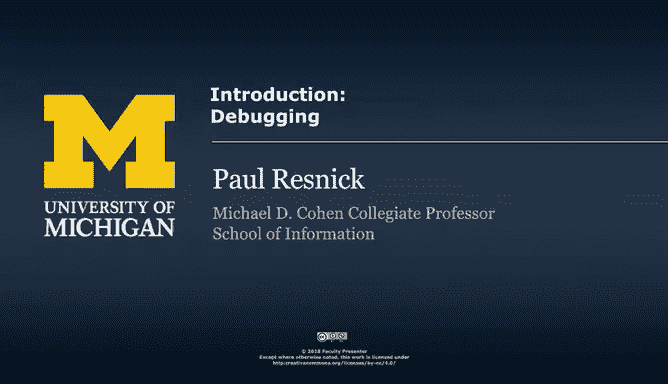

# 课程25：Python 3编程（课程1、2）｜调试导论 🐛

在本节课中，我们将学习程序调试的基础知识。调试是编程中不可或缺的技能，它能帮助你找出并修复代码中的错误。我们将介绍三种主要的错误类型，并探讨如何有效地解读错误信息、养成良好的编程习惯，以及识别和解决一些常见的错误。

---

## 调试：程序员的必经之路 🕵️‍♂️

大多数时候，我们的最后一课都会以“程序员之道”为标题。这些内容并非关于Python如何工作，而是关于你应如何工作。这包括代码的风格建议、解决编程问题的策略、习惯以及心态，这些都能让你在编程过程中保持乐趣，尽管它有时是艰苦且令人沮丧的。

本周，我们将重点讨论调试。你的程序不会总在第一次运行时就能正常工作。事实上，它们很少能一次成功。你必须调试它们。调试代码有点像在犯罪电影中扮演侦探，而同时你也是罪犯，因为代码是你写的。

---

## 学习目标 🎯

在本课结束时，你应该能够：

*   区分三种类型的错误：语法错误、运行时错误和语义错误。
*   养成一个习惯：当遇到错误时，查看错误信息。
*   开始培养解读这些错误信息的技能。
*   内化一个信条：先让代码运行起来，并保持其运行。不要在测试之前编写大段的代码。
*   能够识别一些常见错误并知道如何修复它们。

---

## 三种主要错误类型

上一节我们了解了调试的重要性，本节中我们来看看程序中常见的三种错误类型。理解它们的区别是有效调试的第一步。

以下是三种主要的编程错误：

1.  **语法错误**
    *   这些错误发生在代码被运行之前，通常是因为违反了Python的语法规则。
    *   例如，忘记闭合括号、引号或使用了错误的关键字。
    *   Python解释器无法理解有语法错误的代码，因此会直接报错并停止执行。

2.  **运行时错误**
    *   这些错误发生在程序运行期间，代码语法本身是正确的，但在执行某个操作时发生了问题。
    *   例如，尝试打开一个不存在的文件，或者进行除以零的运算。
    *   程序会执行到错误发生的那一行，然后崩溃并显示错误信息。

3.  **语义错误**
    *   这是最隐蔽的一类错误。代码的语法正确，也能正常运行而不会崩溃，但程序的行为与你的预期不符。
    *   例如，逻辑错误，如使用了错误的公式或条件判断。
    *   程序会给出一个错误的结果，而不是直接报错。

---

## 养成查看错误信息的习惯

认识了错误类型后，我们需要掌握处理它们的第一个关键步骤：认真阅读错误信息。

当程序出错时，Python会提供错误信息。你应该养成查看这些信息的习惯。错误信息通常会告诉你错误类型（如 `SyntaxError`， `ZeroDivisionError`）和错误发生的位置（文件名和行号）。开始培养解读这些错误信息的技能至关重要，它们是定位问题根源的最直接线索。

---

## 核心编程信条：渐进式开发

为了减少调试的难度，一个重要的策略是采用渐进式的开发方法。

你需要内化一个信条：**先让代码运行起来，并保持其运行**。这意味着不要一次性编写大量代码后再进行测试。相反，应该写一小段功能，立即测试它是否工作，然后再添加下一小段功能。这种方式可以确保你始终在一个正确的基础上进行构建，并能在问题出现时快速定位到新引入的代码。

---

## 常见错误示例及修复

最后，让我们通过一些具体例子来识别常见的错误。熟悉这些模式能帮助你在未来更快地解决问题。

以下是一些初学者常遇到的错误：

*   **语法错误示例**：`print("Hello, World"` （缺少闭合括号）
    *   **修复**：`print("Hello, World")`

*   **运行时错误示例**：`result = 10 / 0` （除以零）
    *   **修复**：检查除数是否为零，例如：`if divisor != 0: result = 10 / divisor`

*   **语义错误示例**：本应计算平均值，却写成了 `average = sum / 2` （假设只有两个数）。
    *   **修复**：使用正确的逻辑，如 `average = sum / count`，其中 `count` 是数字的个数。

---

## 总结 📝

本节课中，我们一起学习了程序调试的基础知识。我们首先区分了语法错误、运行时错误和语义错误这三种主要的错误类型。接着，我们强调了养成查看和解读错误信息习惯的重要性。然后，我们介绍了一个核心的编程信条——采用“先让代码运行起来”的渐进式开发策略，以避免复杂的调试局面。最后，我们看了一些常见错误的例子及其修复方法。掌握这些调试的基本技能，将使你在编程道路上更加自信和高效。