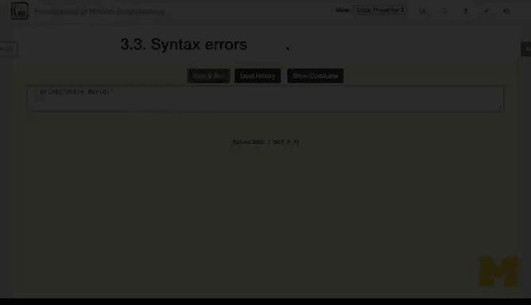
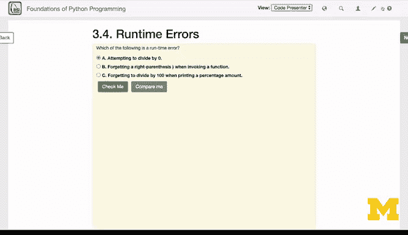
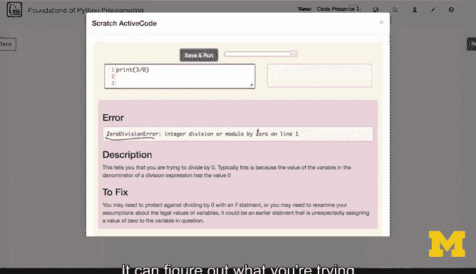
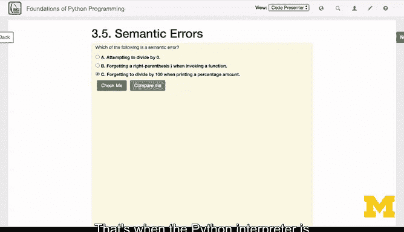
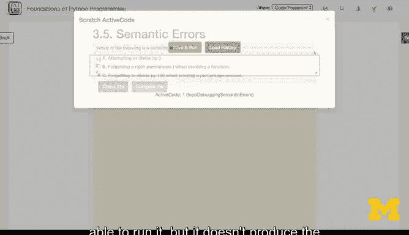
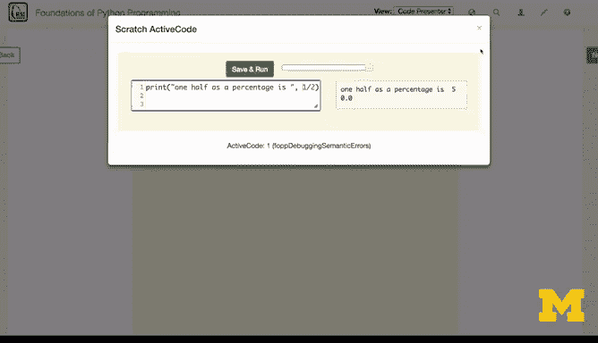
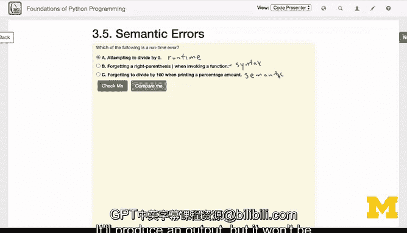

# 密歇根大学《Python3编程》课程1 - P26：Python中的三种错误类型 🐛




在本节课中，我们将要学习Python编程中常见的三种错误类型：语法错误、运行时错误和语义错误。理解这些错误的区别，是调试代码和成为更高效程序员的关键一步。

## 概述 📋

编程时遇到错误是不可避免的。Python解释器会将遇到的错误分为几类，每一类都有其特定的原因和表现形式。我们将逐一探讨语法错误、运行时错误和语义错误，并通过简单的例子来理解它们。

## 语法错误 🚫

第一种错误被称为语法错误。就像英语语法一样，Python语句的结构必须正确。语法错误意味着语句格式不正确，解释器无法理解程序员的意图，因此不会尝试猜测，而是直接报告错误。

以下是语法错误的一个例子及其分析：

```python
print("Hello, World"  # 缺少右括号
```

*   **错误表现**：解释器在解析代码时，发现`print`语句有开括号，但没有找到对应的闭括号。它会一直向后查找，直到文件结束也未能找到，于是报告一个“语法错误”。
*   **错误信息**：你可能会看到类似 `SyntaxError: unexpected EOF while parsing` 的信息。`EOF`代表“文件结束”。解释器在等待一个右括号来结束语句，但直到文件末尾也没等到。
*   **注意点**：错误信息可能指向错误发生影响到的行（例如文件末尾的第3行），但实际需要修复的位置通常在更早的地方（例如第1行缺少括号的位置）。
*   **修复方法**：补上缺失的括号即可。将代码修正为 `print("Hello, World")`，程序就能正常运行。

上一节我们介绍了因结构错误导致解释器无法解析的语法错误。接下来，我们来看看即使代码结构正确，在运行过程中也可能出现的问题。

## 运行时错误 ⚠️

第二种错误是运行时错误。这类错误发生在解释器成功解析程序之后，但在程序执行过程中，某个操作是非法的。

以下是运行时错误的一个典型例子：

```python
result = 3 / 0  # 试图进行除以零的运算
print(result)
```

*   **错误表现**：代码语法完全正确，解释器可以理解你要进行除法运算。然而，在实际计算 `3 / 0` 时，这个数学操作本身是没有定义的（不合法）。
*   **错误信息**：执行上述代码会引发 `ZeroDivisionError`，提示“division by zero”。
*   **核心概念**：运行时错误意味着代码指令本身清晰，但在特定条件下（如除数为零）无法执行。



我们已经了解了代码无法运行（语法错误）和运行中崩溃（运行时错误）的情况。最后，我们来看一种更隐蔽的错误类型。

## 语义错误 🤔

第三种错误被称为语义错误。这种情况下，Python解释器既能成功解析代码，也能顺利运行程序直到结束，但程序产生的结果并不是程序员原本期望的。





以下是语义错误的一个例子：



```python
# 程序员意图：计算并打印“二分之一等于50%”
print("One half as a percentage is", 1/2)  # 语义错误：忘记乘以100
```

*   **错误表现**：程序会正常输出：`One half as a percentage is 0.5`。从技术角度看，程序没有报错并执行完毕。但逻辑是错误的，因为 `1/2` 作为百分比应该是 `50%`，而不是 `0.5`。
*   **问题根源**：错误在于程序员的逻辑。程序员忘记了将分数（0.5）乘以100来转换为百分比。
*   **修复方法**：修正逻辑。正确的代码应为 `print("One half as a percentage is", (1/2)*100, "%")`，这样才会输出期望的 `50%`。

## 总结与练习 ✅

本节课中我们一起学习了Python编程中的三种主要错误类型：



1.  **语法错误**：代码结构不正确，解释器无法解析。例如：`print(“Hello”` （缺少右括号）。
2.  **运行时错误**：代码结构正确，但执行时遇到非法操作。例如：`3 / 0` （除以零）。
3.  **语义错误**：代码能运行完成，但输出结果不符合预期。例如：计算百分比时忘记乘以100。

为了巩固理解，请判断以下情况分别属于哪种错误类型：

*   **试图除以零**：这是一个**运行时错误**。解释器知道你要做除法，但除数为零这个操作是非法的。
*   **忘记一个右括号**：这是一个**语法错误**。这会导致解释器无法解析代码结构。
*   **打印百分比时忘记除以100**：这是一个**语义错误**。程序会正常运行并输出一个值，但这个值（如0.5）并不是你想要的百分比结果（50%）。



通过识别和区分这些错误类型，你可以更快速、更有效地定位和解决代码中的问题。