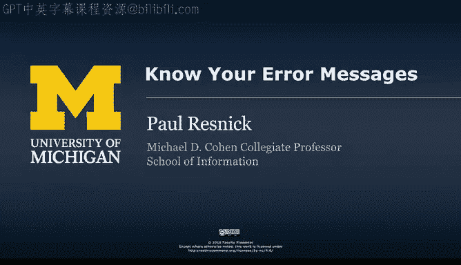
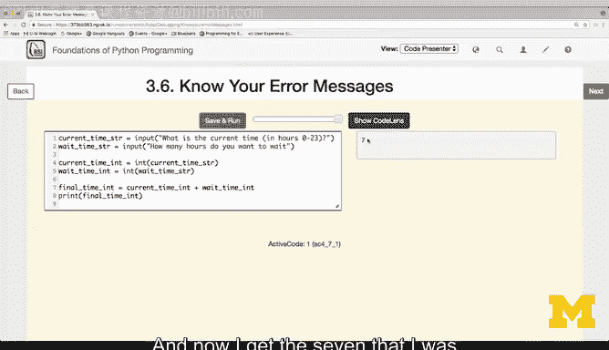

# 课程1：Python 3编程｜第27讲：理解错误信息 🐛


在本节课中，我们将学习如何阅读和理解Python程序运行时报出的错误信息。这对于调试代码、找出程序中的问题至关重要。



---

当程序出现错误时，查看错误信息非常有价值。错误信息能告诉你很多信息。

首先，你会注意到一个粉红色的错误提示框。你可能会忍不住直接去看代码，试图找出问题所在。但花时间仔细阅读错误信息是值得的。它会告诉你一个行号，这是一个很好的线索。如果你开始学习解读这些特定的信息，它们会非常有帮助。

下面我们来看一个例子。

## 一个示例程序

这里有一个程序，它会要求用户输入几个值。它会询问我们想从几点开始，以及我们想等待多长时间。最后，它应该打印出结束的时间。

例如，如果我输入3点开始，3是我们的开始时间。然后我想等待4小时，它应该告诉我们结果是7点。让我们看看实际会发生什么。

以下是程序代码：

```python
current_time_str = input("What's the current time in hours? ")
wait_time_str = input("How many hours do you want to wait? ")
current_time_int = int(current_time_str)
end_time_int = current_time_int + wait_time_int
print(end_time_int)
```

运行程序，我们输入：
- 当前时间：`3`
- 等待时间：`4`

我们期望它打印出 `7`。但相反，我们得到了那个粉红色的错误提示框。

## 解读错误信息

让我们看看错误信息告诉了我们什么。

错误信息显示：
1.  首先，**第5行**是一个值得查看的地方。
2.  它指出我们遇到的问题类型是 **`NameError`**。
3.  具体来说，错误是：**`wait_time_int is not defined`**（`wait_time_int` 未定义）。

所以，让我们去看第5行代码：
```python
end_time_int = current_time_int + wait_time_int
```

这意味着程序实际上执行了第1到第4行，一切正常，直到它执行到第5行。

## 理解赋值语句

每当你看到像第5行这样的赋值语句时，其执行过程是：
1.  首先，**计算等号右侧**表达式的值。
2.  然后，将计算结果**赋值给等号左侧**的变量 `end_time_int`。

因此，程序会尝试获取一个值，但**只有在我们成功计算出右侧表达式后**，它才能得到这个值。

## 定位问题根源

右侧的表达式要求查找变量 `wait_time_int` 的当前值。但是，根据错误信息，`wait_time_int` 并未定义。

所以，当我们执行到第5行时，`wait_time_int` 在此之前并没有被设置过。当程序在第5行尝试查找它时，就得到了这个错误。这给了我们一个线索。

现在，我们必须回顾我们原本想做的事情，并弄清楚发生了什么。我们会意识到：“哦，等等。我们原本是想使用我们获取的输入。`wait_time_str` 才是存储输入字符串（例如‘4’）的变量。`wait_time_int` 并不是这个变量的名字。”

## 修正错误

正确的做法应该是将字符串 `wait_time_str` 转换为整数，并存储到一个新变量中（或者直接使用）。让我们修正代码：

```python
current_time_str = input("What's the current time in hours? ")
wait_time_str = input("How many hours do you want to wait? ")
current_time_int = int(current_time_str)
wait_time_int = int(wait_time_str)  # 新增这行：将等待时间的字符串转换为整数
end_time_int = current_time_int + wait_time_int
print(end_time_int)
```

让我们看看修正后是否有效。我们再次输入：
- 开始时间：`3`
- 等待时间：`4`

现在，我们得到了期望的结果：`7`。

---

## 总结

本节课中，我们一起学习了如何解读Python的错误信息。关键步骤包括：
1.  **不要忽略错误信息**：仔细阅读粉红色提示框中的内容。
2.  **定位行号**：错误信息会指出问题发生的代码行，这是调试的起点。
3.  **理解错误类型**：例如 `NameError` 表示尝试使用了一个未定义的变量名。
4.  **分析错误详情**：信息会具体说明是哪个名称出了问题（例如 `wait_time_int is not defined`）。
5.  **回顾代码逻辑**：根据错误线索，检查变量命名和赋值过程，找出不一致或遗漏的地方。

通过练习解读这些信息，你将能更高效地独立调试程序，并理解代码的执行流程。



我们下次再见。