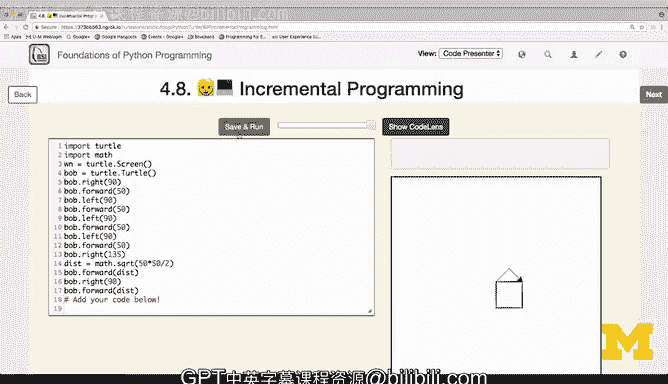

# 课程28：增量式编程 🏗️


在本节课中，我们将学习一种名为“增量式编程”的编程方法。这种方法的核心思想是：通过编写少量代码并持续测试，来逐步构建一个完整且能正常工作的程序，从而减少编程过程中的错误和困扰。

---

## 概述

作为程序员，你可以通过增量式编程来减少困扰。其方法是逐步编写程序，先让一部分代码运行起来，并始终保持其可运行状态。“从小处着手，并保持其正常运行”将是我们的座右铭。

上一节我们介绍了编程的基本概念，本节中我们来看看如何通过具体的例子实践增量式编程。

## 逐步构建：绘制一座房子 🏠

我们以一个绘制房子的程序为例。目标是画一个矩形，并在其顶部加上一个三角形。我们已经完成了第一部分，即让程序先运行起来一部分。

现在，我们将尝试以增量方式添加更多代码，逐步画出房子的更多部分。这样，当我们犯错时，就能在代码变得过于复杂之前发现并修正。

我们从一个可以运行的程序开始。目前，角色Bob向下移动并左转。

### 完成正方形

首先，让我们完成这个正方形。这部分应该很简单。

以下是完成正方形所需的步骤：
1.  让Bob再次左转。
2.  让Bob向前移动。

你可能会想一次性写更多行代码，但我强烈建议你在编写每一小段代码后都进行测试。

所以，让我们先让他再次左转，然后测试一下。接着，让他向前移动，并再次测试。

### 绘制屋顶

现在，我们进入稍难的部分：绘制三角形的屋顶。我需要让Bob转向，以便他能完成房子的屋顶。

为了实现这个目标，我需要进行以下操作：
1.  让Bob向右转（而不是左转）。
2.  尝试让他转45度角（而不是90度）。
3.  然后让他向前移动50个单位。

**代码示例：**
```python
# 假设已有初始移动代码
# bob.forward(50)
# bob.left(90)

# 尝试绘制屋顶
bob.right(45)   # 向右转45度
bob.forward(50) # 向前移动
```

哎呀！这就是为什么一次只做一点是个好主意——我立刻意识到方向错了。我本意是让他转向这边，以便朝那个方向移动，但他转的角度不够。他转了45度，但我需要他转到135度的方向。

**修正后的代码：**
```python
bob.right(135)  # 向右转135度
bob.forward(50) # 向前移动
```

现在看起来好多了。接下来，我只需要让他再左转90度，然后向前移动，就能完成房子了。

**继续添加代码：**
```python
bob.left(90)
bob.forward(50)
```

让我们看看效果。哦，不，这样并没有画出一个完整的房子屋顶。

### 精确计算移动距离

结果发现，Bob不需要移动那么远。与其移动50个单位，他应该移动得少一点，比如每次移动40个单位。

**尝试调整：**
```python
bob.right(135)
bob.forward(40) # 将距离改为40
bob.left(90)
bob.forward(40) # 将距离改为40
```

这样接近了，但还不完美。你可以反复试验直到得到接近的结果，但有时退一步进行计算会更有帮助。在这个案例中，**勾股定理**能真正帮助我们。

我们想要的是一个直角等腰三角形，斜边长度为50。如果直角边长度为 `a`，那么根据勾股定理：

**公式：** `a² + a² = 50²`

因此，`2a² = 2500`， `a² = 1250`， `a = √1250`。

我们可以用计算器算，也可以让Python解释器为我们计算。Python中有平方根函数，但用法有点技巧：你需要先导入 `math` 模块。

**计算并应用正确距离的代码：**
```python
import math

# 计算直角边长度
distance = math.sqrt(50 * 50 / 2)
# 或者 distance = math.sqrt(1250)

# 使用计算出的距离
bob.right(135)
bob.forward(distance)
bob.left(90)
bob.forward(distance)
```

让我们试试看这次是否能得到一个漂亮的屋顶。太好了！

---

## 总结



本节课中我们一起学习了**增量式编程**的核心思想。主要要点是：你不太可能第一次就写出完全正确的长程序。更好的方法是，从一个可以运行的小程序开始，每次添加一两行代码，然后进行测试，确保程序始终处于可运行状态。就这样逐步构建，并始终保持你的程序能够正常工作。