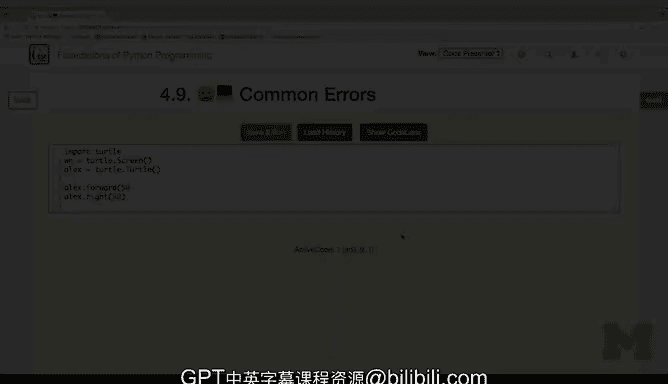
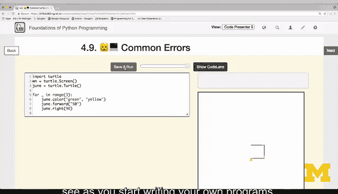

# 29：常见错误类型 🐛




在本节课中，我们将学习Python编程中几种常见的错误类型。了解这些错误及其提示信息，能帮助你更快地识别问题并修复代码。

---

上一节我们介绍了编程的基本概念，本节中我们来看看初学者常犯的具体错误。

## 忘记括号

一种常见的错误是忘记闭合括号。Python会提示语法错误（`SyntaxError`），并指出它发现问题的行号。

**示例代码：**
```python
print("Hello, World"  # 缺少右括号
print("Another line")
```
Python解释器可能在下一行（第2行）才报告错误，但实际的问题出在上一行（第1行）缺少了右括号。修复方法是补上缺失的括号。

**修复后代码：**
```python
print("Hello, World")  # 补上右括号
print("Another line")
```

---

处理了语法问题后，我们来看看与变量命名相关的错误。

## 变量命名错误

以下是几种典型的变量命名错误。

### 大小写敏感

Python是大小写敏感的语言。`Turtle`和`turtle`是两个完全不同的变量名。

**错误示例：**
```python
import turtle
Turtle.forward(50)  # 错误：`Turtle`未定义
```
`turtle`是模块名，其中的类名为`Turtle`。正确的调用方式是通过模块名访问类。

**正确代码：**
```python
import turtle
turtle.Turtle().forward(50)  # 正确：`turtle.Turtle`
```

### 方法调用顺序错误

调用对象方法时，顺序必须是：对象、点号、方法名。

**错误示例：**
```python
right(june, 90)  # 错误：函数式调用
```
对于`turtle`对象`june`，应使用点号调用其方法。

**正确代码：**
```python
june.right(90)  # 正确：对象.方法()
```

### 变量名拼写不一致

创建变量和使用变量时，名称必须完全一致，包括大小写。

**错误示例：**
```python
june = turtle.Turtle()  # 变量名为 `june`
June.right(90)          # 错误：使用了 `June`
```
`june`和`June`被视为两个不同的变量。确保使用相同的拼写。

**正确代码：**
```python
june = turtle.Turtle()
june.right(90)          # 正确：使用 `june`
```

---

解决了命名问题，接下来我们看看函数调用时可能出现的错误。

## 函数参数错误

调用函数时，必须提供正确数量和类型的参数。

### 缺少必要参数

某些函数要求至少传递一个参数。例如，`range()`函数需要知道循环次数。

**错误示例：**
```python
for i in range():  # 错误：`range()`缺少参数
    print(i)
```
`range()`函数期望至少一个参数来指定停止值。

**正确代码：**
```python
for i in range(3):  # 正确：指定循环3次
    print(i)
```

### 参数类型问题

有时，函数能够灵活处理不同类型的数据。例如，`turtle.forward()`方法可以接受数字或可转换为数字的字符串。

**示例代码：**
```python
june.forward("50")  # 可以工作：字符串"50"被转换
```
虽然在这个特定例子中不会报错，但在其他函数中传递错误类型的参数通常会导致`TypeError`。始终确保传递函数所期望的数据类型。

---



本节课中我们一起学习了Python编程中几种常见的错误：忘记括号、变量命名错误（包括大小写敏感、方法调用顺序和拼写不一致）以及函数参数错误（包括缺少参数和类型问题）。识别这些错误的提示信息并理解其根源，是调试代码和提升编程技能的关键步骤。


我们下次再见。