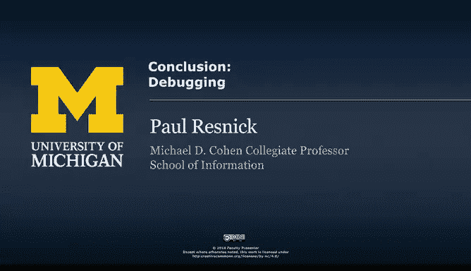

# 30：调试总结 🐛

在本节课中，我们将总结并回顾在编程过程中至关重要的调试技能。调试是发现并修复代码错误的过程，掌握它能让你的编程之路更加顺畅。

---

## 概述

你已经掌握了一些宝贵的调试技能。请记住，你的程序通常不会第一次就完美运行，你也不应抱有此期望。但凭借你已开始掌握的调试技能，这不会成为问题。

---

## 区分错误类型

上一节我们介绍了调试的重要性，本节中我们来看看如何区分不同类型的错误。目前，你应该能够区分语法错误、运行时错误和语义错误。

*   **语法错误**：代码违反了Python的语法规则，程序无法开始运行。例如，缺少冒号 `:` 或括号不匹配。
*   **运行时错误**：代码语法正确，但在执行过程中发生问题。例如，尝试打开一个不存在的文件。
*   **语义错误**：代码能运行，但产生的结果与预期不符。这是逻辑上的错误。

---

## 培养良好习惯

在能够区分错误之后，下一步是培养处理错误的良好习惯。你应该已经走上正轨，开始养成查看错误信息并培养解读它们的技能。

学会珍视你的错误信息。你需要内化一个信条：**让代码先运行起来，并保持它能运行**。庆祝每一个小的成功，而为了庆祝这些小的成功，你首先必须取得它们。

---

## 识别与修复常见错误

以下是初学者常遇到的一些错误及其修复思路：

*   **`NameError`**：通常意味着你使用了一个未定义的变量名。检查拼写或确认变量是否已赋值。
*   **`IndentationError`**：Python对缩进非常严格。确保同一代码块的语句具有相同的缩进级别。
*   **`TypeError`**：例如尝试将字符串和数字相加。需要确保操作的数据类型是兼容的。
*   **`SyntaxError`**：仔细检查错误信息指出的行，常见原因是缺少 `:`、括号或引号不匹配。

---

## 一个关于调试的寓言

最后，让我们通过一个故事来加深对调试的理解。一个经理、一个机械工程师和一个程序员在参加完会议后开车经过山路，突然刹车失灵了。

车子失控冲下山坡，猛烈地刮擦着护栏，最终幸运地冲进沟里停了下来。三人惊魂未定地爬出车外，开始评估如何解决问题。

经理说：“我们协作吧，分享想法，一起努力解决这个问题。”
机械工程师说：“我们把整辆车拆开，分析每个零件的故障，找出问题所在。”
程序员说：“嘿，我们为什么不把车推回山顶，然后再开下来，看看故障会不会重现呢？”

**请不要做那样的程序员**。要更像那位机械工程师：阅读“错误信息”（即故障表现），找出根本问题所在。这样，你的编程生涯会愉快得多。

---

## 总结

本节课中我们一起学习了调试的核心思想：接受程序初次运行出错是常态，并学会利用错误信息来定位和解决问题。我们回顾了三种主要的错误类型，探讨了“先运行，再完善”的实用信条，并列举了常见错误的应对方法。记住，耐心、细致地分析是高效调试的关键。我们下次再见。😊