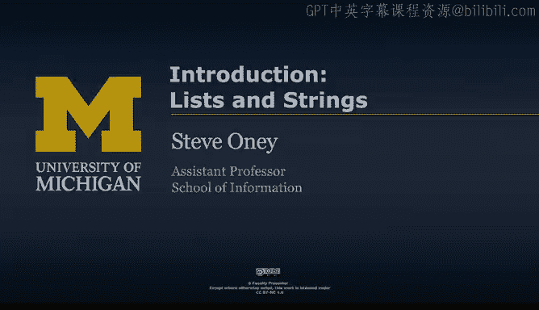

# 课程31：Python序列入门 🐍

在本节课中，我们将要学习Python中的“序列”。序列是元素的有序集合。我们将介绍两种主要的序列类型：字符串和列表。通过学习，你将掌握如何创建它们，并使用索引、切片以及序列方法来分析和处理数据。

---

## 什么是序列？ 📚


上一节我们介绍了本课的主题。本节中我们来看看序列的具体定义。

序列是Python中一种基本的数据结构，它代表一个**有序的、可通过位置（索引）访问**的元素的集合。字符串和列表是Python中最常用的两种序列。



---

## 字符串：文本的序列 ✍️

字符串是字符的有序序列，非常适合表示文本数据，例如单词、句子、姓名等。

在Python中，我们使用单引号 `' '` 或双引号 `" "` 来创建字符串。

**代码示例：**
```python
my_string = "Hello, World!"
```

字符串拥有许多内置方法，允许我们处理和提取其中的数据。

以下是字符串的一些常用操作：
*   **获取长度**：使用 `len()` 函数。
*   **访问字符**：使用索引，例如 `my_string[0]` 获取第一个字符。
*   **切片**：获取子字符串，例如 `my_string[0:5]` 获取前五个字符。
*   **常用方法**：如 `.upper()` 转为大写，`.find()` 查找子串。

---

## 列表：通用的序列 📋

列表是一种更通用的序列，它可以是有序的任何类型数据的集合。

例如，我们可以用一个数字列表来表示每日气温，或者用一个字符串列表来表示应用程序的所有用户。

**代码示例：**
```python
temperatures = [22, 24, 19, 23, 25]  # 数字列表
usernames = ["alice", "bob", "charlie"]  # 字符串列表
mixed_list = [1, "hello", 3.14, True]  # 混合类型列表
```

与字符串类似，列表也支持索引、切片和多种方法。

以下是列表的一些核心操作：
*   **创建与访问**：使用方括号 `[]`，通过索引访问元素。
*   **修改元素**：列表是可变的，可以直接赋值修改，如 `my_list[1] = "new_value"`。
*   **添加元素**：使用 `.append()` 方法在末尾添加。
*   **删除元素**：使用 `del` 语句或 `.remove()` 方法。

---

## 序列的通用操作：索引与切片 🔍

无论是字符串还是列表，作为序列，它们都共享一些强大的通用操作，即索引和切片。

**索引**允许我们通过位置（从0开始计数）访问序列中的单个元素。
**公式/代码：**
```python
sequence[index]  # 获取序列中第index个元素（从0开始）
```

**切片**允许我们获取序列中的一个子序列（片段）。
**公式/代码：**
```python
sequence[start:end]  # 获取从索引start到end（不包括end）的子序列
sequence[start:end:step]  # 可以指定步长
```

---

## 元组简介 🔒

除了字符串和列表，Python还有另一种重要的序列类型：**元组**。

元组与列表非常相似，也是有序的元素集合。**关键区别在于，元组是不可变的**，创建后不能修改其内容。元组使用圆括号 `()` 定义。

**代码示例：**
```python
my_tuple = (1, 2, 3, "four")
```
元组的不可变性使得它们在某些场景下（如作为字典的键或确保数据不被意外更改）非常有用。

---

## 总结 🎯

本节课中我们一起学习了Python中的序列。

我们首先了解了序列是有序的元素集合。然后，我们深入探讨了两种主要的序列类型：用于表示文本的**字符串**和可以容纳任意类型数据的**列表**。我们还简要介绍了不可变的序列——**元组**。


你学会了如何创建这些序列，并掌握了使用**索引**访问元素、使用**切片**获取子序列以及利用序列**方法**处理数据的核心技能。这些是进行数据分析与处理的基础。

我们下节课再见。