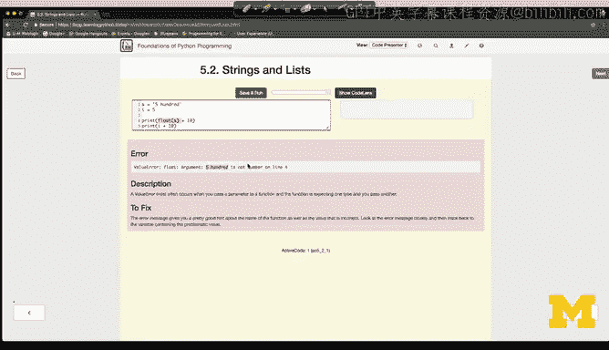

# 课程1：Python 3编程 - P32：字符串操作 🧵


在本节课中，我们将要学习三种新的数据类型：字符串、列表和元组。这三种类型都属于“序列”。序列是一个有序的集合，意味着它包含一系列项目，并且这些项目有明确的顺序（第一项、第二项等），同时序列也有长度。

上一节我们介绍了整数和浮点数，本节中我们来看看字符串。

## 创建字符串

创建字符串最简单的方法是使用字符串字面量表达式。例如：

```python
s = "Hello World"
```

我通过以双引号（或稍后会谈到的单引号）开始来创建字符串。引号内的内容就是字符串的内容。这个字符串的内容是一个字符序列。在这个例子中，第一个字符是大写的 `H`，第二个字符是小写的 `e`，依此类推。这个字符串总共有11个字符（空格也算一个字符），因此字符串 `s` 的长度是11。

我们也可以使用单引号创建字符串。例如：

```python
s = 'Hello World'
```

此时 `s` 仍然是一个有效的字符串。

如果我们想创建多行字符串，可以使用三引号。例如：

```python
m = """Hello
World"""
```

现在，如果我打印 `s` 的值，会得到 `Hello World`。如果我打印 `m` 的值，则会得到这个多行字符串。

对于多行字符串，我们可以使用三个双引号或三个单引号，两者都有效。

## 引号使用规则

我们可以使用双引号或单引号，但必须保持前后一致。例如，我不能用一个双引号开始字符串，却用单引号结束它。如果我尝试这样做，第一行会出现语法错误。

以下是正确的做法：

```python
s = "Hello"  # 双引号开始和结束
s = 'Hello'  # 单引号开始和结束
```

多行字符串的规则相同，我们可以使用三个双引号或三个单引号。

## 特殊字符串示例

我将稍微修改一下字符串 `s`。首先，这是另一个有效的字符串：

```python
s = "M"
```

如果我打印它，会得到 `M`。这个操作创建了一个长度为1的字符串，其第一个字符是大写的 `M`。

这里有一个稍微令人困惑的字符串：

```python
s = ""
```

这里的 `s` 是一个包含零个字符的字符串，因此 `s` 的长度为0。这不要与一个只包含一个空格字符的字符串混淆：

```python
s = " "  # 长度为1
```

如果我删除这个空格，`s` 的长度就变成了0。

## 字符串与数字的区别

关于字符串还有一点需要注意：我可以有一个看起来很像整数的字符串。例如：

```python
s = "5"
```

当我打印 `s` 的值时，会得到 `5`。但对Python来说，这与下面的语句完全不同：

```python
i = 5  # 整数 5
```

即使我打印这两个东西时，它们的表示看起来几乎完全相同，但我可以对 `s` 或 `i` 做一些对方无法做的事情，因为 `s` 是字符串，而 `i` 是整数。

为了展示它们是不同的类型，我将打印出 `s` 的类型和 `i` 的类型：

```python
print(type(s))
print(type(i))
```

当我运行这段代码时，会看到 `i` 和 `s` 具有不同的类型。

这实际上影响了我能用 `i` 和 `s` 做什么。例如，假设我想打印 `10 + i` 的结果：

```python
print(i + 10)  # 输出 15
```

如果我尝试将 `10` 加到 `s` 上，即打印 `s + 10`，那么Python会给我一个运行时错误。它会说无法在第4行连接字符串和整数对象。

具体来说，错误信息的意思是：`s` 是一个字符串，我不能将一个整数加到一个字符串上。因为即使 `s` 的第一个字符恰好是 `5`，对Python来说它仍然是一个字符串。虽然在我们看来 `s` 像一个数字，但对Python而言，`s` 只是一个字符序列。因此，将一个数字加到一个字符序列上对Python来说没有意义，所以我们会得到一个运行时错误。

## 类型转换

如果我们确实想将 `5` 加到类似 `s` 的东西上，那么我们需要先进行类型转换。例如：

```python
print(int(s) + 10)
```

这个对 `int()` 函数的调用，会将字符串 `s` 转换为整数。因此，整个表达式的值就是整数 `5`。现在当我运行代码时，可以看到我可以将 `10` 加到 `s` 的整数值上。

或者，我也可以将其转换为浮点数：

```python
print(float(s) + 10)  # 输出 15.0
```

因为整个表达式的值是字符串 `s`（即 `5`）被转换为浮点数 `5.0`，所以 `5.0 + 10` 的结果是 `15.0`。

## 转换注意事项

当我们通过调用 `float(s)` 或 `int(s)` 将字符串转换为数字时，有一点需要注意：被转换的字符串必须是一个有效的数字。这意味着如果字符串中包含数字以外的内容，转换就会失败。

例如，假设我有：

```python
s = "500 dollars"
```

当我尝试将 `s` 转换为浮点数时，会得到一个运行时错误。这个错误说明字符串 `"500 dollars"` 不是一个数字。换句话说，Python不知道如何将这个字符串转换为浮点数。对于整数转换也是如此。

---



本节课中我们一起学习了字符串的基础知识，包括如何创建字符串、引号的使用规则、字符串与数字类型的区别，以及如何进行类型转换。理解字符串作为字符序列的本质，是后续学习更复杂字符串操作的基础。