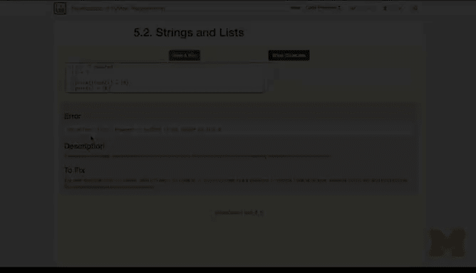
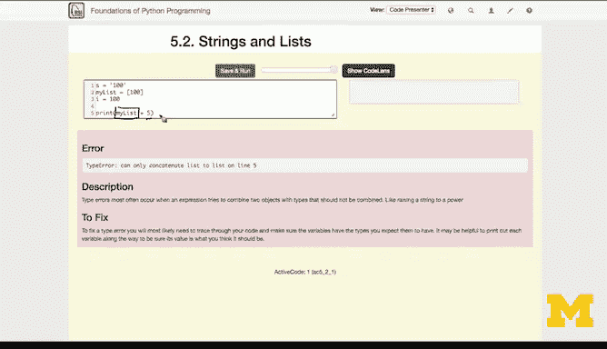

# 密歇根大学《Python3编程》课程1｜第33课：列表操作 📋


在本节课中，我们将要学习Python中的一种新数据类型——列表。我们将了解列表是什么，如何创建列表，以及它与字符串、整数等其他数据类型的区别。



---

## 列表是什么？🤔

上一节我们介绍了字符串，它是一种字符序列。本节中我们来看看列表。

列表是Python的一种新类型，它是**任何类型值**的序列，这些值可以包括其他字符串或列表。

## 如何创建列表？🛠️

列表通过使用方括号来创建。我通过使用左方括号开始创建一个列表，然后用逗号分隔我的内容。

以下是创建一个列表的示例：

```python
my_list = ['1', 2, '3']
```

在这个例子中：
*   第一个元素是一个字符串 `'1'`。
*   第二个元素是一个整数 `2`。
*   第三个元素是另一个字符串 `'3'`。

当我打印出我的列表时，我会得到我放入列表中的项目。

## 列表的顺序与长度 📏

就像字符串一样，列表具有顺序和长度。

对于列表 `my_list = ['1', 2, '3']`：
*   它实际上有三个项目。
*   第一个项目是字符串 `'1'`。
*   第二个项目是整数 `2`。
*   第三个项目是字符串 `'3'`。
*   每个项目之间用逗号分隔。

因此，这个列表的长度是3。

## 更多列表示例 📝

以下是其他一些列表的例子：

*   **空列表**：就像我可以有空字符串一样，我也可以有空列表。这是一个长度为0的列表。
    ```python
    empty_list = []
    ```

*   **单元素列表**：我的列表是一个包含一个项目的列表，这个项目是整数100。
    ```python
    my_list = [100]
    ```

## 列表与其他类型的区别 ⚠️

现在，就像字符串一样，`my_list = [100]` 与创建一个整数 `i = 100` 是非常不同的。

即使它们在我们看来相似，但对Python来说，它们是完全不同的。

进一步说，如果我让 `s` 成为字符串 `'100'`，那么这三者是完全不同的东西：
*   `s` 是一个**字符串**。
*   `my_list` 是一个**列表**。
*   `i` 是一个**整数**。

因此，如果我尝试做类似 `my_list + 5` 的操作，我会得到一个运行时错误，提示我们只能将列表与其他列表连接起来。

因为 `my_list` 是一个列表，我们唯一能与之相加的东西是另一个列表，这将在后面的课程中讨论。

---



本节课中我们一起学习了Python列表的基础知识：列表是任意类型元素的序列，使用方括号 `[]` 创建，具有顺序和长度，并且与字符串、整数等是截然不同的数据类型。理解这些区别对于避免程序错误至关重要。