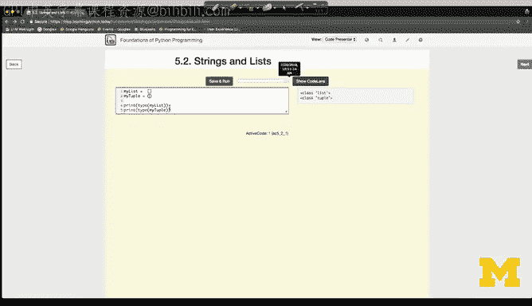

# Python 3 编程课程（第34课）：元组（Tuples）📚


在本节课中，我们将要学习Python中的第三种序列类型：元组（Tuple）。我们将了解元组的基本概念、如何创建元组，以及它与之前学过的列表（List）之间的关键区别。


---

## 序列类型回顾

上一节我们介绍了字符串和列表这两种序列类型。本节中我们来看看第三种序列：元组。

我们说过要介绍三种序列。我们已经完成了字符串和列表的学习。但我要相对快速地介绍的第三种序列是元组。

---

## 什么是元组？🤔

元组与列表非常相似，但有一个关键区别：元组是不可变的（immutable）。这意味着元组在创建之后，其内容不能被改变。我们将在后续课程中更详细地讨论可变性。现在，我们主要关注如何创建元组。

**核心概念**：元组的不可变性意味着创建后无法修改其元素。

---

## 如何创建元组

以下是创建元组的基本方法。

### 创建多元素元组

要创建一个包含三个项目的元组，我可以这样做：

```python
my_tuple = ('1', 2, '3')
```

这里，我创建了一个列表，包含三个项目。要创建一个包含三个项目的元组，我会做非常类似的事情。我会写 `my_tuple =`。基本上，我会采用几乎相同的语法，只是将方括号 `[]` 替换为圆括号 `()`。第一个项目是字符串 `'1'`，第二个项目是整数 `2`，第三个项目是字符串 `'3'`。我必须用右括号来标识元组的结束。

现在，如果我打印出 `my_tuple` 的类型并运行代码，我会看到 `my_list` 是列表类型，而 `my_tuple` 是元组类型。

```python
print(type(my_tuple))  # 输出: <class 'tuple'>
```

在大多数情况下，创建元组时，你可以使用与创建列表相同的语法，只需将方括号替换为圆括号即可。

---

### 创建单元素元组的特殊情况

创建元组与创建列表有少数例外情况，略有不同。

假设我有一个列表，其唯一项目是 `100`。我也想创建一个只包含一个项目 `100` 的元组。

```python
my_tuple = (100)
```

当Python看到这个表达式时，它实际上认为这是一个整数。所以当我运行代码时，我会看到 `my_tuple` 或者说这个表达式实际上创建了一个值为 `100` 的整数。这是因为Python在这里有点困惑，因为它认为我把 `100` 放在括号里是为了改变运算顺序。所以它认为我的意思是创建一个整数。

为了明确表示我想创建元组 `(100)`，我只需要添加一个额外的逗号。

```python
my_tuple = (100,)
```

添加了这个额外的逗号后，如果我重新运行代码，就会看到 `my_tuple` 再次成为一个元组。

---

### 创建空元组

如果我想创建一个零项目的元组，就像我可以创建一个零项目的列表一样，那么我只需写一对空的圆括号。

```python
my_tuple = ()
```

你会看到 `my_tuple` 仍然是一个元组。

---

## 总结



本节课中我们一起学习了Python的元组。我们了解到元组是一种与列表相似的序列，但它是不可变的，创建后无法更改。我们学习了使用圆括号 `()` 创建元组，并特别说明了创建单元素元组时需要添加逗号 `(item,)`，而创建空元组则直接使用 `()`。下一节课再见。