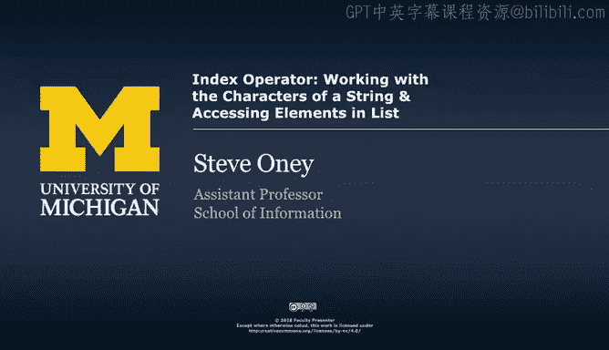
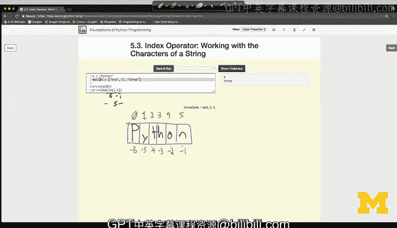

# 课程1：Python 3编程 - P35：索引运算符 📍




在本节课中，我们将要学习Python中一个非常基础且重要的概念：索引运算符。通过索引，我们可以访问序列（如字符串、列表、元组）中的特定元素。

## 概述

序列，如字符串、列表或元组，是有序的集合。这意味着它们有第一个项目、第二个项目、第三个项目，依此类推。索引允许我们访问序列中的特定元素。

## 什么是索引？

索引是一种通过位置来访问序列中单个元素的方法。在Python中，我们使用方括号 `[]` 来执行索引操作。

### 零基索引

Python使用**零基索引**。这意味着序列中的第一个元素的索引是 `0`，第二个是 `1`，第三个是 `2`，以此类推。

**公式**：`sequence[0]` 访问第一个元素。

### 为什么是零基索引？

Python的创始人曾幽默地解释过这一点。从技术角度看，零基索引在编程中非常普遍，一旦习惯，它会带来很多便利。

## 字符串索引示例

假设我们有一个字符串 `S`，其值为 `"Python"`。

```python
S = "Python"
```

如果我们想获取整个字符串，可以直接打印 `S`。但如果我们只关心第一个字符，就需要使用索引。

以下是获取字符串中特定字符的方法：

*   `S[0]`：获取第一个字符 `'P'`。
*   `S[1]`：获取第二个字符 `'Y'`。
*   `S[2]`：获取第三个字符 `'T'`。

## 列表索引示例

索引同样适用于列表。假设我们有一个列表 `my_list`。

```python
my_list = ["one", 2, "three"]
```

以下是获取列表中特定项目的方法：

*   `my_list[0]`：获取第一个项目 `"one"`。
*   `my_list[1]`：获取第二个项目 `2`。
*   `my_list[2]`：获取第三个项目 `"three"`。

## 获取序列长度

有时我们需要知道一个序列包含多少个元素（字符或项目）。我们可以使用 `len()` 函数。

**公式**：`len(sequence)` 返回序列的长度。

例如：
*   `len(S)` 返回 `6`，因为字符串 `"Python"` 有6个字符。
*   `len(my_list)` 返回 `3`，因为列表中有3个项目。

## 访问序列的最后一个元素

上一节我们介绍了如何使用正向索引访问元素，本节中我们来看看如何方便地访问序列末尾的元素。

要获取最后一个元素，一个直接的想法是使用 `序列[长度 - 1]`，因为索引从0开始。

例如，获取 `S` 的最后一个字符：`S[len(S) - 1]`。

然而，Python提供了一种更简洁的方式：**负索引**。

### 负索引

负索引允许我们从序列的末尾开始向前计数。

以下是使用负索引访问 `S` 中元素的方法：

*   `S[-1]`：获取最后一个字符 `'n'`（等同于 `S[len(S)-1]`）。
*   `S[-2]`：获取倒数第二个字符 `'o'`。
*   `S[-3]`：获取倒数第三个字符 `'h'`。

负索引同样适用于列表：
*   `my_list[-1]`：获取列表的最后一个项目 `"three"`。

## 总结



本节课中我们一起学习了Python中的索引运算符。我们了解了如何使用零基索引和方括号 `[]` 来访问字符串和列表中的特定元素。我们还学习了如何使用 `len()` 函数获取序列的长度，以及如何使用方便的负索引从序列末尾访问元素。掌握索引是处理任何有序数据集合的基础。