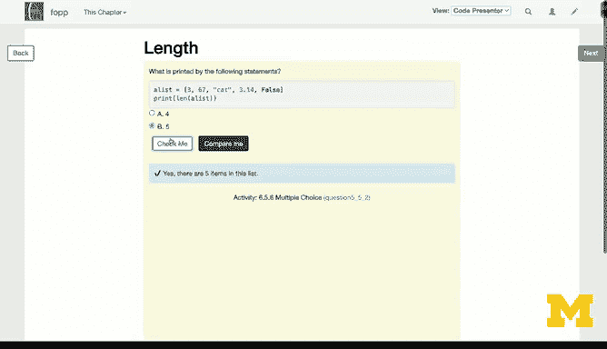

# 课程1：Python基础 - 第36课：获取序列长度 📏


在本节课中，我们将要学习如何使用 `len()` 函数来获取序列（如字符串和列表）的长度，并探讨如何利用长度信息进行索引操作，特别是获取序列的最后一个和中间的元素。


---

## 概述

`len()` 函数用于获取序列（例如字符串或列表）中包含的元素数量。理解序列的长度对于正确地进行索引和切片操作至关重要。

---

## `len()` 函数的基本用法

`len()` 函数作用于一个序列时，会返回该序列中元素的数量。

例如，我们有一个字符串 `"banana"` 被赋值给变量 `fruit`。

```python
fruit = "banana"
```

当我们获取 `len(fruit)` 的值时：

```python
print(len(fruit))
```

运行代码后，我们将得到 `6` 作为 `fruit` 的长度，因为这个字符串包含 6 个字符。

如果我们把字符串改为 `"XYZ"`：

```python
fruit = "XYZ"
print(len(fruit))  # 输出将是 3
```

那么 `len(fruit)` 的结果将是 `3`。

---

## 利用长度获取最后一个元素

在进行索引操作时，我们可能希望获取序列的最后一个元素。

我们可能会尝试通过以下方式获取 `fruit` 的最后一个字符：

```python
fruit = "banana"
sz = len(fruit)  # sz 的值为 6
last = fruit[sz]  # 尝试获取索引为 6 的元素
print(last)
```

我们可能期望打印出最后一个字符 `'a'`。然而，如果运行这段代码，我们会得到一个索引错误，提示“字符串索引超出范围”。

这是因为 `len(fruit)` 返回的是 `6`，但 Python 使用**零基索引**。这意味着第一个字符的索引是 `0`，最后一个字符的索引是 `5`，而不是长度 `6`。

因此，为了正确获取最后一个字符，我们应该这样做：

```python
fruit = "banana"
sz = len(fruit)  # sz = 6
last = fruit[sz - 1]  # 索引为 5
print(last)  # 输出 'a'
```

在实际编码中，我们通常不会创建一个单独的变量来存储长度，而是直接写成：

```python
last = fruit[len(fruit) - 1]
```

或者，更好的方法是使用**负索引**：

```python
last = fruit[-1]  # 直接获取最后一个元素
```

---

## 获取序列的中间元素

现在，假设我们想获取一个字符串的中间字符。

让我们将 `fruit` 赋值为 `"grape"`，并找出它的中间字符（在这个例子中是 `'a'`）。

```python
fruit = "grape"
```

我们可能会尝试用 `len(fruit) / 2` 来获取中间索引，但这会得到一个浮点数，不适合用作索引。

相反，我们可以使用**整数除法**（`//`）来截断余数，从而得到一个整数索引：

```python
mid_index = len(fruit) // 2  # 长度为5，5 // 2 = 2
mid_char = fruit[mid_index]  # fruit[2] 是 'a'
print(mid_char)  # 输出 'a'
```

整数除法 `//` 将长度除以 2 并丢弃小数部分，为我们提供了有效的整数索引。

---

## `len()` 函数在列表上的应用

`len()` 函数不仅适用于字符串，也适用于列表。

例如，我们有一个名为 `a_list` 的列表：

```python
a_list = ["hello", 3.14, 42]
```

当我们打印 `len(a_list)` 时：

```python
print(len(a_list))  # 输出 3
```

这里需要注意，`len(a_list)` 打印的是**顶层列表**的长度。列表中的第一个元素是一个字符串 `"hello"`，但它只算作列表中的一个项目，无论这个字符串本身有多长。

如果我们想获取列表中第一个字符串（即 `"hello"`）的长度，而不是列表的长度，我们可以这样做：

```python
print(len(a_list[0]))  # 输出 5，因为 "hello" 有5个字符
```

表达式 `a_list[0]` 的值是列表的第一个元素，即字符串 `"hello"`，然后 `len()` 函数计算这个字符串的长度。

---

## 练习题

以下是几个选择题，帮助你巩固理解。

**第一题：以下语句会打印什么？**

```python
s = "Python rocks!"
print(len(s))
```

我们需要计算字符串 `s` 中的字符数量。让我们数一数：P-y-t-h-o-n-空格-r-o-c-k-s-!，一共是 13 个字符吗？仔细核对：P(1), y(2), t(3), h(4), o(5), n(6), 空格(7), r(8), o(9), c(10), k(11), s(12), !(13)。所以正确答案是 **13**。但原视频中数成了12，这里以实际为准。选项 B 是 12，但正确答案应为 13。

**第二题：以下语句会打印什么？**

```python
a_list = [3, "apple", 5.2, "banana", 7]
print(len(a_list))
```

我们需要计算列表 `a_list` 中有多少项。让我们数一下：`3`（第一项），`"apple"`（第二项），`5.2`（第三项），`"banana"`（第四项），`7`（第五项）。所以列表的长度是 **5**。

---

## 总结

本节课中我们一起学习了：
1.  如何使用 `len()` 函数获取字符串和列表等序列的长度。
2.  如何利用序列长度和零基索引的特性，正确获取最后一个元素（使用 `len(seq)-1` 或负索引 `seq[-1]`）。
3.  如何通过整数除法 `//` 获取序列的中间元素。
4.  理解了 `len()` 作用于列表时，计算的是顶层项目的数量，而非嵌套元素的总数。



掌握这些概念是进行有效数据操作和避免常见索引错误的基础。