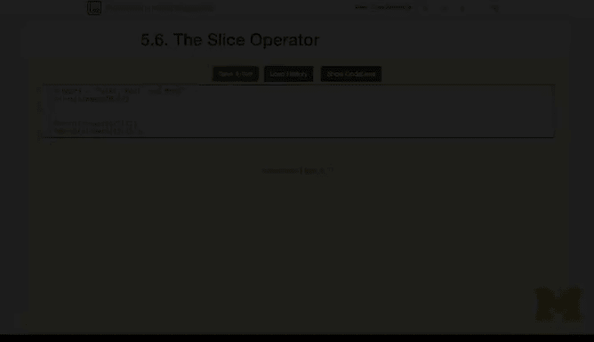
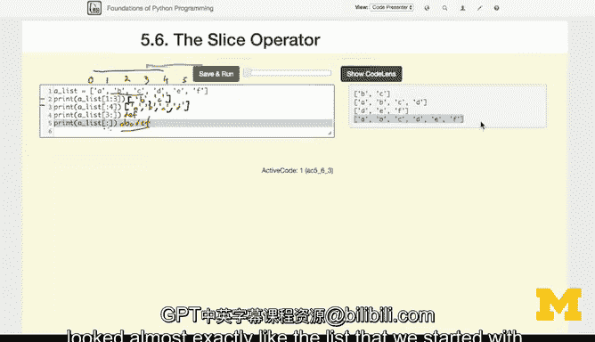

# 37：切片运算符 🍰




在本节课中，我们将要学习Python中一个非常强大的概念——切片运算符。切片允许我们从序列（如字符串、列表或元组）中获取一个子集，而不仅仅是单个元素。

上一节我们介绍了索引，它用于从序列中获取一个特定的项目。本节中我们来看看切片，它用于获取序列中的一个子序列。

## 切片基础

切片运算符的语法与索引类似，但使用冒号 `:` 来指定一个范围。基本语法如下：

```python
sequence[start:end]
```

其中，`start` 是起始索引（包含），`end` 是结束索引（不包含）。这是切片与索引的关键区别：索引返回一个元素，而切片返回一个子序列。

让我们通过一个字符串的例子来理解。假设我们有一个字符串 `singers`：

```python
singers = "Peter, Paul and Mary"
```

字符串中的每个字符，包括空格和标点，都有自己的索引。

以下是索引位置的图示（将索引视为字符之间的“线”）：

```
P e t e r ,   P a u l   a n d   M a r y
0 1 2 3 4 5 6 7 8 9 10 11 12 13 14 15 16 17 18 19 20
```

当我们执行 `singers[0:5]` 时，我们从索引0（`P`之前）开始，到索引5（`,`之前）结束。结果将包含索引0到4的字符，即 `"Peter"`。

## 更多切片示例

为了更好地掌握切片，让我们看几个具体的例子。

以下是几个使用字符串 `singers` 的切片操作及其结果：

*   `singers[7:11]`：从索引7（`P`之前）到索引11（空格之前）。结果是 `"Paul"`。
*   `singers[17:21]`：从索引17（`M`之前）到索引21（字符串末尾之后）。结果是 `"Mary"`。

## 省略起始或结束索引

切片时，我们可以省略起始索引或结束索引，Python会为我们提供合理的默认值。

以下是省略索引的规则：

*   **省略起始索引**：`sequence[:end]` 表示从序列开头切片到 `end`。
*   **省略结束索引**：`sequence[start:]` 表示从 `start` 切片到序列末尾。
*   **两者都省略**：`sequence[:]` 表示复制整个序列。

让我们用字符串 `fruit = "banana"` 来演示：

```python
fruit = "banana"
print(fruit[:3])  # 输出: ban (从开头到索引3)
print(fruit[3:])  # 输出: ana (从索引3到末尾)
print(fruit[:])   # 输出: banana (整个字符串的副本)
```

## 在列表上使用切片

切片不仅适用于字符串，也适用于列表。其工作原理完全相同。

假设我们有一个列表 `a_list`：

```python
a_list = ['A', 'B', 'C', 'D', 'E', 'F']
```

以下是几个列表切片的例子：

*   `a_list[1:3]`：结果是 `['B', 'C']`。
*   `a_list[:4]`：结果是 `['A', 'B', 'C', 'D']`。
*   `a_list[3:]`：结果是 `['D', 'E', 'F']`。
*   `a_list[:]`：结果是 `['A', 'B', 'C', 'D', 'E', 'F']`，这是原列表的一个**副本**。这一点在后续讨论可变性时非常重要。

## 总结



本节课中我们一起学习了Python的切片运算符。我们了解到，切片使用 `sequence[start:end]` 的语法来获取序列的子集，其中包含起始索引，但不包含结束索引。我们可以省略 `start` 或 `end` 来从开头切片或切片到末尾。使用 `sequence[:]` 可以创建整个序列的副本。切片是处理字符串和列表数据时一个极其有用的工具。