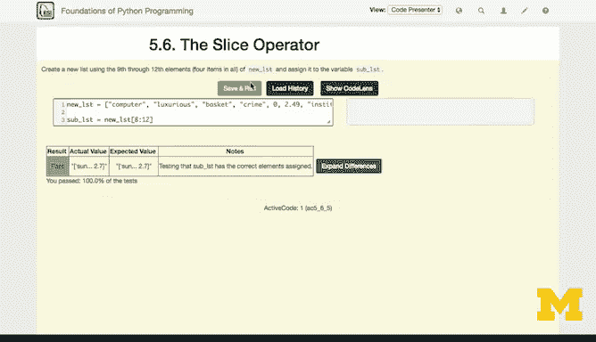
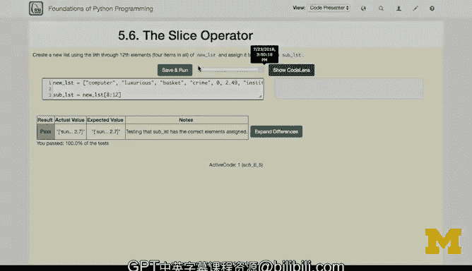

# Python 3 编程（课程1、2）｜第38课：切片与索引示例 🧩


在本节课中，我们将回顾并巩固之前学到的切片与索引知识。切片与索引是Python中处理序列数据（如字符串、列表、元组）的核心操作。我们将通过具体的示例，学习如何准确地对序列进行访问和截取。

---

## 回顾切片与索引的基本概念

上一节我们介绍了序列的基本操作，本节中我们来看看切片与索引在元组上的具体应用。

切片与索引的操作方式在元组上与在字符串、列表或其他序列类型上完全一致。这里我们有一个名为 `Julia` 的元组，它包含几个项目：一些字符串和一些整数。

```python
Julia = ("Julia", "Roberts", 1967, "Duplicity", 2009, "Actress", "Atlanta", "Georgia")
```

在第二行，我们打印 `Julia[2]`。要确定打印结果，首先需要判断这是哪种操作。我们看到 `Julia[2]` 的写法，这表明我们正在进行索引或切片操作。由于没有冒号，所以这是索引操作。

打印 `Julia[2]` 将输出第三项。因为Python使用零基索引，所以索引2对应第三项。`"Julia"` 是索引0，`"Roberts"` 是索引1，`1967` 是索引2。因此，打印结果应为 `1967`。

---

## 切片操作示例

接下来，我们打印 `Julia[2:6]`。为了确定输出内容，我们将在每个项目的边缘标注索引。

索引分布如下：
*   0: `"Julia"`
*   1: `"Roberts"`
*   2: `1967`
*   3: `"Duplicity"`
*   4: `2009`
*   5: `"Actress"`
*   6: `"Atlanta"`
*   7: `"Georgia"`

`Julia[2:6]` 表示从索引2开始，到索引6结束（不包含索引6）。因此，它将包含从 `1967` 到 `"Actress"` 的所有项目。这正是该行代码的预期输出。

---

## 计算序列长度

当我们打印 `len(Julia)` 时，代码会询问元组中有多少项。我们可以看到共有0到7个索引。请注意，字符串 `"Atlanta"` 后面的逗号是字符串本身的一部分，而不是元组定义的分隔符。因此，总共有8项。如果最后一项的索引是7，并且存在索引0，那么长度就是8。

---

## 复杂的拼接操作

这里有一个复杂的拼接操作。首先，我们取 `Julia[:3]`，即从开始到索引3（不包含3）的部分。这将是 `("Julia", "Roberts", 1967)`。

然后，我们将其与字符串 `"Eat Pray Love"` 和整数 `2010` 拼接。接着，再加上 `Julia[5:]`，即从索引5开始到末尾的所有内容：`("Actress", "Atlanta", "Georgia")`。

如果我们在这些部分之间加上逗号，就会得到一个新的元组。这就是运行此代码时期望打印的结果。

让我们测试一下我们的假设。运行代码后，第二行确实打印出 `1967`。第三行确实打印出从 `1967` 到 `"Actress"` 的所有内容。第五行打印出 `8`。第八行打印出我们指定的这个新元组。

---

## 切片与索引练习题

以下是几个与切片和索引相关的问题。

**问题一：**
字符串 `S = "Python rocks"`，打印 `S[3:8]` 的结果是什么？

为了确定输出，首先找到索引3的位置。`"P"`是0，`"y"`是1，`"t"`是2，`"h"`是3。这意味着我们从 `"h"` 开始。切片到索引8（不包含8）。索引8是 `"o"`（在 `"rocks"` 中）。因此，我们将得到从 `"h"` 到 `"r"`（包含）的所有字符，即 `"hon r"`。

**问题二：**
我们有一个包含整数、字符串和其他列表的混合列表。
```python
lst = [3, 5, 7, 8, "hello", [ ], 3.14, False]
```
问题是：打印 `lst[4:]` 的结果是什么？

为了找出答案，首先定位索引4。列表索引如下：
*   0: `3`
*   1: `5`
*   2: `7`
*   3: `8`
*   4: `"hello"`
*   5: `[ ]`
*   6: `3.14`
*   7: `False`

索引4是 `"hello"`。由于冒号后面没有指定结束索引，这意味着我们需要从索引4开始到末尾的所有内容。因此，结果将是 `["hello", [ ], 3.14, False]`。可以验证，选项A是正确答案。

**问题三：**
要求我们使用 `new_list` 的第9到第12项（共四项）创建一个新列表，并将其赋值给变量 `sublist`。

首先，`sublist = new_list[8:12]`。如果我们想要第9项，实际上需要使用索引8。因为我们需要一个子集，所以使用切片操作符冒号。我们想要到第12项，即索引11（因为第13项的索引是12）。所以，`new_list[8:12]` 将包含索引8、9、10、11，正好是四项。运行此代码即可得到正确答案。

---

## 总结



本节课中我们一起学习了切片与索引的核心操作。我们通过元组示例回顾了索引访问、切片截取、长度计算以及序列拼接。随后，我们通过练习题巩固了对字符串和列表进行切片操作的理解。记住，**切片语法 `sequence[start:stop]`** 包含起始索引，不包含结束索引，这是准确进行切片的关键。熟练掌握这些操作是有效处理Python中序列数据的基础。



---
*下节课再见！*