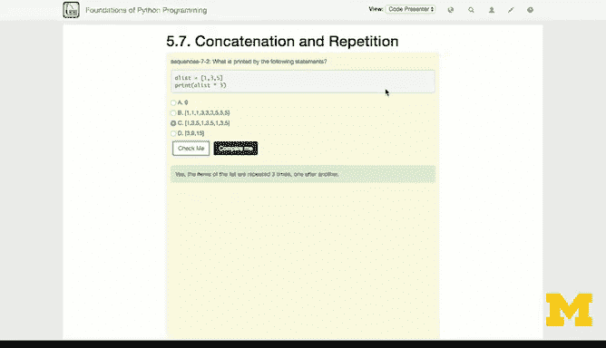

# Python 3 编程（课程1、2）｜第39课：连接与重复操作 🔗🔄


在本节课中，我们将要学习如何通过**连接**与**重复**操作来创建新的序列（如列表、字符串和元组）。这两种方法为我们提供了除直接声明字面量之外，另一种灵活构建序列的方式。

---

## 连接操作

上一节我们介绍了直接声明序列字面量的方法。本节中我们来看看如何使用连接操作。

连接操作将两个序列合并成一个更长的序列。它使用加法运算符 `+` 来实现。

例如，我们有两个列表 `[1, 2]` 和 `[3, 4]`。连接这两个列表的表达式是 `[1, 2] + [3, 4]`。这个表达式的结果是一个新的列表 `[1, 2, 3, 4]`。

**代码示例：**
```python
print([1, 2] + [3, 4])
```
运行上述代码，输出结果为 `[1, 2, 3, 4]`。

我们也可以将一个已存在的列表与一个临时创建的列表进行连接。

**代码示例：**
```python
fruit = ["apple", "orange", "banana", "cherry"]
print(fruit + [6, 7, 8, 9])
```
运行上述代码，输出结果为 `['apple', 'orange', 'banana', 'cherry', 6, 7, 8, 9]`。可以看到，两个列表的内容被合并到了一起。

---

## 重复操作

除了连接，我们还可以对序列进行重复操作。重复操作使用乘法运算符 `*` 来实现。

如果有一个只包含一个元素 `0` 的列表 `[0]`，将其重复四次的操作是 `[0] * 4`。结果会得到一个新列表 `[0, 0, 0, 0]`。

**代码示例：**
```python
print([0] * 4)
```
运行上述代码，输出结果为 `[0, 0, 0, 0]`。

如果列表包含多个元素，例如 `[0, 1]`，那么重复操作会将所有元素作为一个整体进行重复。

**代码示例：**
```python
print([0, 1] * 4)
```
运行上述代码，输出结果为 `[0, 1, 0, 1, 0, 1, 0, 1]`。

---

## 混合使用连接与重复

我们可以将连接和重复操作组合使用。但需要注意的是，它们的运算顺序遵循标准的数学运算法则（先乘除后加减），可以使用括号 `()` 来改变运算顺序。

以下是混合操作的示例：

**代码示例（使用括号）：**
```python
fruit = ["apple", "orange", "banana", "cherry"]
print((fruit + [1]) * 4)
```
这个表达式先进行连接 `fruit + [1]`，得到 `['apple', 'orange', 'banana', 'cherry', 1]`，然后将这个结果重复四次。

如果不使用括号，运算顺序会不同：

**代码示例（不使用括号）：**
```python
fruit = ["apple", "orange", "banana", "cherry"]
print(fruit + [1] * 4)
```
这个表达式会先进行重复 `[1] * 4`，得到 `[1, 1, 1, 1]`，然后再与 `fruit` 列表连接，结果是 `['apple', 'orange', 'banana', 'cherry', 1, 1, 1, 1]`。

---

## 理解操作的本质

连接和重复操作都会**创建新的序列**，而不会修改原始的序列。这是一个非常重要的概念。

让我们通过一个例子来加深理解：

**代码示例：**
```python
fruit = ["apple", "orange", "banana", "cherry"]
num_list = [6, 7]
new_list = fruit + num_list
print(new_list)  # 输出新列表
print(fruit)     # 原始列表未改变
print(num_list)  # 原始列表未改变
```
运行代码后，`new_list` 是 `fruit` 和 `num_list` 内容合并后的新列表，而 `fruit` 和 `num_list` 本身保持不变。

---

## 练习题解析

以下是两个练习题，帮助我们巩固所学知识。

**题目一：**
```python
a_list = [1, 3, 5]
b_list = [2, 4, 6]
print(a_list + b_list)
```
问：输出结果是什么？

以下是选项：
A. `[1, 2, 3, 4, 5, 6]`
B. `[2, 4, 6, 1, 3, 5]`
C. `[1, 3, 5, 2, 4, 6]`

**解析：**
连接操作会先保留 `a_list` 中元素的顺序，然后紧接着保留 `b_list` 中元素的顺序。因此，结果是 `[1, 3, 5, 2, 4, 6]`，对应选项 **C**。

**题目二：**
```python
a_list = [1, 3, 5]
print(a_list * 3)
```
问：输出结果是什么？

以下是选项：
A. `[3, 9, 15]`
B. `[1, 3, 5, 1, 3, 5, 1, 3, 5]`
C. `[1, 1, 1, 3, 3, 3, 5, 5, 5]`

**解析：**
重复操作会将整个列表 `[1, 3, 5]` 重复三次，得到 `[1, 3, 5, 1, 3, 5, 1, 3, 5]`，对应选项 **B**。

---

## 总结

本节课中我们一起学习了 Python 中序列的**连接**与**重复**操作。
*   **连接操作**使用 `+` 运算符，将两个序列合并成一个新序列。
*   **重复操作**使用 `*` 运算符，将序列的内容重复指定次数以创建新序列。
*   这两种操作都**不会改变原始序列**，而是生成新的序列对象。
*   当混合使用时，需要注意运算顺序，可以使用括号 `()` 来控制。



掌握这些操作，能让我们更灵活地动态构建和处理数据序列。