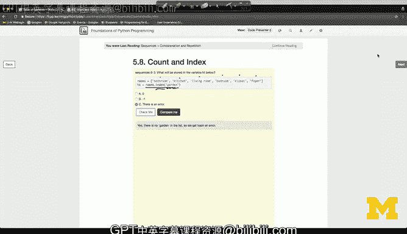

# 40课：序列的计数与索引定位 🔍


在本节课中，我们将学习序列（如字符串和列表）的两个实用方法：`count()` 和 `index()`。我们将了解如何使用它们来统计元素出现的次数以及查找元素的位置。

---

## 序列的通用方法

大多数序列类型都提供了一些通用的方法。调用这些方法的格式是：先写序列的名称，然后是一个点号（`.`），接着是方法名。

上一节我们介绍了序列的基本概念，本节中我们来看看两个具体的方法：`count()` 和 `index()`。

---

## 使用 `count()` 方法进行计数

`count()` 方法用于统计某个特定元素（对于字符串是字符或子串，对于列表是项目）在序列中出现的次数。

调用方式如下：
```python
sequence_name.count(item_to_count)
```

### 在字符串上使用 `count()`

假设我们有一个字符串 `a`：
```python
a = "The elephant is eating an apple."
```
如果我们想知道字符 `'e'` 在这个字符串中出现了多少次，可以这样写：
```python
print(a.count('e'))
```
这段代码会输出 `5`，因为小写字母 `'e'` 出现了五次。需要注意的是，`count()` 是**区分大小写**的，它不会统计大写字母 `'E'`。

除了单个字符，我们还可以统计子串：
```python
print(a.count('ha'))
```
这段代码会输出 `2`，因为子串 `"ha"` 在字符串中出现了两次（在 `"The"` 和 `"apple"` 中）。

### 在列表上使用 `count()`

`count()` 方法同样适用于列表。考虑以下列表：
```python
z = [1, 2, 3, 4, 'atoms', 4, 'electron', 4, 'electron', 'atoms']
```
以下是使用 `count()` 的例子：

统计字符串 `'4'` 出现的次数：
```python
print(z.count('4'))  # 输出: 0
```
这里输出 `0`，因为列表 `z` 中没有字符串 `'4'`，只有整数 `4`。

统计整数 `4` 出现的次数：
```python
print(z.count(4))    # 输出: 3
```
这里输出 `3`，因为整数 `4` 在列表中出现了三次。

一个需要注意的情况是，当在列表中搜索字符 `'a'` 时：
```python
print(z.count('a'))  # 输出: 0
```
即使 `'a'` 作为字符出现在 `'atoms'` 中，`count()` 方法也只会寻找**完全等于** `'a'` 的列表项，而不会在项的内部进行搜索。因此结果为 `0`。

统计字符串 `'electron'` 出现的次数：
```python
print(z.count('electron'))  # 输出: 2
```
这里输出 `2`，因为 `'electron'` 作为独立的项在列表 `z` 中出现了两次。

---

## 使用 `index()` 方法进行定位

`index()` 方法用于查找某个元素在序列中**第一次**出现的位置（索引）。如果元素不存在，则会引发错误。

调用方式如下：
```python
sequence_name.index(item_to_find)
```

### 在字符串上使用 `index()`

假设我们有一个字符串：
```python
music = "pull out your music and dancing can begin"
```
查找字符 `'m'` 第一次出现的位置：
```python
print(music.index('m'))  # 输出: 14
```
索引从 `0` 开始计数，所以第一个 `'m'` 出现在索引 `14` 的位置。

查找子串 `'your'` 第一次出现的位置：
```python
print(music.index('your'))  # 输出: 9
```
`'your'` 从索引 `9` 开始。

### 在列表上使用 `index()`

`index()` 方法也适用于列表。考虑以下列表：
```python
bio = [['metatarsal', 'arch'], ['phalanx', 'femur'], [], [43, 44, 45]]
```
以下是使用 `index()` 的例子：

查找子列表 `['metatarsal', 'arch']` 的位置：
```python
print(bio.index(['metatarsal', 'arch']))  # 输出: 0
```
该子列表是列表 `bio` 的第一个元素，索引为 `0`。

查找空列表 `[]` 的位置：
```python
print(bio.index([]))  # 输出: 2
```
空列表是 `bio` 的第三个元素，索引为 `2`。

查找整数 `43` 的位置：
```python
print(bio.index(43))  # 输出: 3
```
整数 `43` 位于 `bio[3]` 这个子列表中，但 `index()` 只搜索顶层元素。因此，它会搜索 `bio` 中是否有等于 `43` 的项。由于 `bio[3]` 是一个列表 `[43, 44, 45]`，而不是整数 `43`，所以**这里会引发一个错误**。正确的做法是先在子列表中查找。

**重要提示**：如果搜索的元素不在序列中，`index()` 会引发 `ValueError` 运行时错误。
```python
seasons = ['winter', 'spring', 'summer', 'fall']
print(seasons.index('autumn'))  # 会引发 ValueError，因为 'autumn' 不在列表中
```

---

## 练习题解析

为了巩固理解，我们来看几个练习题。

**问题一**：以下代码中，变量 `ty` 的值是什么？
```python
ty = "QU Welcome to week two!".index('we')
```
我们需要在字符串 `"QU Welcome to week two!"` 中查找子串 `'we'` 第一次出现的起始索引。子串 `'we'` 出现在 `"Welcome"`（索引5）和 `"week"`（索引14）中。`index()` 返回第一个匹配的位置，所以结果是 `5`。

**问题二**：以下代码中，变量 `ty` 的值是什么？
```python
ty = "QU Welcome to week two!".count('we')
```
我们需要统计子串 `'we'` 出现的次数。它在 `"Welcome"`（索引5）和 `"week"`（索引14）中各出现一次。注意，`"two!"` 中的 `'We'` 以大写 `W` 开头，由于区分大小写，不会被计入。因此结果是 `2`。

**问题三**：以下代码中，变量 `ht` 的值是什么？
```python
rooms = [['bedroom', 'closet'], ['kitchen', 'bathroom'], ['living', 'dining']]
ht = rooms.index('garden')
```
我们需要在列表 `rooms` 中查找字符串 `'garden'`。`rooms` 中的元素都是子列表，没有一个是字符串 `'garden'`。因此，`index()` 方法会引发 `ValueError` 错误。

---

## 总结

本节课中我们一起学习了序列的两个核心方法：
1.  **`count(item)`**：用于统计特定元素在序列中出现的次数。它对字符串和列表都有效，并且区分大小写。
2.  **`index(item)`**：用于查找特定元素在序列中第一次出现的索引位置。如果元素不存在，则会引发错误。



理解这两个方法能帮助你更有效地处理和查询数据。记住，`count()` 关心的是“有多少个”，而 `index()` 关心的是“第一个在哪里”。