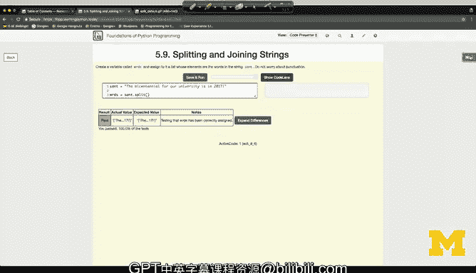

# 41：字符串的`split`与`join`方法 🧩


在本节课中，我们将要学习字符串操作中两个非常实用的方法：`split`（分割）和`join`（合并）。它们能帮助我们在字符串和列表之间进行灵活的转换。

---

## 概述 📋

`split`和`join`是作用于字符串和列表的两个方法。简单来说，`split`方法能将一个字符串“切分”成多个部分，并存入一个列表；而`join`方法则相反，它能将一个列表中的多个字符串“粘合”成一个完整的字符串。掌握它们对于处理文本数据至关重要。

---

## `split`方法：将字符串分割成列表 ✂️

`split`方法接收一个字符串，并将其转换为该字符串的子字符串列表。

它的工作原理是：当调用`split()`方法且不传入任何参数时，它会查找字符串中的所有空格，并沿着这些空格将字符串“切割”开。最终，原始字符串被分割成多个单词，并作为一个列表返回。

**核心概念公式**：
```
list_of_words = original_string.split()
```

### 代码示例

让我们通过代码来理解。假设我们有一个字符串：

```python
song = "the rain in Spain"
words = song.split()
print(words)
```

执行这段代码后，`words`变量将成为一个包含四个元素的列表：`['the', 'rain', 'in', 'Spain']`。可以看到，`split()`方法自动去除了单词之间的空格。

---

### 使用参数进行分割

`split`方法也可以接收一个参数，用来指定分割的依据。例如，如果我们想根据字母`'e'`来分割字符串：

```python
result = "leaders and best".split('e')
print(result)
```

执行后，我们会得到列表：`['l', 'ad', 'rs and b', 'st']`。方法会找到字符串中所有的`'e'`，并在这些位置进行分割。

再来看一个例子，用`'ai'`分割：

```python
song = "the rain in Spain"
result = song.split('ai')
print(result)
```

输出将是：`['the r', 'n in Sp', 'n']`。

---

## `join`方法：将列表合并成字符串 🧷

`join`方法是`split`的逆操作。它接收一个字符串列表，并使用指定的“胶水”（一个字符串）将它们连接成一个长字符串。

**核心概念公式**：
```
joined_string = “glue”.join(list_of_strings)
```

### 代码示例

假设我们有一个颜色列表：

```python
words = ['red', 'blue', 'green']
glue = ';'
s = glue.join(words)
print(s)
```

运行后，变量`s`的值将是字符串`"red;blue;green"`。分号`;`作为“胶水”被插入到了每个列表元素之间。

---

### 重要注意事项

调用`join`方法不会改变原始列表本身。在上面的例子之后，如果我们打印`words`列表，它仍然是`['red', 'blue', 'green']`。

“胶水”可以是任何字符串，包括多字符或空字符串：

```python
# 使用“***”作为胶水
s = '***'.join(words)  # 结果：'red***blue***green'

# 使用空字符串作为胶水
s = ''.join(words)     # 结果：'redbluegreen'
```

---

## 实践练习 🧪

上一节我们介绍了`split`和`join`的基本用法，本节中我们来看看如何应用它们解决问题。

以下是两个练习题及其解答思路：

**问题一**：将字符串`string1`分割成单词列表，并赋值给变量`output`。

**解答**：我们使用不带参数的`split()`方法，它会默认按空格分割。
```python
output = string1.split()
```

**问题二**：将句子字符串`sent`分割成单词列表，并赋值给变量`words`（无需处理标点符号）。

**解答**：同样使用`split()`方法。
```python
words = sent.split()
```

---

## 总结 🎯

本节课中我们一起学习了字符串处理的两个核心方法：
1.  **`split()`方法**：用于将字符串按特定分隔符（默认为空格）分割成列表。
2.  **`join()`方法**：用于使用指定的“胶水”字符串将一个字符串列表合并成一个字符串。



这两个方法在文本处理和数据清洗中会反复用到，是Python编程中非常基础和强大的工具。理解并熟练运用它们，将为后续更复杂的学习打下坚实基础。