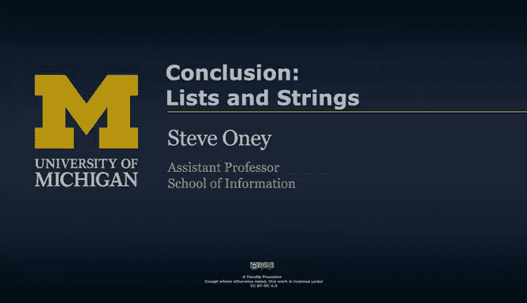

# 42：列表与字符串总结 📚

在本节课中，我们将对Python中两个核心的序列类型——列表和字符串——进行总结。它们极大地扩展了我们作为Python程序员的能力，因为程序中的许多数据都可以用它们来表示。

## 概述

列表和字符串是Python中处理数据集合的基础。理解它们的特性和操作方法，是构建更复杂程序的关键。


## 列表与字符串的核心概念

列表和字符串都是**序列**，这意味着它们是由一系列元素按顺序排列而成的。



*   **列表** 是一个**可变**的序列，可以包含不同类型的元素。它用方括号 `[]` 表示。
    ```python
    my_list = [1, 'hello', 3.14, True]
    ```

*   **字符串** 是一个**不可变**的序列，元素是字符。它用单引号 `''` 或双引号 `""` 表示。
    ```python
    my_string = "Hello Python"
    ```

## 共同操作

由于都是序列，列表和字符串支持许多相同的操作。

以下是它们共有的关键操作：

*   **索引**：使用 `序列[索引]` 访问单个元素。Python使用**从0开始的索引**。
    ```python
    my_list[0]   # 获取列表第一个元素
    my_string[1] # 获取字符串第二个字符
    ```

*   **切片**：使用 `序列[起始:结束]` 获取子序列。切片范围包含起始索引，但不包含结束索引。
    ```python
    my_list[1:3]   # 获取列表索引1和2的元素
    my_string[0:5] # 获取字符串前5个字符
    ```

*   **长度**：使用 `len()` 函数获取序列包含的元素个数。
    ```python
    len(my_list)   # 返回列表长度
    len(my_string) # 返回字符串长度
    ```

*   **遍历**：使用 `for` 循环遍历序列中的每个元素。
    ```python
    for item in my_list:
        print(item)
    for char in my_string:
        print(char)
    ```

*   **成员检查**：使用 `in` 关键字检查一个元素是否存在于序列中。
    ```python
    if 'hello' in my_list:
        print("Found!")
    if 'P' in my_string:
        print("Letter P is in the string.")
    ```

## 主要区别

上一节我们介绍了它们的共同点，本节中我们来看看它们的关键区别。最主要的区别在于**可变性**。

*   **列表是可变的**：创建后可以修改其内容。
    *   **修改元素**：`my_list[1] = 'world'`
    *   **添加元素**：`my_list.append('new_item')`
    *   **删除元素**：`del my_list[0]` 或 `my_list.remove('hello')`

*   **字符串是不可变的**：创建后无法修改。任何看似修改的操作，实际上都是创建了一个新的字符串。
    ```python
    # 这是错误的，会导致错误
    # my_string[0] = 'J'

    # 正确做法是创建新字符串
    new_string = 'J' + my_string[1:]
    ```

## 关于零基索引的一个笑话

让我们用一个与零基索引相关的笑话来结束本课。

你可能听过“为什么6害怕7？因为7 8 9（7吃了9）”。

但你知道为什么在0和3进行了一场“谁是最伟大的数字”的比赛后，他们给3和0都颁了奖吗？

因为0， 1， 2（零赢了）。

## 总结


本节课中我们一起学习了Python中列表和字符串的总结。我们回顾了它们作为序列的共同特性，如索引、切片和遍历，并重点区分了列表的可变性与字符串的不可变性。掌握这些基础序列类型，为你处理更复杂的数据结构打下了坚实的基础。

我们下节课再见。