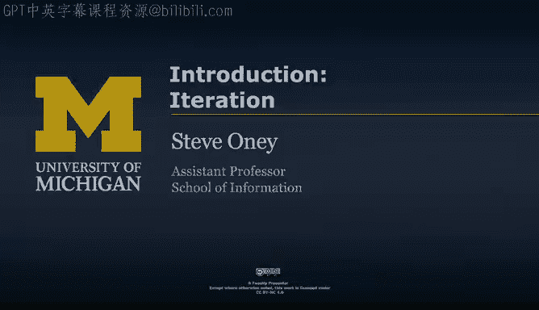

# Python 3 编程（课程 1、2）｜第 43 课：迭代导论 🔄

在本节课中，我们将学习如何通过循环来迭代序列，从而对序列进行更多操作。上一节我们介绍了列表和字符串等序列类型。本节中，我们来看看如何遍历序列中的每一个元素。

当我们迭代一个序列时，我们可以对该序列中的每个元素执行某些操作。索引允许我们从序列中获取一个特定元素，而迭代则允许我们对序列中的每个元素执行操作。

例如，我们可以通过遍历一个数字列表并将每个数字相加来计算总和。


在本节课结束时，你将学会如何使用 `for` 循环来迭代序列，并了解**累加器模式**。这是一种可以适用于解决多种问题的模式或技巧。

我们将在课程结尾再见。



---

## 什么是迭代？

迭代意味着按顺序访问序列中的每个元素。与使用索引获取单个元素不同，迭代允许我们对每个元素执行操作。

以下是迭代的一个基本示例：

```python
# 假设我们有一个列表
numbers = [1, 2, 3, 4, 5]

# 使用 for 循环迭代
for num in numbers:
    print(num)
```

这段代码会依次打印列表中的每个数字。

---

## 使用 For 循环

`for` 循环是 Python 中用于迭代序列的主要工具。其基本语法是：

```python
for item in sequence:
    # 对 item 执行操作
```

循环会从序列的第一个元素开始，依次将每个元素赋值给变量 `item`，然后执行缩进块中的代码。

---

## 累加器模式

累加器模式是一种常见的编程模式，用于在迭代过程中累积一个值（如总和、乘积或拼接的字符串）。

其核心思想是：
1.  在循环开始前，初始化一个变量（累加器）来保存结果。
2.  在循环体内，更新这个累加器的值。
3.  循环结束后，累加器中存储的就是最终结果。

**公式**可以概括为：
**最终结果 = 初始值 ⊕ 元素₁ ⊕ 元素₂ ⊕ ... ⊕ 元素ₙ**
（其中 ⊕ 代表某种操作，如加法、乘法或字符串连接）。

以下是使用累加器模式计算列表总和的示例：

```python
numbers = [1, 2, 3, 4, 5]
total = 0  # 1. 初始化累加器

for num in numbers:
    total = total + num  # 2. 在循环中更新累加器
    # 等价于 total += num

print(total)  # 3. 循环结束后，total 为 15
```

---

## 迭代的应用

了解了基本循环和累加器模式后，我们来看看它们能解决哪些问题。

以下是迭代的一些常见应用场景：
*   **计算总和或平均值**：遍历数字列表进行累加。
*   **查找最大/最小值**：遍历序列并比较元素。
*   **过滤数据**：根据条件从序列中挑选元素。
*   **转换数据**：对序列中的每个元素应用某种转换。

---

## 总结

本节课我们一起学习了序列迭代的核心概念。我们介绍了如何使用 `for` 循环遍历序列中的元素，并深入探讨了**累加器模式**这一强大的编程技巧。通过初始化一个变量并在循环中不断更新它，我们可以解决求和、拼接、计数等多种问题。记住，迭代是对序列中**每个**元素执行操作的过程，这是自动化处理数据集合的基础。