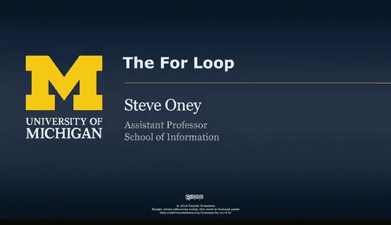
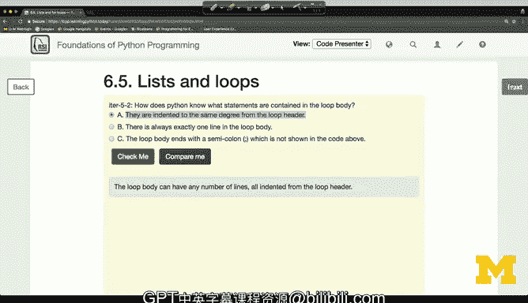

# Python 3 编程（课程1、2）｜第44课：深入理解 for 循环 🔄




在本节课中，我们将要学习 Python 中一个非常重要的控制结构：**for 循环**。我们将了解如何使用 for 循环来遍历序列（如字符串、列表或元组）中的每一个元素，并执行相应的代码块。

---

## 什么是迭代？

上一节我们介绍了序列的概念。本节中我们来看看 **迭代**。

迭代是指为序列中的每一个项目运行一段代码，无论这个序列是字符串、列表还是元组。

为了实现迭代，我们将使用 **for 循环**。这是本课程中我们将要看到的众多控制结构中的第一个。

---

## for 循环的基本结构

为了创建一个用于遍历序列的 for 循环，我们首先使用关键字 `for` 来声明循环。

在 `for` 之后，我们创建一个称为 **循环变量** 的东西。我们可以为循环变量起任何有效的变量名。

声明循环变量后，我们使用关键字 `in`，然后指定我们要遍历的实际序列。

以下是 for 循环的基本语法结构：

```python
for 循环变量 in 序列:
    # 循环体代码块
```

循环体代码块必须通过缩进（使用空格或制表符）来表示它属于这个 for 循环。

---

## for 循环的工作原理

让我们通过一个具体的例子来理解 for 循环是如何工作的。

假设我们有一个包含名字的列表：

```python
for name in ["Joe", "Amy", "Brad", "Angelina", "Zuki", "Thandi", "Paris"]:
    print("Hi", name, "please come to my party on Saturday")
```

以下是这个 for 循环的执行步骤：

1.  **第一次迭代**：循环变量 `name` 被赋值为列表中的第一个元素 `"Joe"`。然后执行循环体内的 `print` 语句，输出：`Hi Joe please come to my party on Saturday`。
2.  **第二次迭代**：`name` 被重新赋值为第二个元素 `"Amy"`，再次执行 `print` 语句。
3.  这个过程会一直重复，直到列表中的所有元素都被遍历一遍。

本质上，Python 会为序列中的 **每一个** 项目运行一次循环体内的代码。每次运行时，循环变量都会被设置为当前的项目。

---

## 遍历不同类型的序列

for 循环不仅可以遍历列表，还可以遍历任何类型的序列，包括字符串和元组。

### 遍历字符串

当我们遍历一个字符串时，循环变量会依次被赋值为字符串中的每一个字符。

```python
for char in "go spot go":
    print(char)
```
执行这段代码会依次打印出字符串中的每个字符：`g`、`o`、` `（空格）、`s`、`p`、`o`、`t`、` `、`g`、`o`。由于 `print` 默认换行，这些字符会垂直打印出来。

### 遍历列表切片

我们也可以遍历序列的一个切片（部分）。

```python
s = "Python rocks"
for ch in s[3:8]:
    print("hello")
```
这里，我们遍历字符串 `s` 从索引 3 到 8（不包括8）的切片。这个切片包含 5 个字符，因此单词 `"hello"` 会被打印 **5** 次。

---

## 循环变量的使用

循环体代码块 **可以** 引用循环变量，但并非必须。

### 不引用循环变量

有时，我们只是单纯地想要重复执行某段代码固定的次数，而不关心序列中的具体值。

例如，使用 `turtle` 模块画一个正方形：

```python
import turtle
alex = turtle.Turtle()

for i in ["red", "blue", "green", "black"]: # 循环4次
    alex.forward(50)
    alex.left(90)
```
在这个例子中，循环变量 `i`（或 `color`）在循环体内从未被使用。我们只是利用了 for 循环会执行 4 次这个事实来画出正方形的四条边。所有边都是默认的黑色。

### 引用循环变量

如果我们引用了循环变量，那么每次迭代时，引用的值都会改变。

```python
import turtle
alex = turtle.Turtle()

for a_color in ["yellow", "red", "purple", "blue"]:
    alex.color(a_color) # 引用循环变量来设置颜色
    alex.forward(50)
    alex.left(90)
```
这次，我们在循环体内通过 `alex.color(a_color)` 引用了循环变量 `a_color`。因此，正方形的四条边会依次被画成黄色、红色、紫色和蓝色。

---

## 关键概念与常见问题

以下是关于 for 循环的一些核心要点和常见问题：

**Python 如何识别循环体？**
Python 通过检查语句的 **缩进** 来判断它们是否属于循环体。所有与 `for` 语句具有相同缩进级别的后续行，直到缩进结束，都被视为循环体的一部分。

**循环体可以有多行代码吗？**
当然可以。循环体可以包含任意多行代码，只要它们保持相同的缩进级别。

**如何确定循环会执行多少次？**
for 循环的执行次数等于它所遍历的序列的长度（或切片后的长度）。例如，遍历一个包含 9 个元素的列表，循环体就会执行 9 次。

---

## 总结

本节课中我们一起学习了 **for 循环**。

我们了解到 for 循环是用于遍历序列（字符串、列表、元组）中每个元素并执行代码块的核心工具。其基本结构是 `for 变量 in 序列:`，循环体通过缩进来定义。循环变量在每次迭代中会被自动更新为序列中的当前元素。我们可以选择在循环体内使用或不使用这个变量，这为我们编写重复性任务提供了极大的灵活性。



掌握 for 循环是迈向自动化处理和高效编程的重要一步。