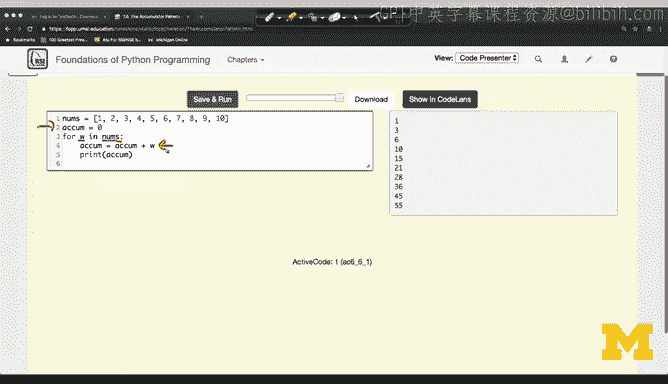

# 课程45：累加器模式 🧮


在本节课中，我们将要学习编程中一个非常常见的模式——累加器模式。这个模式用于遍历列表（或其他序列）中的元素，并将它们累积成一个单一的值，例如列表中所有数字的总和。

## 累加器模式概述

累加器模式的核心思想是：初始化一个变量（累加器），然后遍历序列，在每次迭代中更新这个累加器的值。遍历结束后，累加器中就存储了我们最终想要的结果。

## 模式的工作原理

上一节我们介绍了累加器模式的基本概念，本节中我们来看看它的具体实现步骤。

以下是累加器模式的标准步骤：

1.  **初始化累加器变量**：通常将其设置为一个起始值，例如 `0`。
2.  **遍历序列**：使用一个迭代变量（如 `for` 循环中的变量）来遍历序列中的每一个元素。
3.  **更新累加器**：在每次迭代中，根据当前元素更新累加器的值。
4.  **获取结果**：遍历全部完成后，累加器变量中存储的就是最终结果。

## 代码示例与分析

让我们通过一个具体的代码例子来理解这个过程。下面的代码计算了数字1到10的总和。

```python
nums = [1, 2, 3, 4, 5, 6, 7, 8, 9, 10]
accum = 0
for w in nums:
    accum = accum + w
print(accum)
```

*   **第1行**：定义了一个列表 `nums`，其中包含数字1到10。
*   **第2行**：初始化累加器变量 `accum`，并将其值设为 `0`。
*   **第3行**：开始 `for` 循环。迭代变量 `w` 会依次绑定到列表 `nums` 中的每一个元素。
*   **第4行**：这是模式的核心。在每次循环中，我们执行更新操作 `accum = accum + w`。这意味着将当前元素 `w` 的值加到累加器 `accum` 当前的值上。
*   **第5行**：循环结束后，打印累加器 `accum` 的最终值，即列表所有数字的总和。

运行这段代码，输出结果是 `55`，这正是1到10的总和。

## 深入理解执行过程

为了更清晰地看到累加器在每一步是如何变化的，我们可以模拟代码的执行流程：

1.  初始时，`accum = 0`。
2.  第一次循环，`w = 1`。执行 `accum = 0 + 1`，所以 `accum` 变为 `1`。
3.  第二次循环，`w = 2`。执行 `accum = 1 + 2`，所以 `accum` 变为 `3`。
4.  第三次循环，`w = 3`。执行 `accum = 3 + 3`，所以 `accum` 变为 `6`。
5.  以此类推，`accum` 的值会像滚雪球一样不断增加，直到遍历完所有元素，最终得到总和 `55`。

这个过程形象地展示了“累积”的含义：累加器像一个跑步计分牌，每经过一个数字，就把它的值加到总分上。

## 一个小挑战

现在，请你思考一个小问题：如果我们将 `print(accum)` 语句缩进，使其成为 `for` 循环内部的一部分，输出结果会有什么不同？

```python
nums = [1, 2, 3, 4, 5, 6, 7, 8, 9, 10]
accum = 0
for w in nums:
    accum = accum + w
    print(accum)  # 注意这行代码现在缩进了
```

运行修改后的代码，你会发现它会打印出每一次更新后的累加器值：
```
1
3
6
10
15
21
28
36
45
55
```
这清晰地展示了累加器在每次迭代后的“运行总和”，有助于我们调试和理解程序的中间状态。

## 总结

本节课中我们一起学习了累加器模式。我们了解到，这个模式包含四个关键步骤：初始化累加器、遍历序列、在循环中更新累加器、最后获取结果。它是一个基础但极其强大的工具，在本课程后续内容中你会频繁地见到和应用它。记住这个模式，它将帮助你解决许多需要对一系列数据进行汇总计算的问题。



我们下次再见。