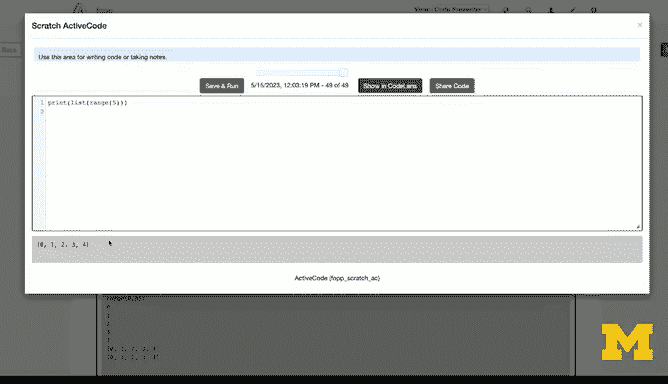
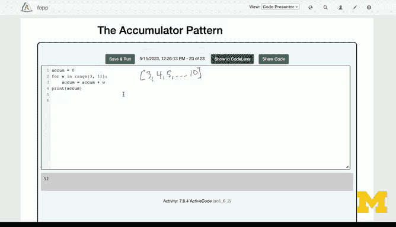

# Python 3 编程（课程1、2）｜第46课：range函数详解 🐍


在本节课中，我们将要学习Python中一个非常实用的内置函数——`range()`函数。它主要用于生成一个数字序列，是循环和迭代操作中的得力助手。

## 概述

上一节我们介绍了如何遍历序列并对每个元素进行操作。本节中我们来看看如何更便捷地生成一个连续的数字序列。

例如，我们想遍历数字0、1、2、3、4，并打印它们。手动列出这些数字虽然可行，但不够高效。

Python提供了一个名为`range`的函数来解决这个问题。你可以指定需要多少个数字，它会从0开始生成相应数量的数字。

`range(5)` 会生成数字0、1、2、3、4。如果使用`range(8)`，则会生成8个数字，即从0到7。

`range`函数始终生成一个序列。这个序列的长度等于你传入的参数值，并且总是从0开始，直到但不包括该参数值。

## range函数的高级用法

除了指定数量，`range`函数还可以指定起始值和结束值。

例如，`range(1, 5)`会生成从1开始，到5结束（不包括5）的序列：1, 2, 3, 4。

你甚至可以指定步长。例如，`range(1, 10, 2)`会生成从1开始，到10结束，步长为2的序列：1, 3, 5, 7, 9。

不过，最常见的用法还是只指定一个参数，表示生成从0开始的N个数字。

## range函数的一个细节

`range`函数并不直接生成一个列表。它生成的是一个“可迭代对象”（iterable），这个对象会在我们使用`for`循环迭代时动态生成数字。

如果你直接打印`range(5)`，得到的不是一个列表`[0, 1, 2, 3, 4]`，而是一个`range`对象。

在大多数情况下，你可以像使用列表一样使用这个`range`对象，例如在`for`循环中：`for i in range(5):`。

如果遇到某些情况，`range`对象的行为不符合你的预期，你可以通过`list()`函数将其转换为一个真正的列表。

以下是转换方法：
```python
my_list = list(range(5))
print(my_list)  # 输出: [0, 1, 2, 3, 4]
```



## 在累加模式中使用range函数

让我们看看`range`函数在累加模式中的应用场景。

假设我们需要计算从0到10（包括10）所有数字的总和，结果是55。

手动输入所有数字非常麻烦。使用`range`函数生成这个序列则方便得多。

`range(11)`会生成从0到10（因为不包括11）的序列，这样我们就能轻松得到总和55。

试想，如果需要计算到30，手动输入所有数字不仅繁琐，还容易出错。而`range`函数可以完美地生成这个序列。

我们也可以指定起始值。例如，`range(1, 11)`会生成数字1到10，总和同样是55。

或者从更晚的数字开始，例如`range(3, 11)`会生成从3到10的序列。这样计算出的总和是52，因为缺少了1和2。

## 总结

本节课中我们一起学习了Python的`range()`函数。

我们了解到：
*   `range(n)` 生成从0到n-1的序列。
*   `range(start, stop)` 生成从`start`到`stop-1`的序列。
*   `range(start, stop, step)` 可以指定步长。
*   `range` 生成的是可迭代对象，必要时可用`list()`转换为列表。
*   它在循环和累加等模式中非常实用，能避免手动输入序列的麻烦。



`range`函数将成为你Python编程生涯中一个非常方便的工具。希望你能熟练运用它。我们下次再见！