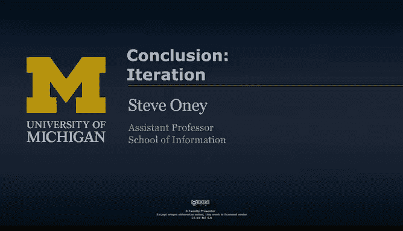

# 课程47：Python 3编程 - 迭代总结 🔄

在本节课中，我们将对之前学习的循环迭代知识进行总结，并理解一个与迭代变量命名相关的编程文化梗。


---



## 概述

到目前为止，我们已经学习了如何使用 `for` 循环来遍历序列中的每一个元素。正如我们已经看到并将继续看到的，这对于解决各种各样的问题至关重要。

## 循环迭代的核心

上一节我们介绍了 `for` 循环的基本用法，本节中我们来对其进行总结。`for` 循环允许我们为序列中的每个项目执行一段代码。

其核心结构可以用以下代码描述：

```python
for item in sequence:
    # 对每个 item 执行的操作
```

## 关于迭代变量命名的实践

以下是关于在循环中命名迭代变量的一些常见实践。

虽然我们鼓励你为迭代变量使用描述性的名称，但许多程序员会有点偷懒，使用单字母变量名，例如 `i`、`j` 或 `x`。

## 团队协作中的小插曲

另外，你可能已经知道，团队合作对程序员来说很重要。事实上，我的团队今天早些时候就关于迭代变量的最佳名称进行了一场辩论。

我赢了。

---

## 总结

本节课中我们一起学习了 `for` 循环迭代的重要性，并了解了迭代变量命名的常见习惯以及团队协作中的一个有趣片段。掌握循环是解决编程问题的关键工具。

下节课再见。