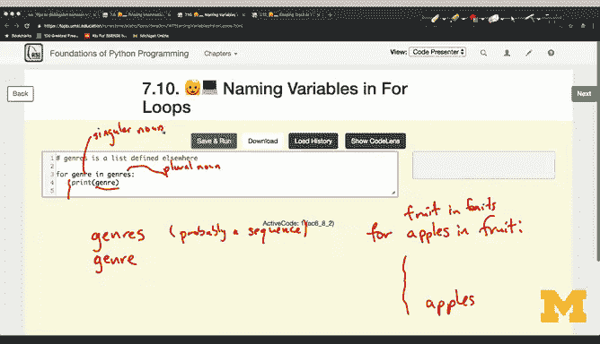

# 课程49：Python 3编程 - 第49课：for循环变量命名规范 🏷️


在本节课中，我们将学习在编写`for`循环时，如何为变量选择清晰、有意义的名称。良好的命名习惯能让代码更易读、更易维护，尤其当你或他人需要回顾代码时。

上一节我们介绍了循环的基本概念，本节中我们来看看如何通过命名规范来提升代码的可读性。

## 概述

程序员在`for`循环中为变量命名时，常会使用过于简单的名称，如`x`和`y`。这会导致代码难以理解。例如，假设`x`是一个在代码上方某处定义的列表变量。

你可能会这样写：
```python
for y in x:
    print(y)
```
这里的问题是，如果你一段时间没看这段代码，或者`x`是在代码上方定义的，你很难立刻明白`x`是什么。名称`x`没有给出任何提示，表明它是一个列表，更不用说它包含什么类型的元素。同样，`for y in x`中的`y`也没有提示`x`中应该包含什么类型的项。

如果是一个很简单的`for`循环，你或许还能勉强理解，但为了代码的清晰度，使用更有意义的名称会非常有帮助。

## 核心命名建议

以下是一个实用的命名建议，可以帮助你避免混淆。

**核心规则**：
*   为指向列表（或任何序列）的变量使用**复数名词**作为名称。
*   为迭代变量（即循环中代表单个元素的变量）使用**单数名词**作为名称。

## 示例解析

让我们通过一个例子来看看这个建议如何应用。

在我的下一个代码窗口中，有一个名为`genres`的变量。因为它以复数形式（以`s`结尾）命名，我预期它是一个序列（比如列表）。

然后，我选择了我的迭代变量。我决定让它成为一个单数名词。更重要的是，这个单数名词与前面的复数名词在语义上是关联的。因此，在一个名为`genres`的列表中，每一项都将是一个`genre`（类型）。

这样，在`for`循环内部的代码中，我将引用这个单数变量`genre`。这会提醒我，它是来自`genres`列表中的一个项目。

这比下面这种做法要好得多：
```python
for apples in fruit:
```
我有时会看到学生把自己搞糊涂。他们有一个包含水果名称的列表`fruit`，而`apples`是列表中的第一个字符串（例如`"apples"`）。他们决定将迭代变量命名为`apples`。

但这在阅读代码时会非常令人困惑。当你读到代码后面几行，看到`apples`时，你可能会想：“哦，`apples`一定是一个包含不同种类苹果的列表之类的。”所以请不要这样做。

正确的写法应该是：
```python
for fruit in fruits:
```
这样就很清晰。

## 总结要点

以下是本节课的核心要点总结：

*   为你的序列（如列表）使用一个**复数名词**。
*   为你的迭代变量使用一个**单数名词**。
*   遵循这个小约定，它将在你编写代码时为你避免大量困惑。

本节课中我们一起学习了如何通过使用复数名词命名序列、单数名词命名迭代变量，来显著提高`for`循环代码的可读性和可维护性。记住这个简单的习惯，它会让你的代码对所有人（包括未来的你）都更加友好。



下次见。