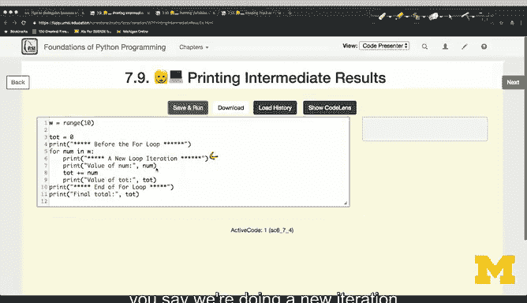

# Python编程入门课程（第50课）：使用打印语句调试程序 🐛


在本节课中，我们将学习一个非常实用的编程技巧：如何通过打印中间结果来理解和调试你的程序。当程序运行结果不符合预期时，这个方法能帮助你清晰地看到每一步发生了什么。

## 概述：为什么需要打印中间结果？

上一节我们介绍了基本的循环和累加器模式。本节中我们来看看，当程序运行结果出乎意料时，如何通过添加打印语句来洞察程序内部的运行状态。

假设我们有一段代码，目的是计算从1到10所有数字的总和。代码使用了累加器模式，但运行后得到的结果是45，而不是预期的55。

```python
total = 0
for num in range(10):
    total += num
print(total)  # 输出 45
```

## 第一步：打印循环变量

为了找出问题所在，我们可以在循环内部添加一个打印语句，输出迭代变量 `num` 在每次循环中的值。

以下是添加打印语句后的代码：

```python
total = 0
for num in range(10):
    print(num)      # 打印当前迭代的num值
    total += num
print(total)
```

运行这段代码，我们会发现 `num` 的值依次是 0, 1, 2, ..., 9。这立刻揭示了问题：`range(10)` 生成的是从0到9的数字，而不是从1到10。这就是总和是45（0到9的和）而不是55（1到10的和）的原因。

## 第二步：打印累加器变量

理解了循环范围后，我们可能还想确认累加过程是否正确。这时，我们可以再添加一个打印语句来输出累加器变量 `total` 在每次循环结束后的值。

以下是同时打印两个变量的代码：

```python
total = 0
for num in range(10):
    print(num)
    total += num
    print(total)    # 打印每次累加后的total值
print(total)
```

运行后，输出会显示每一步的累加过程：
- 初始：`num=0`, `total=0`
- 第一次循环后：`num=1`, `total=1` (0+1)
- 第二次循环后：`num=2`, `total=3` (1+2)
- 以此类推...

这样，我们就能清晰地看到 `total += num` 这行代码是如何工作的：它将 `total` 的旧值与当前的 `num` 值相加，然后将结果存回 `total`。

## 第三步：为打印信息添加描述

当有多个打印语句时，输出的数字可能会让人困惑，不知道哪个数字对应哪个变量。为了使输出更易读，我们可以在打印时添加描述性文本。

以下是带有描述性文本的改进代码：

```python
total = 0
print("循环开始前，total =", total)



for num in range(10):
    print("--- 新的一次迭代 ---")
    print("当前 num 的值是：", num)
    total += num
    print("累加后 total 的值是：", total)

print("最终结果 total =", total)
```

现在，输出结果会像这样：
```
循环开始前，total = 0
--- 新的一次迭代 ---
当前 num 的值是： 0
累加后 total 的值是： 0
--- 新的一次迭代 ---
当前 num 的值是： 1
累加后 total 的值是： 1
...
```

添加描述后，我们可以一目了然地看懂程序的执行流程，大大降低了调试的难度。

## 核心技巧总结

本节课中我们一起学习了如何使用打印语句进行调试：

1.  **定位问题**：当程序输出不符合预期时，在关键步骤插入 `print()` 语句。
2.  **检查变量**：打印出循环变量、条件判断变量或累加器变量的值，观察其变化是否符合逻辑。
3.  **添加描述**：当打印多个值时，使用描述性文本（如 `"变量x的值是："`）让输出信息更清晰。
4.  **由简到繁**：开始时可以只打印关键变量，随着调试深入，逐步增加打印点以获取更全面的信息。

这个简单的技巧是理解程序行为、发现逻辑错误的最直接有效的方法之一，尤其适合初学者掌握。记住，看到程序内部的状态，是掌控它的第一步。