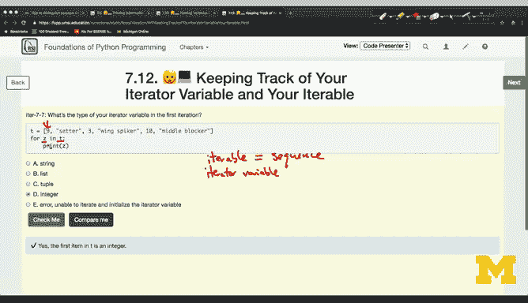

# Python 3 编程（课程1、2）｜第51课：迭代变量与可迭代对象跟踪 🎯


在本节课中，我们将学习如何区分 Python 循环中的两个核心概念：**迭代变量** 与 **可迭代对象**。理解这两者的区别对于正确编写和理解 `for` 循环至关重要。

---

## 概述：迭代中的两个角色

在 `for` 循环中，有两个关键部分：
1.  **可迭代对象**：这是我们要遍历的序列或集合，它位于关键字 `in` 之后。
2.  **迭代变量**：这是在每次循环中被赋值的变量，它位于关键字 `for` 和 `in` 之间。

上一节我们介绍了循环的基本结构，本节中我们来看看如何具体识别这两个部分。

---

## 识别可迭代对象的类型

可迭代对象是循环中实际被遍历的数据。以下是几个例子，帮助我们判断其类型。

**示例 1：列表**
```python
for x in [1, 2, 3]:
    print(x)
```
在这个例子中，可迭代对象是 `[1, 2, 3]`，它是一个**列表**。

**示例 2：字符串**
```python
for char in "hello":
    print(char)
```
这里的可迭代对象是 `"hello"`，它是一个**字符串**。字符串中的每个字符会被依次迭代。

**示例 3：元组**
```python
for item in (4, 5, 6):
    print(item)
```
这里的可迭代对象是 `(4, 5, 6)`。圆括号 `()` 表示这是一个**元组**。

**示例 4：整数（错误示例）**
```python
for num in 18:  # 这会导致错误！
    print(num)
```
这里的可迭代对象是 `18`，它是一个**整数**。整数不是序列，无法被迭代，因此这段代码会引发 `TypeError`。

---

## 识别迭代变量的类型

迭代变量在每次循环中会被绑定到可迭代对象中的一个元素。它的类型取决于当前被迭代出的元素是什么。

以下是判断迭代变量类型的例子：

**示例 1：迭代字符串列表**
```python
t = ["cat", "dog"]
for z in t:
    print(z)  # z 在每次循环中是什么类型？
```
第一次循环时，`z` 被绑定到 `"cat"`，因此 `z` 是一个**字符串**。第二次循环时，`z` 是 `"dog"`，同样是字符串。

**示例 2：迭代数字元组**
```python
for z in (9, 8, 7):
    print(z)  # 在第一次迭代时，z 是什么类型？
```
在第一次迭代时，`z` 被绑定到 `9`，因此 `z` 是一个**整数**。

---

## 核心概念总结

让我们用简单的定义和公式来巩固这两个概念：

*   **可迭代对象**：位于 `in` 关键字之后，是我们要遍历的序列。
    *   **公式表示**：`for item in <iterable>`
*   **迭代变量**：位于 `for` 和 `in` 之间，在每次循环中代表序列中的一个当前元素。
    *   **公式表示**：`for <iterator_variable> in iterable`

**关键区别**：
*   不要混淆两者。**可迭代对象**是你遍历的“整体”（如一个列表）。
*   **迭代变量**是每次循环中代表“单个成员”的临时标签（如列表中的一个元素）。

---

## 总结

本节课中我们一起学习了如何跟踪和区分 Python `for` 循环中的迭代变量与可迭代对象。
*   **可迭代对象**是数据源（如列表、字符串、元组），写在 `in` 后面。
*   **迭代变量**是临时变量，在每次循环中自动被赋予可迭代对象中的一个元素。



理解这个区别能帮助你更清晰地阅读和编写循环代码，避免常见的概念错误。我们下次再见！