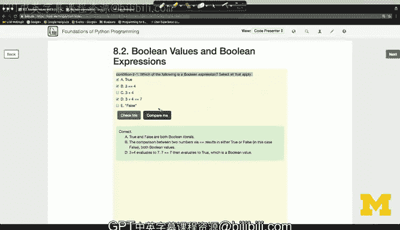

# 密歇根大学《Python3编程》课程1｜第54课：布尔表达式详解 🔍


在本节课中，我们将要学习Python中的一种新数据类型——布尔类型。我们将了解它的用途、如何创建布尔值，以及如何使用比较运算符来生成布尔值。

---

## 概述

到目前为止，我们已经学习了多种Python数据类型。整数用于存储整数，浮点数用于存储小数，字符串用于存储字符序列，列表和元组用于存储其他项目的序列。本节中，我们将学习一种名为“布尔”的新类型。布尔类型非常适合存储真值，即某事物是“真”还是“假”。

---

## 布尔类型简介

布尔类型只有两个可能的值：`True`（真）和 `False`（假）。这与几乎所有其他类型都不同。例如，整数可以是-105或无限个值中的任何一个，但布尔值始终只能是 `True` 或 `False`。

因此，我们几乎从不直接书写布尔字面量，而是通常书写能计算出布尔值的表达式。

我们可以通过书写大写的 `False` 或大写的 `True` 来创建布尔字面量。

```python
print(False)  # 输出：False
print(True)   # 输出：True
```

为了确认它们是布尔类型而非字符串或其他类型，我们可以使用 `type()` 函数。

```python
print(type(True))   # 输出：<class 'bool'>
print(type(False))  # 输出：<class 'bool'>
```

需要注意的是，布尔字面量与字符串完全不同。例如，`True` 是布尔值，而 `"True"` 是一个字符串。

```python
print(type(True))   # 输出：<class 'bool'>
print(type("True")) # 输出：<class 'str'>
```

---

## 比较运算符

上一节我们介绍了布尔类型本身，本节中我们来看看如何通过表达式生成布尔值。我们将从一种称为“比较运算符”的布尔表达式开始。

比较运算符会比较左侧和右侧的值。例如，我们学习的第一个比较运算符是等于运算符 `==`。

整个表达式的值将为 `True`，当且仅当左侧的值等于右侧的值；否则为 `False`。

```python
print(5 == 5)  # 输出：True
print(5 == 6)  # 输出：False
```

除了 `==`，还有其他比较运算符。

以下是常用的比较运算符列表：

*   `==`：等于
*   `!=`：不等于
*   `<`：小于
*   `<=`：小于或等于
*   `>`：大于
*   `>=`：大于或等于

所有这些表达式都期望左侧和右侧各有一个值，整个表达式的值将是一个布尔值。

让我们看一些例子：

```python
print(3 < 4)    # 输出：True
print(4 <= 4)   # 输出：True
print(5 > 6)    # 输出：False
print(7 >= 8)   # 输出：False
```

---

## 区分赋值与比较

关于 `==` 运算符，有一点需要特别注意：它完全不同于单个等号 `=`。

*   `x = 3` 是一个**赋值**语句，它将值 `3` 赋给变量 `x`。
*   `x == 3` 是一个**比较**表达式，它的值是一个布尔值。如果 `x` 等于 `3`，其值为 `True`；否则为 `False`。

我们通过等号的数量来区分赋值和比较：赋值使用一个等号 `=`，比较使用两个等号 `==`。

---

## 总结



本节课中我们一起学习了Python的布尔类型。我们了解到布尔值只有 `True` 和 `False` 两种。我们几乎不直接书写布尔字面量，而是通过比较运算符（如 `==`、`!=`、`<`、`>` 等）来生成布尔值。这些运算符比较左右两边的值，并返回一个布尔结果。最后，我们明确了单个等号 `=` 用于赋值，而双等号 `==` 用于比较。