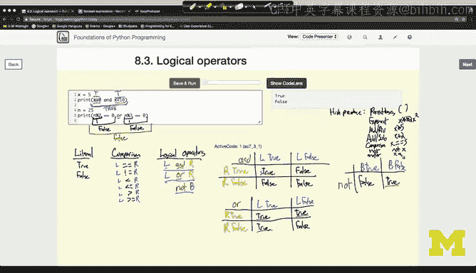

# 密歇根大学《Python3编程》课程1、2｜第55课：逻辑运算符 🧠


在本节课中，我们将要学习Python中的逻辑运算符。逻辑运算符是构建复杂布尔表达式的关键工具，它们允许我们组合多个条件，从而做出更精细的判断。

到目前为止，我们已经见过两种创建布尔值的方式。我们见过字面量表达式，即 `True` 或 `False`。我们也见过比较运算符，例如 `==`（等于）、`!=`（不等于）、`<`（小于）、`<=`（小于等于）、`>`（大于）、`>=`（大于等于）。所有这些运算符都会比较左侧和右侧的值，整个表达式的值将是 `True` 或 `False`，即一个布尔值。

现在，我们来介绍另一种创建布尔值的方法：逻辑运算符。与比较运算符类似，逻辑运算符也需要左侧和右侧有操作数。我们将要介绍的逻辑运算符是 `and`、`or` 和 `not`。其中，`and` 和 `or` 像比较运算符一样，需要左侧和右侧各有一个操作数。而 `not` 只需要一个操作数，我们简称它为 `B`（代表布尔值）。

与比较运算符不同，比较运算符的左右两侧可以是整数、字符串或几乎任何类型。但逻辑运算符要求其左侧和右侧的操作数本身必须是布尔表达式。

以下是逻辑运算符的核心定义：
*   `L and R` 的值只有在 `L` 和 `R` 都为 `True` 时才为 `True`。
*   `L or R` 的值在 `L` 为 `True`、`R` 为 `True` 或两者都为 `True` 时为 `True`。
*   `not B` 的值只有在 `B` 为 `False` 时才为 `True`。

为了清晰地展示这些逻辑运算符的工作原理，我们将绘制所谓的“真值表”。

## 真值表详解 📊

上一节我们介绍了逻辑运算符的基本概念，本节中我们来看看如何通过真值表系统地理解它们。

### `and` 运算符的真值表

首先，我们绘制 `and` 的真值表。记住 `L` 和 `R` 都是布尔值，因此 `L` 要么是 `True`，要么是 `False`。我们用列来表示 `L` 的值，用行来表示 `R` 的值。

| L (列) | True | False |
| :--- | :--- | :--- |
| **R (行)** | | |
| **True** | True | False |
| **False** | False | False |

*   左上角单元格表示 `L` 为 `True` 且 `R` 为 `True`，此时 `L and R` 为 `True`。
*   右上角单元格表示 `L` 为 `True` 但 `R` 为 `False`，此时 `L and R` 为 `False`。
*   左下角单元格表示 `L` 为 `False` 但 `R` 为 `True`，此时 `L and R` 为 `False`。
*   右下角单元格表示 `L` 为 `False` 且 `R` 为 `False`，此时 `L and R` 为 `False`。

由此可见，`L and R` 只有在 `L` 和 `R` 都为 `True` 时才为 `True`。

### `or` 运算符的真值表

接下来，我们绘制 `or` 的真值表。

| L (列) | True | False |
| :--- | :--- | :--- |
| **R (行)** | | |
| **True** | True | True |
| **False** | True | False |

*   如果 `L` 和 `R` 都为 `True`，则 `L or R` 为 `True`。
*   如果 `L` 为 `True` 但 `R` 为 `False`，则 `L or R` 为 `True`。
*   如果 `L` 为 `False` 但 `R` 为 `True`，则 `L or R` 为 `True`。
*   只有当 `L` 和 `R` 都为 `False` 时，`L or R` 才为 `False`。

由此可见，`L or R` 在 `L` 为 `True` 或 `R` 为 `True` 时即为 `True`。

### `not` 运算符的真值表

最后，`not` 的真值表更简单。

| B | not B |
| :--- | :--- |
| True | False |
| False | True |

*   如果 `B` 为 `True`，则 `not B` 为 `False`。
*   如果 `B` 为 `False`，则 `not B` 为 `True`。

由此可见，`not B` 只有在 `B` 为 `False` 时才为 `True`。

在实际编写代码时，我们不需要每次都画出完整的真值表，但真值表是系统理解 `and`、`or` 和 `not` 工作原理的有效工具。

## 代码示例 💻

理解了真值表后，让我们通过一些代码示例来看看逻辑运算符的实际应用。

```python
x = 5
print(x > 0 and x < 10)
```

在这段代码中，我们将变量 `x` 赋值为 `5`，然后打印表达式 `x > 0 and x < 10`。左侧是一个布尔表达式 `x > 0`，右侧是另一个布尔表达式 `x < 10`。这意味着整个布尔表达式的值只有在左侧表达式为 `True` **且** 右侧表达式为 `True` 时才为 `True`。

我们来检查一下：
*   `x > 0` 吗？`x` 等于 `5`，`5 > 0` 为 `True`。
*   `x < 10` 吗？`x` 等于 `5`，`5 < 10` 为 `True`。

根据 `and` 的真值表，当两个操作数都为 `True` 时，结果为 `True`。因此，打印结果为 `True`。

```python
n = 25
print(n % 2 == 0 or n % 3 == 0)
```

在第四行，我们将变量 `n` 赋值为 `25`，然后打印 `n % 2 == 0 or n % 3 == 0`。记住，`%` 是取模运算符，表示求余数。

*   `n % 2` 的结果是 `25` 除以 `2` 的余数。`25` 是奇数，所以余数为 `1`。因此 `n % 2 == 0` 是在比较 `1 == 0`，结果为 `False`。
*   `n % 3` 的结果是 `25` 除以 `3` 的余数，余数为 `1`。因此 `n % 3 == 0` 也是在比较 `1 == 0`，结果同样为 `False`。

现在，我们计算 `False or False`。根据 `or` 的真值表，只有当两个操作数都为 `False` 时，结果才为 `False`。因此，打印结果为 `False`。

运行代码，我们得到 `True` 和 `False`，与预期一致。

## 运算符优先级 ⚖️

在编写复杂表达式时，理解运算符的优先级至关重要。如果你还记得之前的课程，Python 有一套运算符优先级规则。

以下是主要的优先级顺序（从高到低）：
1.  **括号 `()`**：拥有最高优先级。
2.  **指数运算 `**`**：例如 `x ** 2` 代表 `x` 的平方。
3.  **乘法 `*`、除法 `/`、取整除法 `//`、取模 `%`**。
4.  **加法 `+`、减法 `-`**。
5.  **比较运算符**：如 `==`、`!=`、`<`、`<=`、`>`、`>=`。
6.  **`not` 运算符**。
7.  **`and` 运算符**。
8.  **`or` 运算符**（优先级最低）。



这意味着，在一个像 `x > 5 and y < 2` 这样的表达式中，Python 会先计算 `x > 5` 和 `y < 2` 这两个比较运算（因为它们优先级高于 `and`），然后再计算 `and` 运算的结果。

---

本节课中我们一起学习了Python的逻辑运算符 `and`、`or` 和 `not`。我们通过真值表系统地理解了它们的工作原理，并通过代码示例看到了它们的实际应用。最后，我们回顾了运算符优先级，这对于正确编写和解析复杂的布尔表达式非常重要。掌握这些知识，你将能够构建更加强大和灵活的条件判断逻辑。