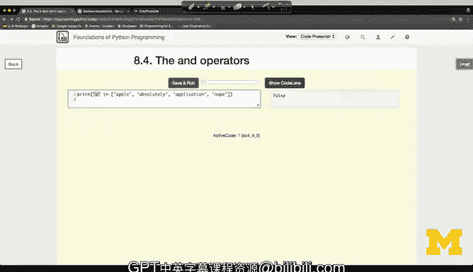

# 56课：`in`与`not in`运算符 🔍


在本节课中，我们将要学习Python中两个用于生成布尔值（`True`或`False`）的实用运算符：`in`和`not in`。它们主要用于检查某个元素是否存在于一个序列（如字符串、列表）中。

---

## `in` 运算符

`in`运算符用于检查**左侧**的元素是否是**右侧**序列的成员。如果左侧元素存在于右侧序列中，则表达式结果为`True`，否则为`False`。

以下是`in`运算符在字符串中使用的几个例子：

```python
# 检查单个字符是否在字符串中
print('p' in 'apple')   # 输出：True
print('i' in 'apple')   # 输出：False

# 检查子字符串是否在字符串中
print('ap' in 'apple')  # 输出：True
print('pa' in 'apple')  # 输出：False

# 检查整个字符串是否在自身中
print('a' in 'a')       # 输出：True
print('apple' in 'apple') # 输出：True
```

一个需要注意的特殊情况是空字符串。在Python中，空字符串被视为任何字符串的子串。

```python
print('' in 'a')        # 输出：True
print('' in 'apple')    # 输出：True
```

---

## `not in` 运算符

上一节我们介绍了`in`运算符，本节中我们来看看它的反面：`not in`运算符。`not in`用于检查某个元素**是否不存在于**一个序列中。

```python
print('x' not in 'apple')  # 输出：True
```

这里，表达式`'x' not in 'apple'`的值为`True`，因为字符`'x'`确实不在字符串`"apple"`中。

**请注意**：`not in`是一个独立的运算符，虽然它在功能上与`not (x in y)`类似，但在Python语法中被视为一个整体。

---

## `in` 运算符与列表

`in`运算符不仅适用于字符串，也适用于列表等其他序列类型。

以下是`in`运算符在列表中使用的例子：

```python
my_list = ['a', 'b', 'c', 'd']
print('a' in my_list)  # 输出：True
print('z' in my_list)  # 输出：False
```

需要特别注意的是，`in`运算符检查的是**列表项**的完全匹配，而不是部分匹配。

```python
my_list = ['apple', 'banana', 'cherry']
print('a' in my_list)  # 输出：False
```

尽管列表中有包含字母`'a'`的字符串，但`in`运算符寻找的是值完全等于`'a'`的列表项，因此结果为`False`。

---

## 总结

本节课中我们一起学习了Python中的成员资格运算符：
*   **`in`运算符**：用于检查一个元素是否存在于一个序列（字符串、列表等）中。
*   **`not in`运算符**：用于检查一个元素是否不存在于一个序列中。
*   这两个运算符都返回布尔值（`True`或`False`），并且可以应用于多种数据类型。



掌握`in`和`not in`运算符，能让你更高效地编写条件判断和搜索数据的代码。