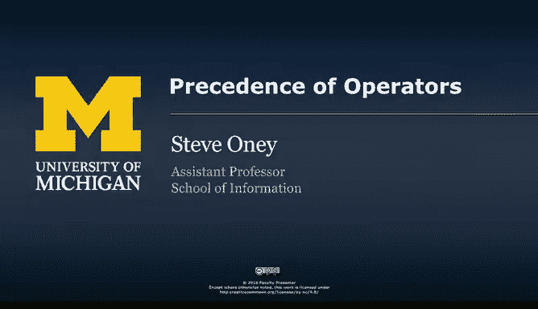
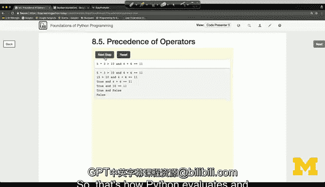
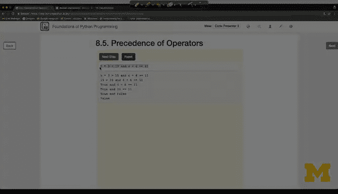

# 课程1：Python 3 编程｜第57讲：运算符优先级 🧮

在本节课中，我们将要学习Python中运算符的优先级。理解运算符的优先级对于正确解读和编写复杂的表达式至关重要。我们将通过一个具体的例子，逐步分析Python是如何根据优先级规则来求值表达式的。

## 概述

运算符优先级决定了在没有括号的情况下，表达式中各个部分计算的先后顺序。掌握这一规则可以避免逻辑错误，并帮助我们写出更清晰、更准确的代码。

## 运算符优先级解析

上一节我们介绍了运算符优先级的概念，本节中我们来看看一个具体的例子，并分析其求值过程。

题目要求我们使用括号正确地表达以下表达式中运算符的优先级。

原始表达式如下：
`5 * 3 > 10 and 4 + 6 == 11`

我们知道，在所有运算符中，`and` 的优先级是最低的。因此，Python会先计算 `and` 左边的表达式，再计算右边的表达式。

现在的问题是，在左右两边的子表达式中，哪些部分会先被计算？

乘法运算符 `*` 的优先级高于比较运算符 `>`。因此，`5 * 3` 会先被计算。所以，我们应该在 `5 * 3` 周围加上括号。

接着，我们将计算结果与 `10` 进行比较：`(5 * 3) > 10`。`5 * 3` 等于 `15`，`15 > 10` 的结果为 `True`。我们可以在整个比较表达式外加括号。

在左手边的表达式处理完后，我们来看右手边。加法运算符 `+` 的优先级高于比较运算符 `==`。因此，`4 + 6` 应该先被计算，我们为其加上括号。

然后，我们将计算结果与 `11` 进行比较：`(4 + 6) == 11`。`4 + 6` 等于 `10`，`10 == 11` 的结果为 `False`。

最后，将左右两边的结果用 `and` 连接：`True and False`，最终结果为 `False`。

因此，使用括号正确表达优先级后的完整表达式应该是：
`((5 * 3) > 10) and ((4 + 6) == 11)`

## Python求值步骤详解

以下是Python逐步求值此表达式的过程：

1.  Python首先看到整个表达式。
2.  它计算 `5 * 3`，得到 `15`。
3.  接着检查 `15 > 10`，得到 `True`。
4.  然后计算 `4 + 6`，得到 `10`。
5.  接着检查 `10 == 11`，得到 `False`。
6.  最后，对 `True and False` 进行逻辑与运算，得到最终结果 `False`。

这就是Python分解和求值这个复杂表达式的方式。

## 总结

本节课中我们一起学习了Python的运算符优先级。我们通过一个例子，详细分析了在没有括号的情况下，Python如何依据优先级规则对表达式进行求值，并学会了如何使用括号来明确表达我们的计算意图。记住这些规则，将有助于你编写出正确且易于理解的代码。